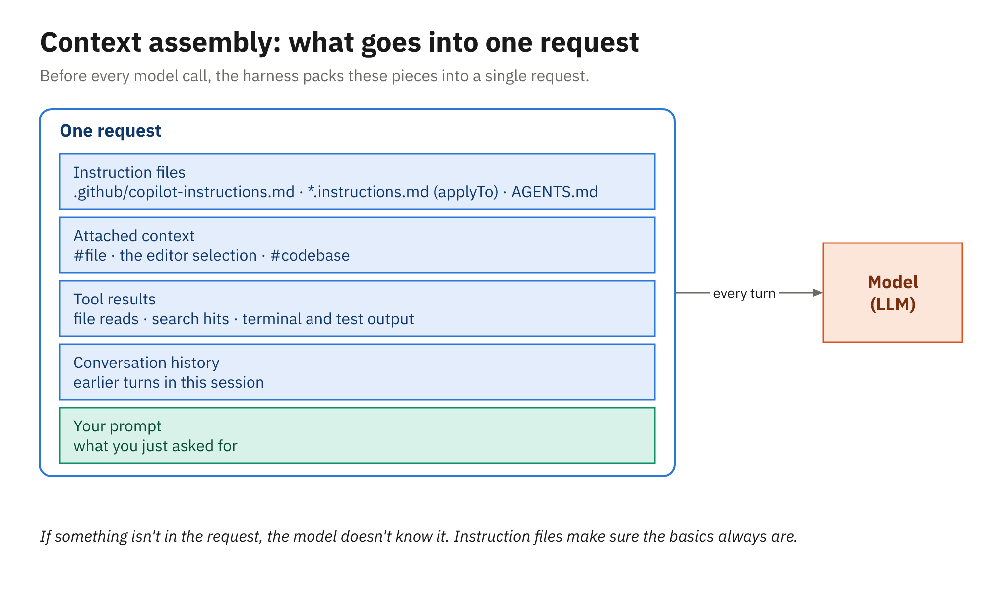

# Activity 01 — Chat with Workspace Context

## Overview

> **Make Copilot explain code you've never seen, then prove you understood it with a test.**

You've just joined the Orders team, and your first tickets are all about pricing. Before you touch
anything you need to know how an order's price is worked out, and the discount rules are the part
nobody remembers writing. In this activity you use Copilot Chat in VS Code, with your project as
context, to map the pricing code, explain `DiscountPolicy` line by line, and generate a unit test for
it that you run yourself.

⏱ **25 minutes.** You aren't expected to finish every task. The first three carry the idea; the rest
go deeper. Compare with [`solution/`](solution/) afterward.

## Prerequisites

- Your practice repo, made from `orders-dotnet` or `orders-java`
  ([Make your practice repo](../../samples/README.md#make-your-practice-repo-do-this-during-the-welcome)),
  open in VS Code as the workspace folder
- Signed in to GitHub in VS Code (the Copilot icon in the Status Bar shows no warning)

## Exercise Goals

- Ask questions about a whole codebase and about a single selection, and see how the context changes
  the answer
- Use the built-in actions (`/explain`, `/tests`, `/doc`) instead of writing long prompts
- Generate a unit test, run it, and judge whether it's right
- Notice what changes when you switch models

---

## Tasks

### Task 1: Ask the codebase how pricing works

Get the big picture before reading any code.

1. Open the Chat view (**Ctrl+Alt+I**). In the agent dropdown under the input box, choose **Ask**.
2. Type `#codebase` and then your question:

   ```text
   #codebase How is the total price of an order worked out? Which classes are involved, and in what
   order are they called?
   ```

3. Click through any file links in the answer to check it against the code.

**Expected:**

- The answer names `OrderService` (its private `Price` / `price` method), `DiscountPolicy`, and
  `TaxCalculator`, in that order, and says the money is `decimal` (.NET) or `BigDecimal` (Java).
- It links to the actual files. If it describes classes that don't exist, ask it to show you where they
  are; that's the quickest way to spot a guess.

---

### Task 2: Explain the unfamiliar code

Now go deep on one class with a narrower context.

1. Open `DiscountPolicy` (.NET: `src/Orders.Domain/Pricing/DiscountPolicy.cs`; Java:
   `src/main/java/com/example/orders/pricing/DiscountPolicy.java`).
2. Select the whole `Calculate` / `calculate` method, press **Ctrl+I** for inline chat, and type
   `/explain`.
3. In the Chat view, attach the file (type `#DiscountPolicy` and pick the file from the list, or drag
   its editor tab into the chat), then ask a follow-up:

   ```text
   Can a Silver customer use the WELCOME10 coupon? What does a single line of 50 units at 21.00
   get, and why?
   ```

4. Write down, in one sentence each, the rules you now know. Note one that surprised you.

**Expected:**

- You can state the rules without the code in front of you: bulk discount per line first, then the
  highest volume tier reached, a loyalty bonus added on top, a cap on the order discount, and a coupon
  that only applies when there's no other order discount.
- The answer to the follow-up quotes the specific lines that decide it.

---

### Task 3: Generate a unit test and run it

Turn your understanding into something executable.

1. With `DiscountPolicy` open, type `/tests` in inline chat (or right-click the method and choose
   **Generate Code > Generate Tests**). Ask for the tests to go in:
   - .NET: `tests/Orders.Domain.Tests/DiscountPolicyTests.cs`
   - Java: `src/test/java/com/example/orders/pricing/DiscountPolicyTest.java`
2. Read the generated tests before you keep them. Does each one check a rule from your Task 2 list?
3. Choose **Keep**, then run the tests in the terminal:

   ```powershell
   dotnet test            # .NET
   .\mvnw.cmd test        # Java (./mvnw test on macOS or Linux)
   ```

**Expected:**

- The tests compile and run. `DiscountPolicy` is correct as shipped, so a failing generated test means
  the test is wrong. Ask Chat:

  ```text
  This test fails. Is the test or the code wrong? Quote the rule.
  ```

  Then fix whichever it is.
- .NET: if the build stops with `error xUnit…` (for example xUnit2013), the generated test breaks one
  of xUnit's style rules, and this project treats warnings as errors. Select the line, use `/fix`, and
  run the tests again.
- You can point at the test that covers each rule, and at the rules nothing covers yet.

---

### Task 4: Compare models

The same question can cost different amounts and come back at different depths.

1. Start a new chat (**Ctrl+N**). Open the model picker and choose a small, fast model. Attach
   `DiscountPolicy` again and ask your Task 2 follow-up.
2. Repeat with a larger model, then with **Auto** (or **Copilot Fusion**, if that's what your picker
   offers).
3. Compare the answers. Which one got the coupon rule exactly right? Hover over each model in the
   picker to see what it costs, and over each answer to see what that turn used.

**Expected:**

- The small model answers fastest and may miss a subtle rule; the larger one is slower and more
  thorough. Auto picks for you, and hovering over its answer shows which model it used.

---

### Task 5: Document the method

1. Select the `Calculate` / `calculate` method again and run `/doc` in inline chat.
2. Read the comment it proposes. Keep it only if every sentence is true of the code.

**Expected:**

- An XML doc comment (.NET) or Javadoc (Java) that describes the rules in order. Correct anything it
  overstates before you keep it.

---

## Stretch goal

Additive only — not reflected in `solution/`.

1. Ask where `DiscountPolicy` comes from, and follow the dependency injection setup in the answer:

   ```text
   #codebase Where is DiscountPolicy created and how does OrderService get it?
   ```

2. Compare your generated tests with [`solution/`](solution/). Ask Chat to list rules the reference
   covers that yours doesn't.
3. Break a line in `DiscountPolicy` on purpose, run the tests, and use `/fix` on the failure. Then
   undo your break.

---

## Diagram



*Everything Copilot knows when it answers comes from what the harness assembled into the request.*

## Related reading

- [Model versus harness](../../docs/01_copilot-harness-and-chat/01_model-versus-harness.md)
- [Chat that knows the project](../../docs/01_copilot-harness-and-chat/03_chat-that-knows-the-project.md)
- [Choosing a model](../../docs/01_copilot-harness-and-chat/04_choosing-a-model.md)
- [Module 1 slides](../../slides/pdf/01-Copilot-Harness-and-Chat-Slides.pdf), to review what the demo
  covered
