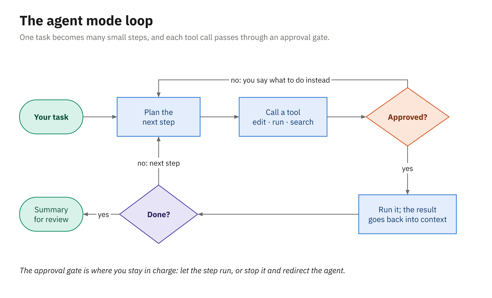
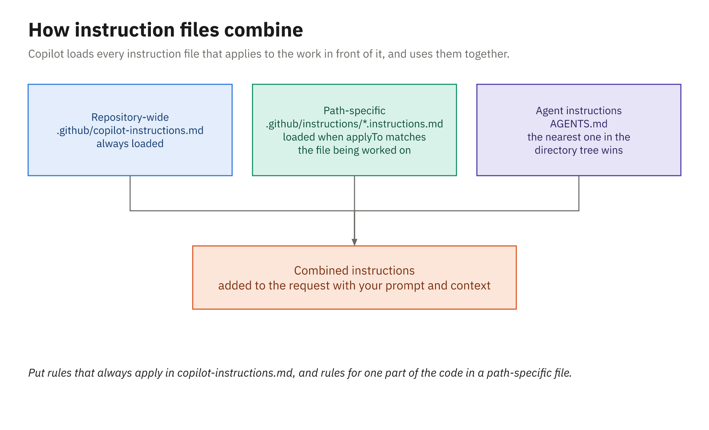

# Activity 02 — Agent Mode with Instructions and a Custom Agent

## Overview

> **Give the agent a real change, watch every step it takes, then teach it your team's rules and run it again.**

The warehouse can't pick more than 999 units of one SKU for a single order line, and the Orders API
should reject anything bigger. In this activity you hand that change to agent mode and approve or
reject each step it takes. Then you add a repository instructions file that spells out the team's
conventions and run the same task again, so you can see exactly what the instructions changed. Finally
you add a custom agent and the GitHub MCP server, and commit everything. Agent mode and Copilot code
review (Activity 03) and the CLI (Activity 04) reuse these files unchanged.

⏱ **25 minutes.** Tasks 1–3 carry the idea; Tasks 4–6 go further. Compare with
[`solution/`](solution/) afterward.

## Prerequisites

- Your practice repo open in VS Code (see
  [Make your practice repo](../../samples/README.md#make-your-practice-repo-do-this-during-the-welcome))
- A clean working tree. Check it, and commit or stash anything left over from Activity 01:

  ```powershell
  git status
  ```

## Exercise Goals

- Run agent mode on a well-scoped change and approve, or reject, each tool call
- Read the session log to see what the agent read, ran, and decided
- Measure the effect of `.github/copilot-instructions.md` by running the same prompt with and without it
- Add a path-scoped instructions file, a custom agent, and the GitHub MCP server

## Getting started

Everything you copy in this activity is in [`assets/`](assets/), in a `dotnet/` or `java/` folder that
mirrors your repository's layout. In VS Code's terminal, in your repository folder, point a variable
at the one for your language once; the tasks below use it.

For .NET:

```powershell
$assets = "$HOME\copilot-course\courseware\activities\02_agent-mode-and-instructions\assets\dotnet"
```

For Java:

```powershell
$assets = "$HOME\copilot-course\courseware\activities\02_agent-mode-and-instructions\assets\java"
```

If you open a new terminal later, run it again.

---

## Tasks

### Task 1: Run the change in agent mode, without instructions

1. Start a new chat with the **+** at the top of the Chat view. Leave **Session Target** on
   **Copilot**, choose **Agent** in the agent dropdown, and choose **Manual permissions** in the
   permissions picker so the agent asks before anything your approval settings don't already cover.
2. Send this prompt exactly as written (you'll reuse it in Task 3):

   ```text
   Add a validation rule to the orders API: a single order line can't have a quantity above 999,
   the warehouse's pick limit. Reject it with a clear error and add unit tests for the rule.
   ```

3. As approval requests appear, read each one before you answer. Approve the ones that fit the task,
   including running the tests. Reject at least one request on purpose and tell it why (for example,
   reject a broad command and ask it to run only the validator's tests).
4. When it's finished, review the edits in the chat, then choose **Keep**.

**Expected:**

- The agent reads `OrderValidator` and its tests, edits the validator (and probably `ValidationCodes`),
  adds tests, and runs the test command, which passes.
- When you reject a step, it adjusts to your reason instead of trying the same thing again.

---

### Task 2: Read the session log and the diff

1. Open the session log: from the chat's **...** menu choose **Show Chat Debug View** (or type
   `/debug`). Find the request that started the task and look at the system prompt, the context that
   was attached, and the tool calls with their results. If the debug view doesn't show this session,
   expand the tool calls in the chat response itself; each one shows what ran and what came back.
2. Open **Source Control** and look at the diff.
3. Fill in this table for "without instructions." You'll fill in the second column in Task 3.

   | Check | Without instructions | With instructions |
   |---|---|---|
   | New code in `ValidationCodes` (`ORD006`)? | | |
   | Limit is a named constant, not a bare `999`? | | |
   | Boundary test for 999 *and* 1000 in one theory (.NET) or parameterized test (Java)? | | |
   | `CHANGELOG.md` updated? | | |
   | Tests run before it said "done"? | | |

**Expected:**

- In the log you can see which files the agent read before it edited anything, and every command it
  ran. Some rows of the table will probably say "no."

---

### Task 3: Add repository instructions and run it again

1. Put the first attempt aside so you can compare later:

   ```powershell
   git stash push --include-untracked -m "attempt without instructions"
   ```

2. Create `.github/copilot-instructions.md`. Either write your own from what you've learned about the
   codebase, or copy [`assets/<language>/.github/copilot-instructions.md`](assets/):

   ```powershell
   Copy-Item -Force "$assets\.github\copilot-instructions.md" .github\
   ```

3. Copy [`assets/<language>/.github/instructions/tests.instructions.md`](assets/) to the same path in
   your repository as well:

   ```powershell
   Copy-Item -Recurse -Force "$assets\.github\instructions" .github\
   ```

   Its `applyTo` front matter limits it to the test files, so it's attached only when the agent works
   on one.
4. Start a **new** chat (so nothing from the first attempt's conversation carries over), choose
   **Agent** again, and send the same prompt from Task 1.
5. Fill in the "with instructions" column of the table.
6. Choose **Keep** on the agent's edits, then commit and push. Do this now even if you plan to go on:
   Activities 03 and 04 build on these instructions, and Copilot code review reads them from your
   practice repo on GitHub, so they need to be there even if you don't reach Task 6.

   ```powershell
   git add .
   git commit -m "Add quantity limit rule and Copilot instructions"
   git push
   ```

**Expected:**

- The second run follows the conventions the instructions name: the next error code, a named constant,
  a boundary theory test, and a `CHANGELOG.md` entry.
- `copilot-instructions.md` is listed under **References** on the agent's response, and its text is in
  the system prompt in the Chat Debug view. `tests.instructions.md` is listed too, because the agent
  wrote tests; a request that doesn't touch a test file won't attach it.
- Your practice repo on GitHub.com has `.github/copilot-instructions.md` and `.github/instructions/`.

---

### Task 4: Add a custom agent

1. Copy [`assets/<language>/.github/agents/test-writer.agent.md`](assets/) into the same path:

   ```powershell
   Copy-Item -Recurse -Force "$assets\.github\agents" .github\
   ```

2. Start a new chat and pick **test-writer** from the agent dropdown.
3. Ask:

   ```text
   Cover InMemoryProductCatalog with tests, including the case-insensitive SKU lookup.
   ```

**Expected:**

- The agent writes tests only under the test folder and doesn't change production code, as its
  instructions say. It finishes with the summary table its profile asks for.

---

### Task 5: Add the GitHub MCP server

1. Copy [`assets/<language>/.mcp.json`](assets/) to the root of your repository:

   ```powershell
   Copy-Item -Force "$assets\.mcp.json" .
   ```

   It adds the GitHub MCP server, which gives the agent tools for issues, pull requests, and
   repositories on GitHub.com.
2. Start a new chat, choose **Agent**, and ask:

   ```text
   Using the GitHub MCP server, create an issue in this repository titled "Reject duplicate SKUs on one
   order", with a two-sentence description of the rule.
   ```

3. Read the approval request before you answer it: it names the server, the tool, and the arguments
   it's about to send. Approve it, and sign in if you're asked.

**Expected:**

- A new open issue in your repository on GitHub.com. The MCP tool call went through the same approval
  gate as a file edit or a terminal command.

---

### Task 6: Commit and push the rest

Push the custom agent, `.mcp.json`, and the tests the agent wrote in Task 4, so the CLI in Activity 04
finds the **test-writer** agent too.

```powershell
git add .
git commit -m "Add test-writer agent and GitHub MCP server"
git push
git stash drop      # the first attempt, no longer needed
```

**Expected:**

- On GitHub.com your repository now has `.github/copilot-instructions.md`, `.github/instructions/`,
  `.github/agents/`, and `.mcp.json`.

---

## Stretch goal

Additive only — not reflected in `solution/`.

1. Pick **Plan** in the agent dropdown (or type `/plan`) and ask for a plan for the issue you created
   in Task 5, "reject duplicate SKUs on one order." Read the plan without implementing it.
2. If you haven't dropped the stash yet, show the first attempt in full and compare it line by line
   with your commit:

   ```powershell
   git stash show -p --include-untracked 'stash@{0}'
   ```

   Keep the quotes: PowerShell would otherwise read `{0}` as a script block.

---

## Diagram



*Every tool call passes through an approval gate you control.*



*Repository-wide instructions always load; path-scoped ones load when the files they apply to are in play.*

## Related reading

- [Agent mode](../../docs/02_agent-mode-instructions-agents-mcp/01_agent-mode.md)
- [Repository instructions](../../docs/02_agent-mode-instructions-agents-mcp/02_repository-instructions.md)
- [Custom agents](../../docs/02_agent-mode-instructions-agents-mcp/03_custom-agents.md)
- [MCP servers](../../docs/02_agent-mode-instructions-agents-mcp/04_mcp-servers.md)
- [Module 2 slides](../../slides/pdf/02-Agent-Mode-Instructions-Agents-MCP-Slides.pdf), to review what
  the demo covered
