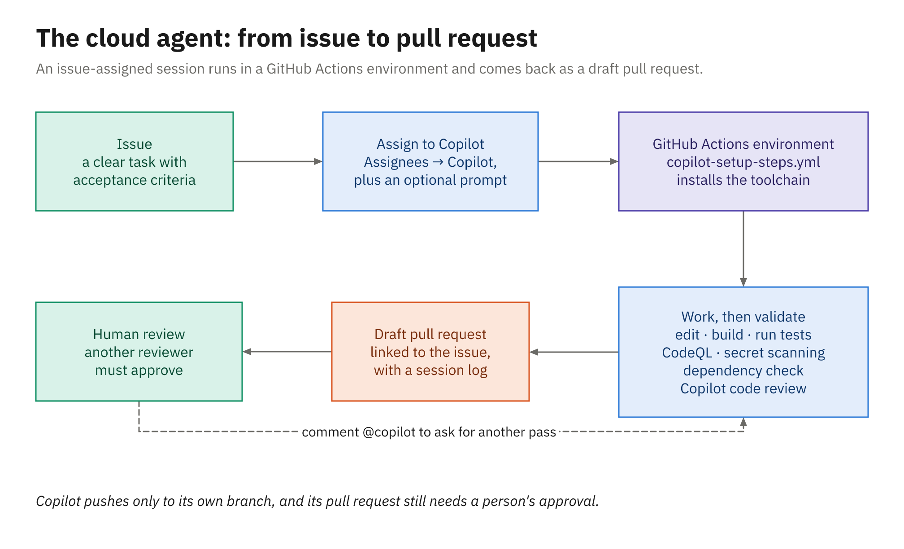

# Activity 03 — Turn an Issue into a Pull Request and Review It with Copilot

## Overview

> **Write an issue an agent can act on, let agent mode build it, and get Copilot's review on the pull request.**

Support wants a way to cancel an order that was placed by mistake. In this activity you file that
request as a GitHub issue in your practice repo and hand it to agent mode in VS Code on a new branch.
In an organization you could assign the issue to the Copilot cloud agent instead, and it would work on
GitHub while you're away; that agent doesn't run in the personal repositories of enterprise accounts,
so your instructor showed it in Demo 03 and you use the local agent from Module 2. Then you open a pull
request, ask Copilot code review for a second opinion, ask Copilot Chat about the change, and compare
your pull request with the cloud agent's.

⏱ **25 minutes, in two parts.** Part 1 (Tasks 1–2) takes five minutes *before* the break. Part 2
(Tasks 3–6) is the twenty minutes after. The reference implementation is in [`solution/`](solution/);
yours will differ, and that's fine.

## Prerequisites

- Your practice repo on your machine and on GitHub.com, with Activity 02's customization files on
  `main` (`.github/copilot-instructions.md` and friends). If you missed Activity 02, run the
  [catch-up commands](../../samples/README.md#if-you-fall-behind) for your language first; they copy
  [`../02_agent-mode-and-instructions/assets/<language>/`](../02_agent-mode-and-instructions/assets/)
  into your repository, commit, and push.
- Your practice repo open in VS Code, and on GitHub.com in your browser

## Exercise Goals

- Write an issue an agent can act on
- Have agent mode implement it on a branch, and judge the result against the acceptance criteria
- Open a pull request and get a review from Copilot code review
- Ask Copilot Chat on GitHub.com about a pull request
- Compare a local agent's pull request with the cloud agent's

---

## Part 1 — before the break

### Task 1: Create the issue

1. In your repository on GitHub.com, go to **Issues** and choose **New issue**.
2. **Title:** `Let customers cancel a pending order`
3. **Description:** paste the contents of [`issues/dotnet.md`](issues/dotnet.md) or
   [`issues/java.md`](issues/java.md), whichever matches your repository.
4. Submit the issue. Read it once more: notice that it says what to build, where it goes, how to test
   it, and what's out of scope. That's what makes an issue something an agent can act on.

If you prefer the GitHub CLI, run the command for your language from your repository's folder. For
.NET:

```powershell
gh issue create --title "Let customers cancel a pending order" `
    --body-file "$HOME\copilot-course\courseware\activities\03_cloud-agent-and-review\issues\dotnet.md"
```

For Java:

```powershell
gh issue create --title "Let customers cancel a pending order" `
    --body-file "$HOME\copilot-course\courseware\activities\03_cloud-agent-and-review\issues\java.md"
```

**Expected:**

- An open issue in your repository with the acceptance-criteria checklist rendered as checkboxes.

---

### Task 2: Hand it to agent mode on a branch

1. In a terminal in your repository's folder, start a branch and put the issue's text on the
   clipboard. For .NET:

   ```powershell
   git switch -c cancel-pending-order
   Get-Content "$HOME\copilot-course\courseware\activities\03_cloud-agent-and-review\issues\dotnet.md" -Raw | Set-Clipboard
   ```

   For Java:

   ```powershell
   git switch -c cancel-pending-order
   Get-Content "$HOME\copilot-course\courseware\activities\03_cloud-agent-and-review\issues\java.md" -Raw | Set-Clipboard
   ```

2. In VS Code, start a new chat with the agent set to **Agent**, and type this prompt:

   ```text
   Implement the GitHub issue below on the current branch. Follow .github/copilot-instructions.md,
   add the tests it asks for, and run the tests before you finish.
   ```

3. Press **Shift+Enter** to start a new line, paste the issue's text from the clipboard (**Ctrl+V**),
   and send.
4. Approve the steps that fit the task, as you did in Activity 02.

**Expected:**

- The agent reads the files the issue points to and starts editing. If it's still asking for approvals
  when the break starts, leave it: it waits for you.

---

## Part 2 — after the break

### Task 3: Finish the work and check it

1. Answer the agent's remaining approval requests until it reports that it's done and the tests pass.
2. Read the diff in **Source Control** and check it against the issue's acceptance criteria one by one.
3. Choose **Keep**.

**Expected:**

- A `Cancel` operation in the domain, the endpoint, tests for the three outcomes, and (because your
  instructions ask for it) a `CHANGELOG.md` entry. Your version will differ from the reference.

If the agent stalled or you're short on time, use the reference implementation instead. For .NET:

```powershell
Copy-Item -Recurse -Force "$HOME\copilot-course\courseware\activities\03_cloud-agent-and-review\solution\dotnet\*" .
```

For Java:

```powershell
Copy-Item -Recurse -Force "$HOME\copilot-course\courseware\activities\03_cloud-agent-and-review\solution\java\*" .
```

---

### Task 4: Open the pull request

Commit the branch, push it, and open a pull request that closes the issue:

```powershell
git add .
git commit -m "Let customers cancel a pending order"
git push -u origin cancel-pending-order
$issue = gh issue list --search "cancel in:title" --json number -q '.[0].number'
gh pr create --title "Let customers cancel a pending order" --body "Closes #$issue"
```

**Expected:**

- `gh` prints the pull request's URL. Open it: it links to the issue, and **Files changed** shows the
  agent's work.

---

### Task 5: Ask Copilot code review for a second opinion

1. On the pull request, open **Reviewers** and request a review from **Copilot**. It usually finishes
   in a minute or two.
2. Read its comments. For each one, decide: apply the suggested change, reply with why you disagree, or
   resolve it.

**Expected:**

- Review comments appear inline on the diff. Your repository has no GitHub Actions, so Copilot gives
  the lighter review it falls back to without them; the demo showed the full one. If **Copilot** isn't
  offered as a reviewer, follow along on your instructor's pull request instead.

---

### Task 6: Ask Copilot Chat, and compare with the cloud agent

1. Open Copilot Chat on GitHub.com (`https://github.com/copilot`) and choose your repository as the
   context. The cancel feature exists only on the pull request's branch so far, and Chat's code search
   covers the default branch, so name the pull request in your question:

   ```text
   In my open pull request "Let customers cancel a pending order", where is the rule that only pending
   orders can be canceled enforced, and which tests cover it?
   ```

2. Open the cloud agent's pull request from Demo 03, **List overdue loans** in
   [`coding-agent-harness-class/library-demo-dotnet`](https://github.com/coding-agent-harness-class/library-demo-dotnet/pulls).
   Compare it with yours: who made the commits, what's in the description, and which checks ran.

**Expected:**

- An answer that names the class, the method, and the tests from your pull request. If it searches
  `main` and comes back empty, ask it to look at the pull request's changed files instead.
- The cloud agent's pull request is a draft whose commits Copilot authored, with a session log and the
  security checks it ran on its own; yours came from an agent on your machine, under your approvals.

---

## Stretch goal

Additive only — not reflected in `solution/`.

1. Add custom review instructions: copy [`assets/<language>/REVIEW.md`](assets/) to the root of your
   branch (Copilot code review reads instructions from the branch being reviewed), push, and request a
   review again. Compare the comments. For .NET:

   ```powershell
   Copy-Item "$HOME\copilot-course\courseware\activities\03_cloud-agent-and-review\assets\dotnet\REVIEW.md" .
   ```

   For Java:

   ```powershell
   Copy-Item "$HOME\copilot-course\courseware\activities\03_cloud-agent-and-review\assets\java\REVIEW.md" .
   ```

   Then push it:

   ```powershell
   git add REVIEW.md; git commit -m "Add review instructions"; git push
   ```

2. Generate a pull request summary: in a new comment, choose the Copilot icon in the toolbar, then
   **Summary**.

---

## Diagram



*What the cloud agent does with an issue in an organization's repository, as Demo 03 showed. You did
the same journey with a local agent.*

## Related reading

- [The cloud agent](../../docs/03_cloud-agent-and-code-review/01_the-cloud-agent.md)
- [Inside a cloud run](../../docs/03_cloud-agent-and-code-review/02_inside-a-cloud-run.md)
- [Steering the cloud agent](../../docs/03_cloud-agent-and-code-review/03_steering-the-cloud-agent.md)
- [Copilot code review](../../docs/03_cloud-agent-and-code-review/04_copilot-code-review.md)
- [PR summaries, Chat, and other agents](../../docs/03_cloud-agent-and-code-review/05_pr-summaries-chat-and-other-agents.md)
- [Module 3 slides](../../slides/pdf/03-Cloud-Agent-and-Code-Review-Slides.pdf), to review what the demo
  covered (a good use of the break)
