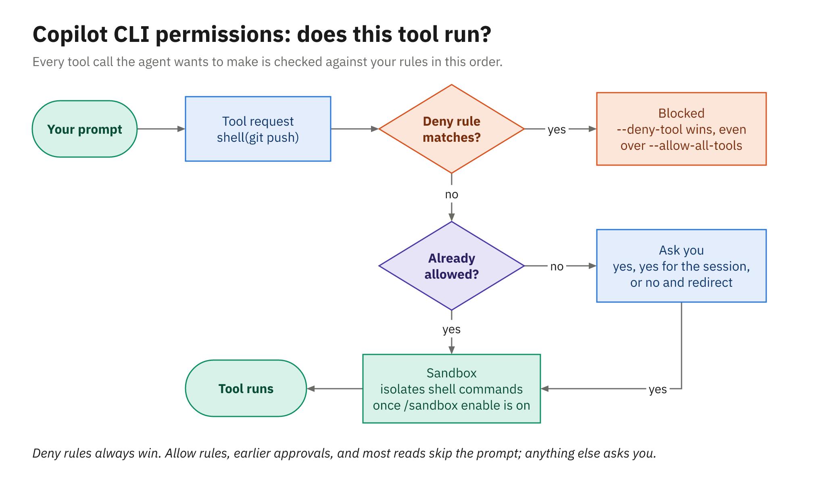
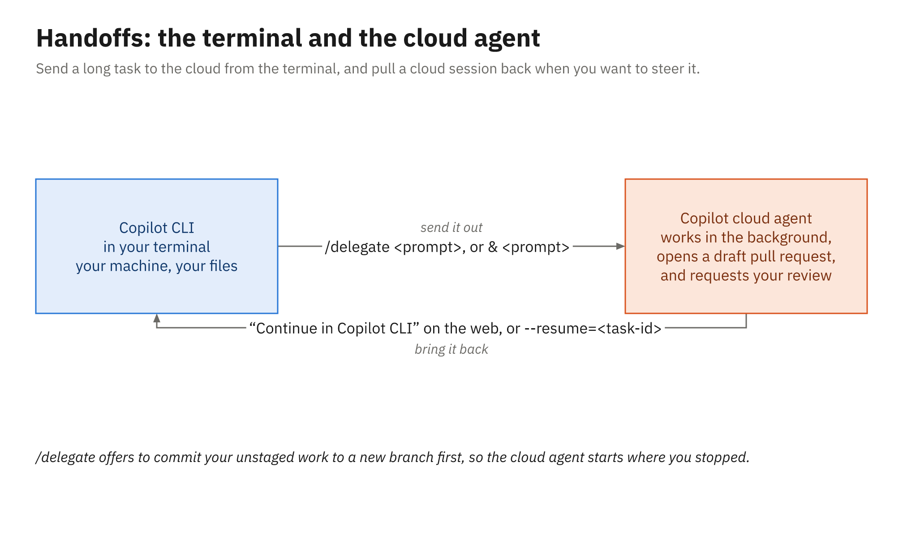

# Activity 04 — Fix a Reported Bug from the Terminal with the Copilot CLI

## Overview

> **Take a reported bug from issue to pull request without leaving the terminal, and approve every change.**

Finance has reported that some orders are charged one cent too little sales tax, and they've attached a
failing test that reproduces it. In this activity you add that test to your repository, file the bug,
and then use the GitHub Copilot CLI to diagnose the cause, fix it under step-by-step approval, run the
test suite, and open a pull request. The instructions and custom agent from Activity 02 load in the CLI
unchanged. (Handing work from the terminal to the cloud agent with `/delegate` needs a repository where
the cloud agent runs, which an enterprise account's personal repositories aren't, so your instructor
shows it in Demo 04.)

⏱ **25 minutes.** Tasks 1–4 carry the idea; Task 5 and the stretch goals go further. The reference
fix is in [`solution/`](solution/).

## Prerequisites

- Your practice repo on your machine, with Activity 02's customization files on `main`. Switch to
  `main` and bring it up to date:

  ```powershell
  git switch main
  git pull
  ```

  If you missed Activity 02, run the
  [catch-up commands](../../samples/README.md#if-you-fall-behind) for your language first; they copy
  [`../02_agent-mode-and-instructions/assets/<language>/`](../02_agent-mode-and-instructions/assets/)
  into your repository, commit, and push.
- A clean working tree, because Task 1 commits everything in the folder. Check it, and commit or stash
  anything left over:

  ```powershell
  git status
  ```

- The Copilot CLI installed and signed in, and the GitHub CLI signed in (the agent uses `gh` to open
  the pull request in Task 5). Check with:

  ```powershell
  copilot --version
  gh auth status
  ```

  If you've never run the Copilot CLI, start it once:

  ```powershell
  copilot
  ```

  Then sign in at its prompt:

  ```text
  /login
  ```

  If `gh` isn't signed in, run:

  ```powershell
  gh auth login
  ```

## Exercise Goals

- Start a CLI session in a repository and confirm which customization files it loaded
- Use plan mode to diagnose a problem before any file changes
- Approve, and decline, the agent's tool calls one at a time
- Open a pull request from the terminal

---

## Tasks

### Task 1: Add the failing test and file the bug

1. Copy the repro test from [`assets/`](assets/) into your repository, at the same path:
   - .NET: `assets/dotnet/tests/Orders.Domain.Tests/TaxCalculatorTests.cs`
   - Java: `assets/java/src/test/java/com/example/orders/pricing/TaxCalculatorTest.java`

   From your repository folder, with the courseware cloned where [Setup](../../setup/README.md) puts it,
   point a variable at this activity's folder (you'll use it again in step 4):

   ```powershell
   $activity = "$HOME\copilot-course\courseware\activities\04_copilot-cli"
   ```

   Then copy the test for your language. For .NET:

   ```powershell
   Copy-Item -Recurse -Force "$activity\assets\dotnet\tests" .
   ```

   For Java:

   ```powershell
   Copy-Item -Recurse -Force "$activity\assets\java\src" .
   ```

2. Run the tests and confirm that only the half-cent test fails (both of its cases):

   ```powershell
   dotnet test            # .NET
   .\mvnw.cmd test        # Java (./mvnw test on macOS or Linux)
   ```

3. Commit and push it, the way a bug reporter would:

   ```powershell
   git add .
   git commit -m "Add failing test for FIN-7 tax rounding"
   git push
   ```

4. File the bug as an issue titled `Sales tax is one cent short on some orders`, with the body from
   [`issues/dotnet.md`](issues/dotnet.md) or [`issues/java.md`](issues/java.md). You can do it on
   GitHub.com, or stay in the terminal and run the command for your language. For .NET:

   ```powershell
   gh issue create --title "Sales tax is one cent short on some orders" --body-file "$activity\issues\dotnet.md"
   ```

   For Java:

   ```powershell
   gh issue create --title "Sales tax is one cent short on some orders" --body-file "$activity\issues\java.md"
   ```

   Note the issue's number; `gh` prints its URL, which ends with it.

**Expected:**

- One failing test, named for the half-cent case (its two cases both fail), and an open issue that
  describes it.

---

### Task 2: Start the CLI and check what it loaded

1. In the repository folder, start an interactive session:

   ```powershell
   copilot
   ```

   If your machine can run the CLI's local sandbox (macOS, Linux, or Windows 11 version 25H2 with
   update KB5124010 or later, or 26H1 with KB5124006 or later; Windows Server can't), start it in the
   sandbox instead:

   ```powershell
   copilot --sandbox
   ```

   Type this to see its policy:

   ```text
   /sandbox
   ```

   From here on, every shell command in this activity runs inside the sandbox, the way it did in the
   demo.

2. If it asks whether you trust the folder, say yes.
3. Type these one at a time, to see the instruction files it found and your custom agents:

   ```text
   /instructions
   /agent
   ```

   The agent list opens as a picker: press **Esc** to close it without choosing one, so the session
   stays on the default agent (**test-writer** isn't allowed to change production code, and Task 4
   needs to).
4. Check the permission mode, and confirm you're in **manual** mode:

   ```text
   /permissions show
   ```

   Reads go ahead on their own, but every file edit and every command that isn't read-only asks you
   first.

**Expected:**

- The list includes `.github/copilot-instructions.md` and `.github/instructions/tests.instructions.md`
  from Activity 02, and `/agent` lists **test-writer**. Nothing was copied or converted for the CLI.
  (No **test-writer**? You stopped before Activity 02's Task 4. This activity doesn't need it.)
- If the CLI reports a problem with the `github` server from your `.mcp.json`, carry on. The CLI has
  its own built-in GitHub server, and that's the one this activity uses.

---

### Task 3: Diagnose in plan mode

1. Press **Shift+Tab** until the prompt shows plan mode.
2. Ask, using your issue's number:

   ```text
   Read issue #<number> and the failing test it mentions. Find the cause in the production code and
   explain it. Don't change any files yet.
   ```

3. Reading files won't prompt you. Approve the calls that fetch the issue or run the tests when they
   come up.

**Expected:**

- A diagnosis that points at one line in the tax code and explains why an exact half cent comes out a
  cent low, plus a short plan for the fix. No files have changed (`git status` is clean).

---

### Task 4: Fix it under approval and run the suite

1. Press **Shift+Tab** until the prompt shows standard mode again. From plan mode that's two presses:
   the first one passes through autopilot, which would approve everything for you. Then ask:

   ```text
   Fix the cause you found for issue #<number>. Keep the test's expectations as they are, then run
   the whole test suite.
   ```

2. Answer each permission prompt deliberately:
   - **1 (Yes)** for the file edit, after reading the proposed change
   - **3 (No, and tell Copilot what to do differently)** for one request on purpose. For example, if it
     wants to run the tests before showing you the diff, decline and ask to see the diff first.
   - **1** or **2** for the test run
3. When it's done, check the change yourself:

   ```text
   /diff
   ```

**Expected:**

- A one-line change in the production code, the test file untouched, and every test passing.
- When you declined a request, the agent changed course based on your reason.

---

### Task 5: Open the pull request from the terminal

1. Ask:

   ```text
   Create a branch named fix/fin-7-rounding, commit the fix with a message that closes
   #<number>, push it, and open a pull request against main.
   ```

2. Approve the `git` commands and the pull request creation (usually `gh pr create`) as they come up.

**Expected:**

- The CLI prints the pull request's URL. On GitHub.com the pull request links to the issue. Request a
  review from **Copilot** on it if you'd like a second opinion, as in Activity 03.
- If the pull request opens in the course's original repository instead of your practice repo, your
  clone is pointing `gh` at the original. Close that pull request, point `gh` at your practice repo,
  and ask again:

  ```powershell
  gh repo set-default "$(gh api user -q .login)/$(Split-Path -Leaf (Get-Location))"
  ```

- If it says it can't create pull requests, make sure you're on the fix branch and type:

  ```text
  /pr create
  ```

  Or exit and restart with the command below, which gives the built-in GitHub MCP server (read-only by
  default) its pull request tools:

  ```powershell
  copilot --continue --add-github-mcp-toolset pull_requests
  ```

---

## Stretch goal

Additive only — not reflected in `solution/`.

1. Get a second opinion before you ask a human. Run these on your branch, one at a time, and compare
   what the two agents look for:

   ```text
   /review
   /security-review
   ```

2. Run a prompt non-interactively, the way a script or CI job would. Prompt mode can't stop to ask
   you, so it needs `--allow-all-tools`; deny rules still win over it, which is how you stop a script
   from editing files or pushing:

   ```powershell
   copilot -p "Summarize the changes on this branch compared with main in three bullets." `
       -s --allow-all-tools --deny-tool='write' --deny-tool='shell(git push)'
   ```

3. Run a whole session in a cloud sandbox. Exit, and start one in the repository folder:

   ```powershell
   copilot --cloud
   ```

   Ask it to run the test suite. The commands run in an isolated Linux environment that GitHub creates,
   not on your machine, and you can pick the session up again from another client. Watch what it has
   to set up before the tests can run. If your enterprise account can't start a cloud session, skip
   this one; Demo 04 showed it.

---

## Diagram



*Deny rules always win; anything not allowed asks you first.*



*`/delegate` sends work to the cloud; Continue in Copilot CLI brings it back.*

## Related reading

- [What the CLI is](../../docs/04_copilot-cli/01_what-the-cli-is.md)
- [Interactive and programmatic use](../../docs/04_copilot-cli/02_interactive-and-programmatic-use.md)
- [Permissions and the sandbox](../../docs/04_copilot-cli/03_permissions-and-sandbox.md)
- [GitHub integration and MCP](../../docs/04_copilot-cli/04_github-integration-and-mcp.md)
- [Reusing customizations and handoffs](../../docs/04_copilot-cli/05_reusing-customizations-and-handoffs.md)
- [Module 4 slides](../../slides/pdf/04-Copilot-CLI-Slides.pdf), to review what the demo covered
