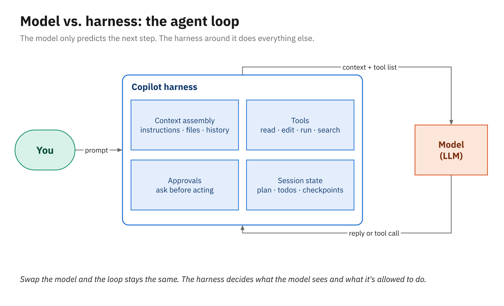

# Demo 01: The Harness and Chat That Knows the Project (Library app, .NET)

The first demo makes the harness visible before anyone types a prompt, then shows chat earning its keep
on code the audience hasn't seen: explain the library's late-fee rules, test them, and look at what the
model was actually sent. Run it on [`samples/library-dotnet`](../../samples/library-dotnet/). The
demo is the module's 25-minute lesson: the trail below takes about fifteen, and the rest goes to
explaining the concepts as they come up, questions, and waiting on the model.

## Before class

1. This is the one demo without a repository on GitHub. Copy the sample to a working folder and commit
   it, so you can reset between runs. From the root of your courseware clone:

   ```powershell
   Copy-Item -Recurse courseware\samples\library-dotnet $HOME\demo\library-dotnet
   Set-Location $HOME\demo\library-dotnet
   git init -b main; git add .; git commit -m "Demo start"
   dotnet test          # warm the NuGet cache; 16 tests pass
   ```

2. Open that folder in VS Code (not the courseware repository) and raise the editor and chat font size.
3. Sign in, open the model picker, and note two models to contrast: one small and fast, one larger.
4. Turn on the experimental Agent Debug Logs, so they can back up step 6 (capture isn't retroactive).
   Open VS Code settings (**Ctrl+,**), paste this setting ID into the search box, and turn it on:

   ```text
   chat.agentHost.agentDebugLog.enabled
   ```

To reset after a rehearsal:

```powershell
git reset --hard
git clean -fd
```

## Demo trail

1. **The harness, before any prompt (2 min).** Open the Chat view. Point at each control under the
   input box: the session target (the Copilot harness), the agent dropdown (Ask, Agent, and Plan,
   which `/plan` also starts), the model picker, and permissions. Say that the same harness runs in the CLI, the Copilot app, and the cloud
   agent, which is why the rest of the session reuses one set of files.
2. **Ask the codebase (3 min).** Choose **Ask**, then send:

   ```text
   #codebase How many books can each type of member borrow, and how is a late fee worked out?
   ```

   Click a file link in the answer. Then start a new chat and send the same question without
   `#codebase`:

   ```text
   How many books can each type of member borrow, and how is a late fee worked out?
   ```

   Compare the two answers: the difference is the context the harness attached, not the model getting
   smarter.
3. **Explain the unfamiliar code (3 min).** Open `src/Library.Domain/Fees/LateFeeCalculator.cs`, select
   `Calculate`, press **Ctrl+I**, and type:

   ```text
   /explain
   ```

   Follow up in the Chat view with the file attached:

   ```text
   Does a senior who returns a book eight days late pay anything?
   ```

   The right answer is yes, 0.25: seniors don't pay for their first seven late days, so only day eight
   is charged.
4. **Generate tests and run them (4 min).** With the method still selected, send this in the Chat view:

   ```text
   /tests Put the tests in tests/Library.Domain.Tests/LateFeeCalculatorTests.cs
   ```

   Read one generated test aloud, choose **Keep**, and run the tests:

   ```powershell
   dotnet test
   ```

   If a generated test fails, ask:

   ```text
   Is the test or the code wrong? Quote board policy LIB-12's rule from the code.
   ```

   The code is correct as shipped.
5. **Switch models (2 min).** Send the senior question three times, with the small model, then the
   larger one, then **Auto** (or **Copilot Fusion**, if that's what the picker offers):

   ```text
   Does a senior who returns a book eight days late pay anything?
   ```

   Hover over a model in the picker
   to show its cost, and hover over Auto's answer to show which model it picked and what the turn cost.
6. **What the model saw (1 min).** Expand **References** on the step 3 answer to show which files went
   into the request. For the whole request, open **Show Chat Debug View** from the chat's **...** menu
   and scroll one request (system prompt, attached file, user prompt); if it's empty for this session,
   open **Show Agent Debug Logs** from the same menu instead. This is the bridge to Module 2, where
   you'll change what goes in there.

## What it demonstrates

- The difference between the model and the harness, made concrete by the chat controls and the debug view
- Context as a choice: `#codebase`, an attached file, and a selection give different answers
- Built-in actions (`/explain`, `/tests`) in place of long prompts
- Model choice, Auto, and per-model cost

## Files

```
samples/library-dotnet/                         # the app you demo on (copied out before class)
demos/01_harness-and-chat/
└── solution/
    ├── dotnet/tests/Library.Domain.Tests/LateFeeCalculatorTests.cs   # reference tests (fallback)
    └── java/src/test/java/com/example/library/fees/LateFeeCalculatorTest.java
```

## If Copilot does something different

- **The explanation misses a rule.** That's a teaching moment: ask a pointed follow-up and show how a
  narrower question gets a better answer:

  ```text
  What does a senior pay if they return a book three days late?
  ```

- **Generated tests don't compile or fail.** Show the failure, then ask Chat to fix the test:

  ```text
  This test fails. LateFeeCalculator is correct as shipped, so fix the test, not the calculator.
  ```

  If time is short, drop in [`solution/dotnet/`](solution/dotnet/) and run it. It's validated to pass.
- **A model isn't in the picker.** The list depends on the organization's model policy; contrast any
  two that are available.

## How it relates to the activity

[Activity 01](../../activities/01_chat-with-context/README.md) has students do the same thing to a
different class in a different app: explain the orders app's `DiscountPolicy`, then generate and run a
test for it.

## Diagram



*The model predicts; the harness does everything else.*

## Related reading

- [Model versus harness](../../docs/01_copilot-harness-and-chat/01_model-versus-harness.md)
- [The capability ladder](../../docs/01_copilot-harness-and-chat/02_the-capability-ladder.md)
- [Chat that knows the project](../../docs/01_copilot-harness-and-chat/03_chat-that-knows-the-project.md)
- [Choosing a model](../../docs/01_copilot-harness-and-chat/04_choosing-a-model.md)
