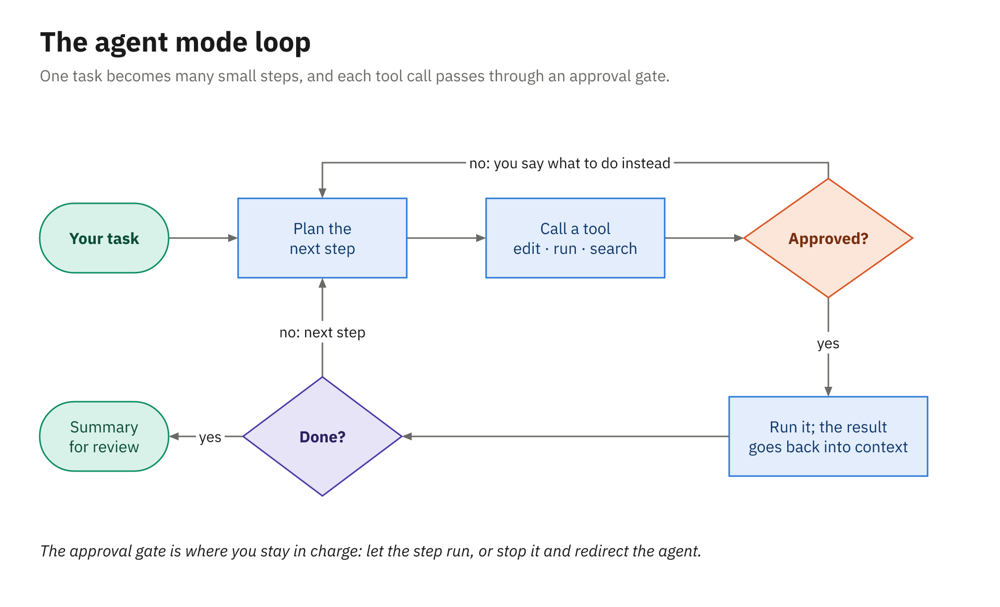
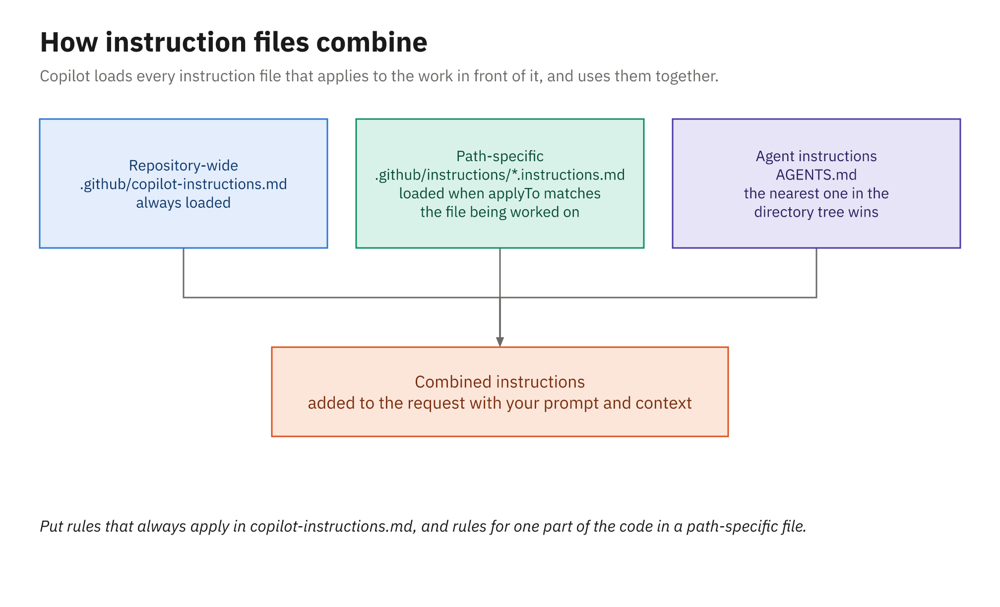
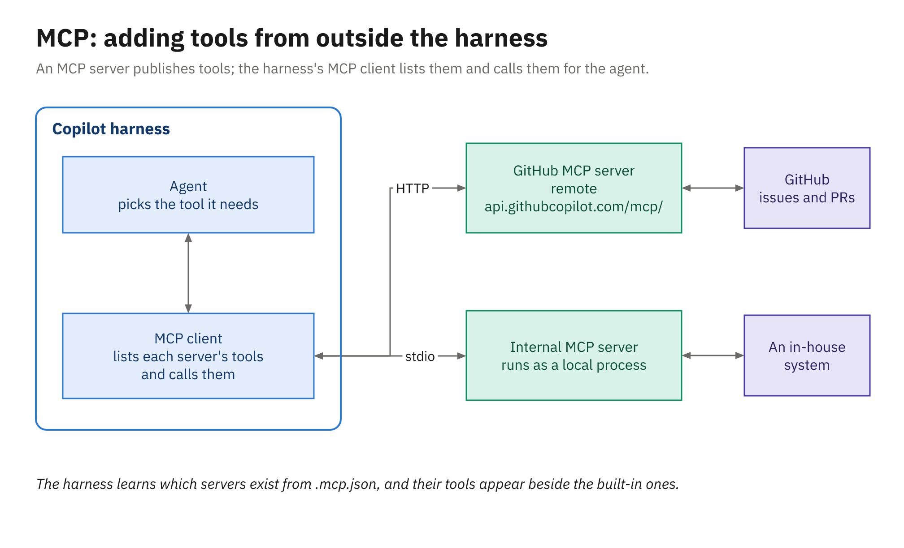

# Demo 02: Agent Mode, Instructions, Custom Agents, and MCP (Library app, Java)

Agent mode is where the harness starts changing code instead of answering questions about it. This
demo gives it a small policy change on [`samples/library-java`](../../samples/library-java/),
approves and rejects its steps in front of the room, and then runs the same prompt again after adding
a repository instructions file, so the audience sees exactly what the instructions bought. It ends by adding a read-only custom agent and
the GitHub MCP server, and pushing everything for Module 4.

## Before class

1. Work in your clone of `library-demo-java` (the [demos README](../README.md#running-a-demo) clones
   it). Module 4 uses the same repository. It has to be at its start: `main` with the single
   "Demo start" commit and no `.github/copilot-instructions.md`, because step 3 compares the agent with
   and without one. Open it, check, and warm the Maven cache:

   ```powershell
   Set-Location $HOME\demo\library-demo-java
   git switch main; git pull
   git log --oneline     # one commit: Demo start
   .\mvnw.cmd test       # 16 tests pass
   ```

2. Keep [`assets/java/`](assets/java/) open in a file explorer so you can copy from it live.
3. Open VS Code settings (**Ctrl+,**), paste this setting ID into the search box, and turn it on:

   ```text
   chat.agentHost.agentDebugLog.enabled
   ```

   The **Agent Debug Logs** panel then captures your Copilot harness sessions. It's your backup view
   of the session log, and it only records sessions that start after you turn it on.
4. Rehearse once. After trail steps 1–5, these commands get you back to the start:

   ```powershell
   git reset --hard
   git clean -fd
   git stash clear
   ```

   Steps 6 and 7 create an issue and push the customization files to GitHub, which `git reset` can't
   undo, and step 3's comparison only works while `main` has no instructions file. If you rehearse
   those two, recreate `library-demo-java` afterward
   ([demos README](../README.md#creating-or-recreating-the-demo-repositories)) and redo step 1.

## Demo trail

1. **Agent mode with manual approvals (4 min).** New chat, Session Target **Copilot**, agent
   **Agent**, permissions **Manual permissions**. Send:

   ```text
   Add a loan rule: a member who owes more than 10.00 in fines can't borrow until they pay.
   Add unit tests for it.
   ```

   Read each approval request aloud before you answer it, and approve the ones that fit the task. When
   it proposes a broad command such as a full `clean install`, reject it and give this reason:

   ```text
   Run only LoanPolicyTest with .\mvnw.cmd test -Dtest=LoanPolicyTest.
   ```

   Show it adapting. Choose **Keep**.
2. **The session log and the diff (2 min).** Open **Show Chat Debug View** and walk the tool calls in
   order: what it read before editing, each command, each result. Then show the diff in Source
   Control. Point at what's missing: no `CHANGELOG.md` entry, perhaps a bare `10.00`.
3. **Add instructions and rerun (4 min).** Stash the attempt:

   ```powershell
   git stash push -u
   ```

   Copy `assets/java/.github/copilot-instructions.md` into the repo, open it, and read two rules aloud.
   Start a new chat and send the same prompt:

   ```text
   Add a loan rule: a member who owes more than 10.00 in fines can't borrow until they pay.
   Add unit tests for it.
   ```

   Compare: `LIB003` in `PolicyCodes`, a `MAX_OUTSTANDING_FINES` constant, a `@CsvSource` boundary test
   at 10.00 and 10.01, and a `CHANGELOG.md` line.
4. **Path-scoped instructions (1 min).** Copy `assets/java/.github/instructions/tests.instructions.md`
   and show its `applyTo: "src/test/**"`. Ask for one more test:

   ```text
   Add one more test to LoanPolicyTest: a member who owes no fines can borrow.
   ```

   Show `tests.instructions.md` listed under **References** on the response.
5. **A read-only custom agent (2 min).** Copy `assets/java/.github/agents/policy-guard.agent.md`. Point
   at `tools: ["read", "search"]`. Pick **policy-guard** from the agent dropdown and send:

   ```text
   Review the uncommitted changes against the library's lending and fee policies.
   ```

   Then ask it to fix something, and show that it can't:

   ```text
   Fix the first problem you found.
   ```
6. **The GitHub MCP server (1 min).** Copy `assets/java/.mcp.json`, start a new Agent chat, and ask:

   ```text
   Using the GitHub MCP server, create an issue in library-demo-java titled "Let members renew a loan once".
   ```

   Read the MCP tool approval aloud (the server, the tool, the arguments) before you approve it, then
   show the new issue on GitHub.com.
7. **Commit and push (1 min).** Commit everything and push it:

   ```powershell
   git add .
   git commit -m "Fines rule and Copilot customization"
   git push
   ```

   Say that Module 4 will open this same repository in the CLI.

## What it demonstrates

- How agent mode plans, which tools it calls, and how approvals and rejections steer it
- Reading the session log (Chat Debug view) to see what the agent actually did
- The measurable effect of `.github/copilot-instructions.md`, path-scoped `*.instructions.md`, a custom
  agent under `.github/agents`, and MCP servers in the portable `.mcp.json`

## Files

```
demos/02_agent-mode-customization/
├── assets/
│   ├── dotnet/ … java/                       # the same set for each language:
│   │   ├── .github/copilot-instructions.md
│   │   ├── .github/instructions/tests.instructions.md
│   │   ├── .github/agents/policy-guard.agent.md
│   │   └── .mcp.json                         # GitHub MCP server
└── solution/
    ├── dotnet/ …                             # reference fines rule + tests + CHANGELOG (fallback)
    └── java/src/main/java/com/example/library/lending/{LoanPolicy,PolicyCodes}.java …
```

## If Copilot does something different

- **The first run already follows the conventions.** The codebase shows its patterns, so a strong model
  may pick some up. Compare on the rules it can't infer, such as the `CHANGELOG.md` entry.
- **The run goes long or stalls.** Stop it, show what it did in the debug view, and copy in
  [`solution/java/`](solution/java/) to keep moving. It's validated to pass.
- **The Chat Debug view doesn't show the session.** Open **Show Agent Debug Logs** from the Chat view's
  **...** menu instead; its Logs and Agent Flow Chart tell the same story.
- **The MCP call needs a sign-in.** Complete it on screen; it's a normal part of adding a remote server.

## How it relates to the activity

[Activity 02](../../activities/02_agent-mode-and-instructions/README.md) runs the same experiment on the
orders app: a quantity-limit rule with and without instructions, then a path-scoped file and a
`test-writer` custom agent, all committed for Activities 03 and 04.

## Diagram



*Plan, request a tool, wait for approval, read the result, decide what's next.*



*Repository-wide instructions always load; path-scoped files load when their files are in play.*



*MCP adds tools without changing the harness.*

## Related reading

- [Agent mode](../../docs/02_agent-mode-instructions-agents-mcp/01_agent-mode.md)
- [Repository instructions](../../docs/02_agent-mode-instructions-agents-mcp/02_repository-instructions.md)
- [Custom agents](../../docs/02_agent-mode-instructions-agents-mcp/03_custom-agents.md)
- [MCP servers](../../docs/02_agent-mode-instructions-agents-mcp/04_mcp-servers.md)
