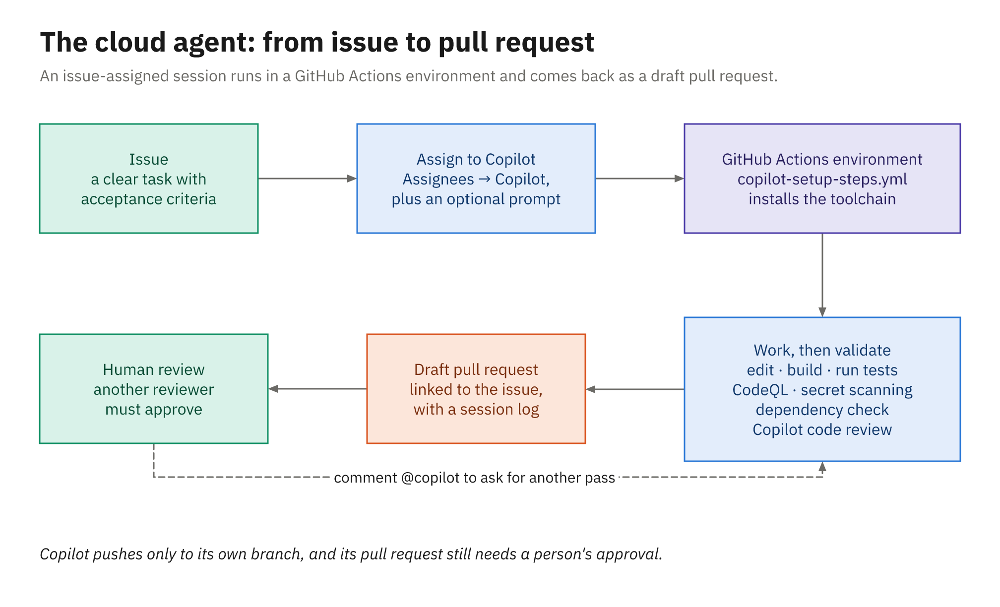

# Demo 03: The Cloud Agent and Copilot Code Review (Library app, .NET)

A cloud-agent run takes longer than a demo slot, so this demo is a cooking show: you start the run
before class and walk the finished result in front of the room, from the issue to the session log to
the draft pull request, then review it with Copilot code review and steer it with a comment. It runs on
`library-demo-dotnet`, a .NET copy of [`samples/library-dotnet`](../../samples/library-dotnet/) with
Demo 02's customization files, in the class organization, `coding-agent-harness-class`.

## Before class

Do this **at least 30 minutes** before Module 3.

1. Work in your clones of `library-demo-dotnet` and `library-demo-dotnet-backup` (the
   [demos README](../README.md#running-a-demo) clones them). `library-demo-dotnet` already has the
   customization files on `main` and three open, unassigned issues: #1 **List overdue loans**, #2
   **Export a member's loan history**, and #3 **Show a member's total fines**. Check them:

   ```powershell
   Set-Location $HOME\demo\library-demo-dotnet
   gh issue list
   ```

2. Check the **Actions** tab: the **CI** run is green, and you can run **Copilot Setup Steps** by hand
   (Run workflow) and see it pass.
3. Assign #1, **List overdue loans** (its body is [`issues/dotnet.md`](issues/dotnet.md)), to
   **Copilot**. Wait for the draft pull request and for the session to finish.
4. Assign #2, **Export a member's loan history** (its body is
   [`issues/dotnet-loan-export.md`](issues/dotnet-loan-export.md)), to **Copilot** too. It
   pins Newtonsoft.Json 12.0.3, which has a published high-severity advisory (GHSA-5crp-9r3c-p9vr).
   Search the package on `github.com/advisories` first to confirm the advisory is still listed. Two
   layers can catch it. This sample treats warnings as errors, so the agent's first `dotnet test`
   fails at restore with `NU1903` (NuGet's audit naming that advisory), and the agent has to choose:
   upgrade past the advisory, or suppress the warning to keep the pinned version. If 12.0.3 survives,
   the run's dependency check reports it at the end. Read the finished log before class so you know
   which story you're telling in trail step 4. (The Java twin pins `org.json:json` 20230227, which is
   affected by GHSA-4jq9-2xhw-jpx7; Maven doesn't audit dependencies, so in Java only the dependency
   check catches it.)
5. Leave #3, **Show a member's total fines**, **unassigned**. Trail step 2 opens the assignment
   options on it without submitting.
6. Check that the backup pull request is there to walk if a pre-run session fails. It's a draft named
   **List overdue loans**, built from this demo's `solution/`:

   ```powershell
   Set-Location $HOME\demo\library-demo-dotnet-backup
   gh pr list --state open
   ```

7. Confirm the settings the room depends on: the **Copilot in the cloud** and **Copilot code review**
   policies are on for the students' Copilot seats, so code review works on the pull requests they open
   in their personal practice repos. Those repos can't run the cloud agent, so this demo is the room's
   only look at it.

If you rehearse trail steps 6 and 7, they push to the pull request's branch and start a new session,
which `git reset` can't undo. Rehearse on the backup repository, or recreate `library-demo-dotnet`
afterward ([demos README](../README.md#creating-or-recreating-the-demo-repositories)) and redo
steps 1–5.

## Demo trail

1. **Where tasks live (1 min).** Open the repository's **Agents** tab and the pre-run sessions. Name
   the other ways in: `github.com/copilot`, assigning an issue, `gh agent-task create`, and (in
   Module 4) the CLI's `/delegate`.
2. **The issue and the assignment (1 min).** Open the overdue-loans issue and point at what makes it
   actionable: what to build, where it goes, acceptance criteria, how to test. On an unassigned issue,
   choose **Copilot** under **Assignees** and show the options that appear (repository, starting branch,
   custom agent, model, optional prompt) without submitting.
3. **The session log (4 min).** On the overdue-loans pull request choose **View session**. Walk it in
   order: the output of the setup steps from `.github/workflows/copilot-setup-steps.yml`, the files it
   opened (did it find `LateFeeCalculator` before writing fee code?), the tests it ran, and the built-in
   validation at the end (Copilot code review, CodeQL, secret scanning, dependency check). Nobody asked
   for those checks; they run on every session.
4. **A check that fires (2 min).** Open the loan-history export session and find where the advisory
   surfaced: the `NU1903` restore error on its first test run, the dependency check near the end of
   its log, or both. Show the package, the advisory it matched, and what the agent did about it. An
   upgrade it explains in the pull request is the good outcome; a suppressed warning (`NoWarn` or
   `NuGetAudit` switched off) is the one a human reviewer has to catch, so say so. Then open the repository's **Settings → Copilot → Cloud agent** and show **Validation
   tools**, where repository admins can switch each of the four checks off; they're all on by default.
5. **The draft pull request (2 min).** Back on the overdue-loans pull request: commits authored by
   Copilot with you as co-author, the files changed against the acceptance criteria, and **Approve and
   run workflows** to let CI run. Point out the difference the students will meet after the break: you
   can run the workflows because you have write access, but your approval of the pull request wouldn't
   count, because you asked for it.
6. **Copilot code review (3 min).** Request a review from **Copilot**. Read a comment or two. Then add
   [`assets/dotnet/REVIEW.md`](assets/dotnet/REVIEW.md) to the pull request's branch (code review reads
   instructions from the branch under review). From the root of your courseware clone, check the
   branch out in your demo folder, copy the file to its root, commit, and push:

   ```powershell
   $course = (Get-Location).Path
   Set-Location $HOME\demo\library-demo-dotnet
   $pr = gh pr list --search "overdue in:title" --json number -q '.[0].number'
   gh pr checkout $pr
   Copy-Item "$course\courseware\demos\03_cloud-agent-code-review\assets\dotnet\REVIEW.md" .
   git add REVIEW.md; git commit -m "Add code review instructions"; git push
   ```

   Re-request the review, and compare. Finish by showing where
   review becomes automatic: a branch ruleset for everyone's pull requests in the repository, or the
   code review page of your personal Copilot settings for your own (students turn that on in
   Activity 03). A ruleset on a private repository needs the organization on GitHub Team or Enterprise.
7. **Steer it with a comment (1 min).** Comment on the pull request:

   ```text
   @copilot Add the new endpoint to the Endpoints table in README.md.
   ```

   Show the reaction and the new session.
8. **Summary and Chat (1 min).** Generate a pull request summary from the Copilot icon in a comment
   box. Then open Copilot Chat at `github.com/copilot`, add `library-demo-dotnet` as context, and ask:

   ```text
   Where are overdue fees calculated in this repository? Name the class and the method.
   ```

If the organization has third-party agents enabled, finish by opening the agent picker on the Agents
tab and showing that the same task box can start a Claude or Codex session.

## What it demonstrates

- The Copilot cloud agent: issue assignment, the Agents tab, the Actions environment shaped by
  `copilot-setup-steps.yml`, and the draft pull request it returns
- The session log and the built-in security and quality checks in every run, including a dependency
  check that finds something, and the **Validation tools** setting that controls them
- Copilot code review, custom review instructions (`REVIEW.md`), automatic review, and iterating with
  `@copilot`
- Pull request summaries and Copilot Chat on GitHub.com

## Files

```
demos/03_cloud-agent-code-review/
├── issues/dotnet.md, java.md          # "List overdue loans" issue bodies
├── issues/dotnet-loan-export.md, java-loan-export.md   # pins a dependency the security check flags
├── assets/dotnet/REVIEW.md, java/…    # custom review instructions added live
└── solution/dotnet/, java/            # reference implementation of the issue (fallback)
```

## If Copilot does something different

- **The pre-run session failed or is still running.** Show what's in the log; failures are
  informative (a firewall block or a setup step). Then walk the backup pull request from Before class
  step 6, which holds [`solution/dotnet/`](solution/dotnet/).
- **The dependency check reports nothing.** The agent most likely upgraded Newtonsoft.Json after the
  `NU1903` restore error, before validation ran; its log and the pull request description say so.
  That makes the same point from the other side, because two layers caught the advisory before a
  human did, so walk it. If the advisory has been withdrawn, pick another package with a current
  one on `github.com/advisories` and edit the issue. This session has no `solution/`, because its log
  is the point, not its code.
- **Code review leaves no comments.** That happens on clean changes. Push a deliberate violation of
  `REVIEW.md` (for example, a `DateTime.Now`) and re-request.
- **The `@copilot` comment gets no reaction.** Only users with write access can trigger it, and only on
  an open pull request; check you're signed in as the repository owner and the pull request isn't
  closed.

## How it relates to the activity

In [Activity 03](../../activities/03_cloud-agent-and-review/README.md) each student files an issue to
cancel a pending order in their own orders repository and, because the cloud agent can't run in their
personal repositories, hands it to agent mode on a branch instead. After the break they open the pull
request, request a Copilot code review, and compare their pull request with this demo's overdue-loans
one, so keep it open.

## Diagram



*The agent works in its own environment; a human always reviews what comes back.*

## Related reading

- [The cloud agent](../../docs/03_cloud-agent-and-code-review/01_the-cloud-agent.md)
- [Inside a cloud run](../../docs/03_cloud-agent-and-code-review/02_inside-a-cloud-run.md)
- [Steering the cloud agent](../../docs/03_cloud-agent-and-code-review/03_steering-the-cloud-agent.md)
- [Copilot code review](../../docs/03_cloud-agent-and-code-review/04_copilot-code-review.md)
- [PR summaries, Chat, and other agents](../../docs/03_cloud-agent-and-code-review/05_pr-summaries-chat-and-other-agents.md)
