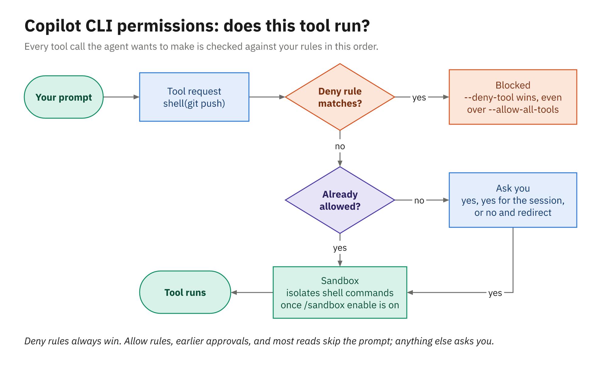
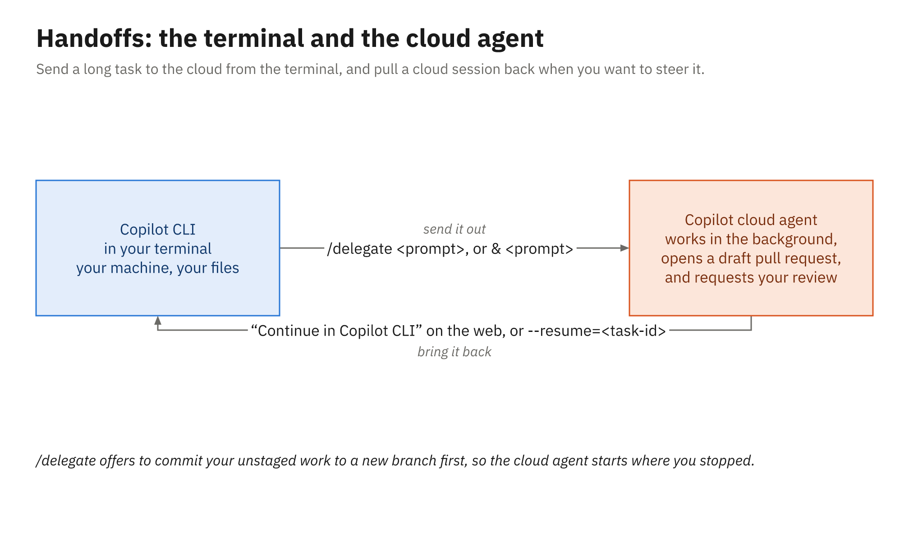

# Demo 04: The GitHub Copilot CLI (Library app, Java)

The last demo moves the same harness into a terminal. You open the Java demo repository from Module 2
inside the CLI's local sandbox, show that its instructions and custom agent load unchanged, and take a
reported bug from issue to pull request without leaving the terminal, approving each edit and command.
Then you hand a follow-up to the cloud agent, bring a cloud session back into the terminal, and run a
prompt the way a script would. It runs in your clone of `library-demo-java`, the repository
[Demo 02](../02_agent-mode-customization/README.md) pushed its customization files to.

The sandbox part matters more than usual when the students' VMs run Windows Server: the local sandbox
can't run there, so this demo is the only place they see it.

## Before class

Steps 3–5 happen before class (step 5 on the morning of, before Demo 02). Steps 1 and 2 happen
**during Module 2, after Demo 02's live push**, while students work on Activity 02 (about 1:25–1:50).
Not earlier: Demo 02 runs live on this repository and has to start green. With a failing test on
`main`, agent mode would find it, and the instructions file tells it to make every test pass, so it
could fix this demo's bug in Module 2.

1. Make sure your clone of `library-demo-java` is on `main` and has Demo 02's push (the customization
   files from that demo):

   ```powershell
   Set-Location $HOME\demo\library-demo-java
   git switch main; git pull
   git status            # clean, and up to date with origin/main
   ```

2. Add the repro test and push it, then file the bug. From the root of your courseware clone:

   ```powershell
   $course = (Get-Location).Path
   Set-Location $HOME\demo\library-demo-java
   Copy-Item -Recurse -Force "$course\courseware\demos\04_copilot-cli\assets\java\src" .
   .\mvnw.cmd test        # one test fails: dueDate_skipsConsecutiveClosedDays
   git add .; git commit -m "Add failing test for consecutive closed days"; git push
   gh issue create --title "Due date can land on a day the library is closed" `
       --body-file "$course\courseware\demos\04_copilot-cli\issues\java.md"
   ```

3. Check that both CLIs work and that you're signed in to each (the agent opens the pull request with
   `gh`):

   ```powershell
   copilot --version
   gh auth status
   ```

   Turn on automatic review in the code review settings of your personal Copilot settings
   (`https://github.com/settings/copilot`), so the pull request you open in trail step 6 gets a
   Copilot review that nobody requested. Use a large terminal font.
4. Check that the local sandbox runs on your machine. It needs macOS, Linux, or Windows 11 version 25H2
   with update KB5124010 or later (26H1 with KB5124006 or later); Windows Server can't run it. In the
   repository, start the CLI in the sandbox:

   ```powershell
   copilot --sandbox
   ```

   Type this to see the policy:

   ```text
   /sandbox
   ```

   Ask it to run the tests:

   ```text
   Run .\mvnw.cmd test and tell me whether the tests pass.
   ```

   Then check that the sandbox blocks a folder outside its policy, so you know the block works before
   you show it in trail step 5:

   ```text
   Run Get-ChildItem C:\ProgramData in the shell.
   ```

   If that folder isn't blocked, try another one outside the policy and use it in step 5 instead. Note
   whether the CLI then offers to rerun the command outside the sandbox, so it doesn't surprise you
   live.
5. On the morning of, before Demo 02 and before any failing test is on `main`, start the session
   you'll bring back in step 7. In `library-demo-java`'s **Agents** tab, start a task with
   **Environment** set to **Cloud**, for example:

   ```text
   Add Javadoc to the public methods of LoanPolicy.
   ```

   It has to be a cloud-sandbox session: those can be continued from another client, while
   issue-assigned sessions run on Actions and stay on the website. Let it finish, then open its
   menu, choose **Continue in Copilot CLI**, and check the command it gives you resumes the session with
   its history (an [older CLI bug](https://github.com/github/copilot-cli/issues/2497) opened an empty
   session instead).

## Demo trail

1. **Same harness, new surface (1 min).** Show the version:

   ```powershell
   copilot --version
   ```

   Name the install options (install script, Homebrew, WinGet, npm). Contrast `copilot` with `gh`,
   which still drives cloud-agent tasks:

   ```powershell
   gh agent-task list
   ```

2. **What it loaded, inside the sandbox (2 min).** Start the CLI in the repository, and trust the folder
   when it asks:

   ```powershell
   copilot --sandbox
   ```

   Type these one at a time (Esc closes the agent picker without choosing):

   ```text
   /instructions
   /agent
   ```

   The instructions and **policy-guard** from Module 2 are there, unchanged. Then show the sandbox
   policy and the model picker:

   ```text
   /sandbox
   /model
   ```

   The policy covers the working directory, PATH, temp, and your profile, with everything else
   blocked. The model picker is the same idea as the one in VS Code.
3. **Diagnose in plan mode (3 min).** Shift+Tab to plan mode, then:

   ```text
   Read the open issue "Due date can land on a day the library is closed" and the failing test it
   names. Find the cause in the production code and explain it. Don't change files.
   ```

   Point out that file reads go through without a prompt; approve the test run when it asks.
4. **Fix under approval (3 min).** Back to the standard mode (Shift+Tab twice from plan mode, past
   autopilot), then:

   ```text
   Fix the cause, keep the test as it is, then run the tests.
   ```

   Read the proposed edit and approve it with **1**. Decline the next request with **3**, and give this
   reason:

   ```text
   Show me the diff before you run the tests.
   ```

   The test run happens inside the sandbox, and
   Maven still reaches its cache because `allowDevToolAccess` grants it. Then show the diff:

   ```text
   /diff
   ```

5. **What the sandbox stops (1 min).** Ask it to list the folder you checked before class:

   ```text
   Run Get-ChildItem C:\ProgramData in the shell.
   ```

   Approve the command. It still fails, because the sandbox enforces its policy
   after you've said yes. If the CLI offers to run it again outside the sandbox, decline, and say that
   this per-command bypass is what an organization's `allowBypass: false` policy takes away. That's
   the point to land: approvals decide what runs, the sandbox limits what it can touch.
6. **Open the pull request (2 min).** Ask:

   ```text
   Create a branch fix/closed-day-rollover, commit with a message that closes the issue "Due date can
   land on a day the library is closed", push, and open a pull request.
   ```

   Approve the `git` steps and the pull request creation (usually `gh pr create`). Show the PR link,
   and the Copilot review that starts on it unasked: that's automatic review from your personal Copilot
   settings (Before class step 3). Managed user accounts like the students' can't turn it on, so this
   is their look at it.
7. **Second opinion and handoff, both ways (2 min).** Run the review agent on the branch:

   ```text
   /review
   ```

   Then hand a follow-up to the cloud agent, and open the session link it prints:

   ```text
   /delegate Add Javadoc to the public methods of DueDateCalculator
   ```

   For the way back, open the cloud-sandbox session you started before class, choose
   **Continue in Copilot CLI**, paste the command into a second terminal, and show its history arriving.
8. **Scripted use (1 min).** Exit and run a one-shot prompt. Prompt mode needs `--allow-all-tools`
   because nobody's there to approve; the deny rules still win, so this run can read but can't edit
   files or push:

   ```powershell
   copilot -p "Summarize the changes on this branch compared with main." `
       -s --allow-all-tools --deny-tool='write' --deny-tool='shell(git push)'
   ```

If there's a moment left, mention `copilot --cloud`, which runs the whole interactive session in a cloud
sandbox instead of on your machine.

## What it demonstrates

- The Copilot CLI as the same harness in a terminal, and how it differs from `gh`
- Interactive sessions, plan mode, slash commands, and model switching
- The approval prompt, declining a step with a reason, and allow/deny rules for scripted runs
- The local sandbox, and what it blocks even after you approve a command
- The built-in GitHub integration, the review agent, and handing work to and from the cloud agent

## Files

```
demos/04_copilot-cli/
├── issues/java.md, dotnet.md                 # the "closed day" bug report
├── assets/java/src/test/java/com/example/library/lending/DueDateCalculatorTest.java   # the repro test
├── assets/dotnet/tests/Library.Domain.Tests/DueDateCalculatorTests.cs
└── solution/java/…/DueDateCalculator.java, dotnet/…/DueDateCalculator.cs              # the reference fix
```

## If Copilot does something different

- **It fixes the test instead of the code.** Decline the edit with **3** and this reason:

  ```text
  Don't change the test; the issue says the expectation is right.
  ```

  That's the lesson of approvals.
- **It can't open the pull request.** On the fix branch, run:

  ```text
  /pr create
  ```

  Or exit and restart with the pull request tools turned on for the built-in GitHub server, which is
  read-only by default:

  ```powershell
  copilot --continue --add-github-mcp-toolset pull_requests
  ```

- **The sandbox won't start, or a command fails naming a missing operating-system feature.** Turn the
  sandbox off and carry on with the trail:

  ```text
  /sandbox disable
  ```

  At the end, show the other way to keep the agent's commands off your machine:

  ```powershell
  copilot --cloud
  ```

- **Continue in Copilot CLI opens an empty session.** Narrate the round trip with the handoff diagram,
  and say that the session itself is safe on GitHub.
- **Short on time.** Copy in [`solution/java/`](solution/java/) and show the tests going green.

## How it relates to the activity

[Activity 04](../../activities/04_copilot-cli/README.md) gives students a different bug in the orders
app, also reported with a failing test, to take from issue to pull request in the terminal the same way.
`/delegate` can't run in students' personal repositories, so step 7's handoff is theirs to watch, not
do. Students whose machines can run the local sandbox start the CLI with `--sandbox`; on Windows Server
VMs they rely on this demo for it.

## Diagram



*Deny rules always win; anything not allowed asks you first.*



*`/delegate` sends work to the cloud; Continue in Copilot CLI brings it back.*

## Related reading

- [What the CLI is](../../docs/04_copilot-cli/01_what-the-cli-is.md)
- [Interactive and programmatic use](../../docs/04_copilot-cli/02_interactive-and-programmatic-use.md)
- [Permissions and the sandbox](../../docs/04_copilot-cli/03_permissions-and-sandbox.md)
- [GitHub integration and MCP](../../docs/04_copilot-cli/04_github-integration-and-mcp.md)
- [Reusing customizations and handoffs](../../docs/04_copilot-cli/05_reusing-customizations-and-handoffs.md)
