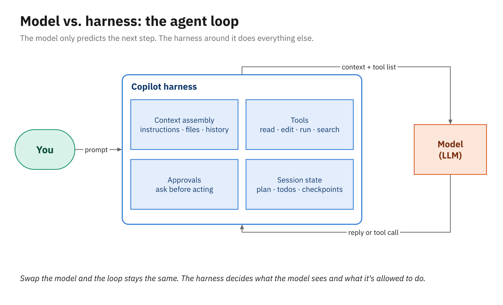
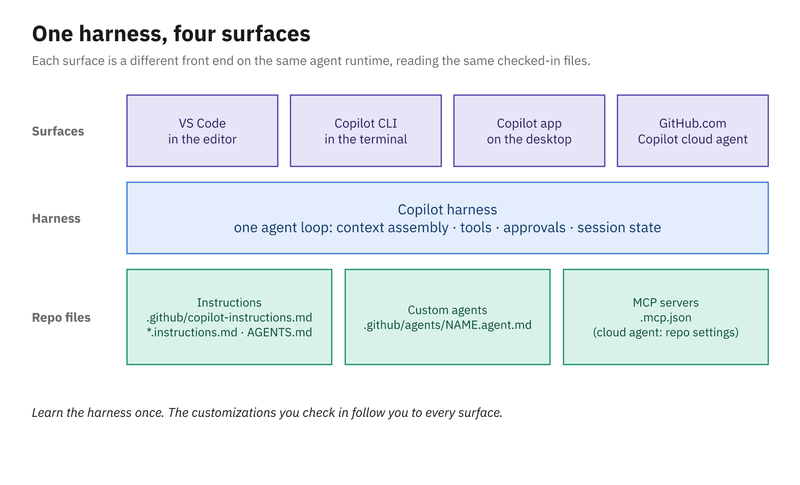

# Model Versus Harness

When a teammate says "Copilot wrote this test," two quite different pieces of software were involved. A
large language model produced the text of the test, and a *harness* around that model found the right
files, handed them over, wrote the result to disk, ran `dotnet test`, and checked with you before doing
anything risky. Keeping those two apart is the most useful mental model in this course, because nearly
every setting you'll touch over the next four hours changes the harness rather than the model.

---

## What the model does

A language model is, for our purposes, a function from text to text. You send it a request made of
instructions, some code, the conversation so far, and a list of tools it's allowed to ask for, and it
predicts what should come next. Sometimes that prediction is an answer in prose. Sometimes it's a
*tool call*: a short, structured request such as "read `src/Library.Domain/Fees/LateFeeCalculator.cs`"
or "run `dotnet test` in the repository root."

```text
request (instructions + code + history + tool list)
   │
   ▼
 model ──► "Calculate charges 0.25 a day once a loan is more than two days late…"   (an answer)
   │
   └────► call tool: read file src/Library.Domain/Fees/LateFeeCalculator.cs       (a tool call)
```

Predicting is all the model does. It can't open a file or run a command, and it keeps no memory
between requests, so each call starts from whatever the request contains. If a file isn't in the
request, the model hasn't seen it, however confident its answer sounds.

---

## What the harness does

A **harness** is the program wrapped around the model that turns its predictions into work. GitHub
Copilot's harness has five jobs, and each one maps to something you can see and control.

### Context assembly

Before every model call, the harness builds the request. It combines a system prompt, your repository's
instruction files (Module 2), whatever you attached yourself (a file, a selection, `#codebase` search
results), the output of earlier tool calls, and the conversation history. Chapter 3 of this module looks
at that assembly in detail, because it's the part you influence most directly.

### Tools

The harness tells the model which tools exist and runs them when the model asks. VS Code's tools
reference groups the built-in ones roughly like this. These are the Local harness's names; a Copilot
harness session lists its own in the **Tools** tab.

| Group | Examples |
|---|---|
| Read and search | `#read/readFile`, `#search/codebase`, `#search/textSearch`, `#search/usages` |
| Edit | `#edit/editFiles`, `#edit/createFile` |
| Run | `#execute/runInTerminal`, `#execute/getTerminalOutput`, `#execute/testFailure` |
| Web and GitHub | `#web/fetch`, `#githubRepo` |

MCP servers, covered in Module 2, plug extra tools into the same list.

### The agent loop

The **agent loop** is what turns an assistant into an agent. The model asks for a tool, the harness runs
it, the result goes into the next request, and the model decides what to do next. The cycle repeats
until the model reports that it's finished or the harness reaches a limit. In VS Code that limit is the
`chat.agent.maxRequests` setting, the most requests the agent can make (25 by default).

### Approvals

Not every tool call should run unattended. The harness decides which calls need your permission first.
In VS Code you choose between **Manual permissions** (the default, which follows your tool, URL, and
terminal approval settings), **Assisted permissions** (an LLM judge assesses each call), and **Allow
all**. The Copilot CLI asks per tool and lets you approve once or for the rest of the session. Module 2
covers VS Code approvals and Module 4 covers the CLI's.

### Session state

The harness remembers what the model can't: the conversation, the edits still waiting for your review,
and the checkpoints you can roll back to. In VS Code's Copilot harness a session can keep running in the
background after you close the editor window, and GitHub Environments (in preview) lets you pick a
session up again from the Copilot app, the CLI, or GitHub.com.



*The model only predicts; the harness assembles each request, runs tools behind approvals, and keeps the session.*

---

## One request, step by step

Here's roughly what happens when you open the library sample, switch to agent mode, and type *"Add a
unit test for the student rate in LateFeeCalculator and run it."*

1. The harness assembles the first request: the system prompt, `.github/copilot-instructions.md` if the
   repository has one, your message, the active file, and the list of available tools.
2. The model answers with a tool call that searches the workspace for `LateFeeCalculator`. The harness
   runs the search and appends the matches to the next request.
3. The model asks to read `LateFeeCalculator.cs` and the existing test project. The harness reads them.
4. The model proposes a new test file. The harness writes it and marks it as a pending edit that you can
   keep or undo.
5. The model asks to run `dotnet test`. Unless you've auto-approved that command, the harness stops and
   asks you first.
6. The test output goes back into the next request, and the model either fixes a compile error and tries
   again or reports that it's done.

The model was called half a dozen times and never touched your disk itself. Every read, write, and
command went through the harness, which is why the harness is where guardrails, conventions, and extra
tools get added.

---

## One harness, four surfaces

The harness behind Copilot is one agent runtime, the same engine the Copilot CLI hosts, and since June
2026 GitHub has offered the **Copilot SDK** (generally available, and being renamed the Microsoft
Copilot SDK as of October 2026) so your own code can drive it. The
SDK's client libraries come in .NET and Java flavors (alongside Node/TypeScript, Python, Go, and Rust),
so the runtime you're about to use in VS Code is also something you could build into your own tools.

Each Copilot surface is a different front end on that runtime:

| Surface | Where the loop runs | Typical use |
|---|---|---|
| VS Code (Copilot harness) | Your machine, driven from the editor | Chat and agent mode while you code |
| Copilot CLI (`copilot`) | Your machine, in a terminal | Terminal tasks, scripts, CI jobs |
| Copilot app (desktop) | Your machine, each local session in its own git worktree, or the cloud | Running and steering several sessions at once |
| GitHub.com | GitHub's cloud | Cloud agent sessions, code review, chat about a repository |

You can see the shared runtime in the products themselves. VS Code's Copilot harness is built on the
Copilot SDK and runs its sessions through a component VS Code calls the Agent Host. The SDK, in turn,
drives the same engine that's behind the CLI; by default it starts the Copilot CLI in server mode and
talks to it. And GitHub says cloud sessions get the same tools as the CLI and the Copilot app, Bash and
the GitHub CLI among them.



*One runtime, four front ends, and one set of customization files in the repository.*

The practical payoff is that your customization files travel with the repository. Instruction files,
custom agents in `.github/agents`, and the portable `.mcp.json` file are read by more than one surface,
so the conventions you write for VS Code in Module 2 also shape the cloud agent in Module 3 and the CLI
in Module 4. Support isn't perfectly uniform, and Module 2 includes GitHub's table of which surface
reads which file.

### Harnesses inside VS Code

VS Code uses the word *harness* itself: the **Session Target** control in the Chat view picks the
harness for a new session, and you choose it before the first prompt.

- Copilot, the default for new sessions since VS Code 1.143, built on the Copilot SDK and the Agent Host
- Local, VS Code's original built-in agent, whose sessions are tied to the editor window
- Claude and Codex, Anthropic's and OpenAI's harnesses, which can run on a Copilot subscription or on
  your own key or account
- Cloud, which isn't a harness but a target: it runs the session in GitHub's cloud instead of on your
  machine (labeled experimental in the VS Code docs)

A few classic features, including prompt files, `/init`, and handoffs, work only in Local sessions. This
course uses the Copilot harness throughout, because it's the default and it's the one shared with the
CLI and the cloud.

---

## Why the distinction pays off

When a result is wrong, it helps to ask which half failed. If the model never saw the file or the
convention it ignored, that's a context problem, and you fix it by attaching the file or writing an
instruction file. If it wanted to run the tests but couldn't, that's a tool or approval problem. If it
saw everything it needed and still reasoned badly, that's the model, and a stronger one (Chapter 4) may
help.

You don't have to guess, either. In VS Code, expand **References** on a response to see which files and
instructions went into that request, and Module 2 covers the debug views that show the full request
the harness sent. The same lens explains the course's closing comparison: Copilot, OpenCode, and Kiro
can call some of the same models, so what really separates them is the harness.

---

## Summary

- The **model** predicts text or tool calls from the request it's given; it can't read files, run
  commands, or remember earlier requests.
- The **harness** assembles context, exposes tools, runs the agent loop, gates actions with approvals,
  and keeps session state.
- The **agent loop** repeats model call, tool call, and result until the task is done or the harness
  hits a limit such as `chat.agent.maxRequests` (25 by default).
- One agent runtime, the one the Copilot CLI hosts and the Copilot SDK lets your code drive, sits behind
  VS Code's Copilot harness, the CLI, the Copilot app, and cloud sessions on GitHub.com.
- Customization files in the repository (instructions, custom agents, `.mcp.json`) are shared across
  those surfaces, with some per-surface differences.
- In VS Code, Session Target picks the harness; the Copilot harness is the default and the one this
  course uses.
