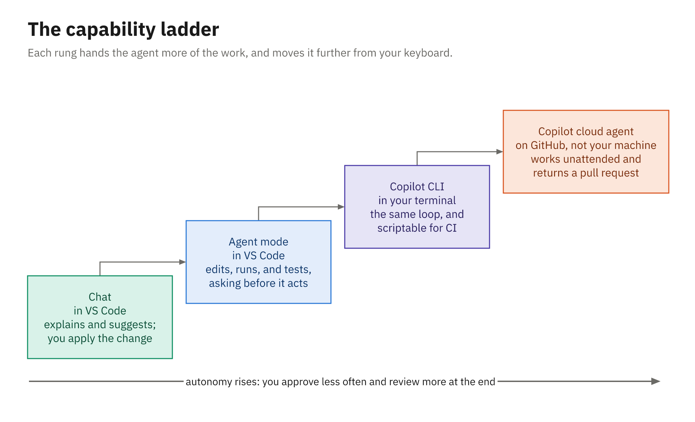

# The Capability Ladder

Copilot gives you four ways to work, and it's easiest to picture them as rungs on a ladder: chat, agent
mode, the Copilot CLI, and the Copilot cloud agent. The harness underneath is the same on every rung.
What changes as you climb is who drives, where the work runs, what the agent can touch, and how you
review the result, and those four questions are a good way to pick the right rung for a task.

---

## The four rungs at a glance

| Rung | Who drives | Where it runs | What it can touch | How you review |
|---|---|---|---|---|
| Chat | You, one turn at a time | VS Code, on your machine | What you attach or let it search; read-only | Read the answer; apply code yourself |
| Agent mode | The agent, with your approvals | VS Code, on your machine | Workspace files, terminal commands, tests, search | Keep or undo each edit; checkpoints |
| Copilot CLI | The agent, with your approvals | A terminal on your machine | Files in a trusted folder, shell commands, GitHub | Permission prompts, `/diff`, `/review` |
| Cloud agent | The agent, on its own | GitHub's cloud | Its own branch, in repositories on GitHub | A draft pull request |



*Each rung hands the agent more autonomy and moves review further from the individual line of code.*

---

## Rung 1: Chat

Chat is a conversation about your code. In VS Code it's the **Ask** agent, which is read-only: it can
read what you attach and search the workspace, but it doesn't edit files or run commands. You ask, it
answers, and you decide what to do with the answer.

Chat is the right rung when the output you want is understanding: what a method does, why a test fails,
which class owns a rule, or what a stack trace means. It's also the cheapest way to check that Copilot
has the right picture of your project before you let it change anything. Chapter 3 covers chat in
detail.

---

## Rung 2: Agent mode

In agent mode the agent works through a task on its own. You pick **Agent** in the Chat view's agent
dropdown, describe the change, and the agent plans, reads, edits files, runs terminal commands, and runs
the tests, pausing for your approval according to the permission level you chose. VS Code also offers a
**Plan** agent (or `/plan`) that writes a plan for you to review before any code changes.

Edits land in your working tree as they're made, but they stay *pending* until you keep them, and you
can undo them or restore an earlier checkpoint. You're still close to the work, watching each step in
the editor you already use. Module 2 is all about this rung.

---

## Rung 3: The Copilot CLI

The **GitHub Copilot CLI** is the same harness in a terminal. It's been generally available since
February 2026, and its command is `copilot` (the older `gh copilot` extension was retired in October
2025). When you start it in a folder, it asks you to confirm that you trust the files in and below that
directory, and from then on it reads, edits, and runs commands there, asking permission per tool.

```powershell
cd C:\src\library-dotnet
copilot
```

The CLI suits work that already lives in a terminal: fixing a failing build, scripting a repetitive
change, or running a prompt non-interactively in CI with `-p`. It also talks to GitHub directly through
a built-in GitHub MCP server, so it can read issues and open pull requests without a browser. Module 4
covers it.

---

## Rung 4: The cloud agent

The **Copilot cloud agent** (formerly "Copilot coding agent") takes a task and works on it in GitHub's
cloud while you do something else. The classic way to start it is to assign an issue to Copilot: open
the issue, choose **Assignees**, and pick **Copilot**. Sessions you start from an issue run on GitHub
Actions, where each session has a 59-minute cap. Sessions you start elsewhere, such as from a
repository's **Agents** tab, run in a cloud sandbox by default.

The agent works on its own branch, runs its own validation (CodeQL, secret scanning, a dependency check,
and a Copilot code review), and opens a draft pull request linked to the issue. Your review happens on
that pull request, the same way you'd review a colleague's. A few guardrails come with it: only people
with write access can start a session, the person who asked for the pull request can't approve it, and
by default workflows on a Copilot pull request don't run until someone clicks **Approve and run
workflows**.

The constraints are worth knowing up front. The cloud agent works only with repositories hosted on
GitHub, it works on one branch at a time, and it opens one pull request per task. The new "Copilot in
the cloud" experience also requires a paid Copilot plan. Module 3 covers this rung.

---

## What changes as you climb

Moving up the ladder trades control for autonomy: on the lower rungs you see every step and can stop
the agent mid-thought, while on the top rung you see the finished pull request and a session log of how
it got there. The cost of a vague request grows with each rung, because there's less chance to correct
course along the way. That's why the work you do in Module 2 (instruction files, custom agents, MCP
servers) matters more the higher you go: it's how you steer an agent you aren't watching.

A rough guide for choosing:

| If the task is… | Start on |
|---|---|
| A question about unfamiliar code | Chat |
| A small, well-scoped change you want to watch | Agent mode |
| Terminal work, a scripted change, or a CI job | Copilot CLI |
| A well-written issue you'll review later as a pull request | Cloud agent |

---

## Moving between rungs

You don't have to finish a task on the rung where you started. In the Copilot CLI, `/delegate` (or a
prompt that starts with `&`) hands the session to the cloud agent, which opens a draft pull request and
keeps working. Going the other way, a cloud session's log on GitHub.com offers **Continue in Copilot
CLI**, and `/resume` in the CLI picks up a cloud session by its ID. VS Code can hand a session to the
cloud agent too, though the exact control differs between builds and between the VS Code and GitHub
documentation, so check the build you're using.

---

## Summary

- The four rungs are chat, agent mode, the Copilot CLI, and the Copilot cloud agent, all on the same
  harness.
- Each step up changes who drives, where the work runs, what the agent can touch, and how you review.
- Chat (the read-only Ask agent) is for understanding; agent mode is for watched, well-scoped changes.
- The Copilot CLI (`copilot`) brings the harness to the terminal and to scripts and CI.
- The cloud agent works asynchronously on GitHub and returns a draft pull request; issue-assigned
  sessions run on GitHub Actions with a 59-minute cap.
- Sessions can move between rungs, for example with `/delegate` from the CLI and **Continue in Copilot
  CLI** from GitHub.com.
