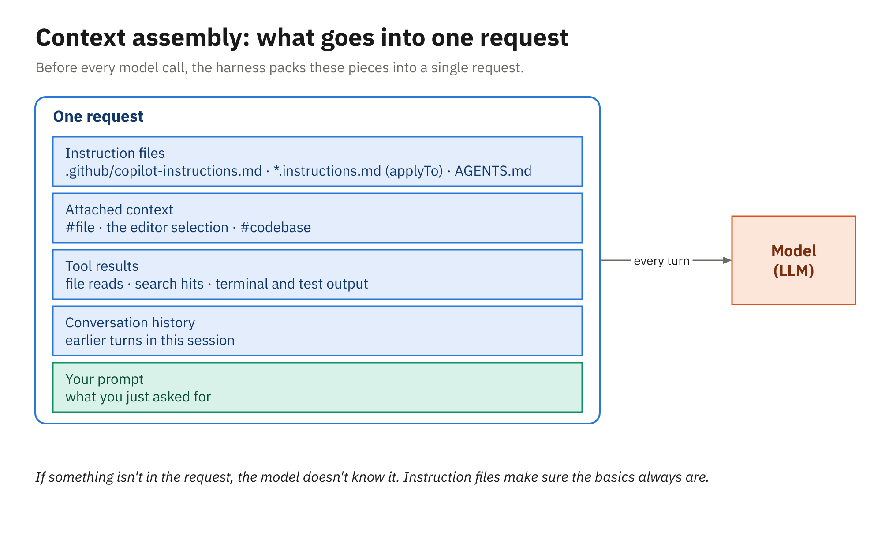

# Chat That Knows the Project

A model can only reason about what's in its request, so the quality of a chat answer depends heavily on
which slice of your project the harness put in front of it. A generic question gets a generic answer,
but ask about `LateFeeCalculator.Calculate` with the file attached and you'll get an explanation of *your*
grace period, *your* student rate, and *your* fee cap. This chapter is about giving chat that context
on purpose, and about the built-in actions for explaining, fixing, testing, and documenting code.

---

## Opening chat in VS Code

Copilot Chat is built into VS Code (since version 1.116), so there's nothing extra to install. To sign
in, hover over the Copilot icon in the Status Bar and choose **Use AI Features**. These are the
shortcuts you'll use most on Windows:

| Shortcut | Opens |
|---|---|
| `Ctrl+Alt+I` | The Chat view |
| `Ctrl+N` (in the Chat view) | A new chat session |
| `Ctrl+I` | Inline chat, in the editor or the integrated terminal |
| `Ctrl+Shift+Alt+L` | Quick Chat |

The Chat view's session controls let you choose the harness (**Session Target**), the **Agent**, the
**Language model**, and the **Permissions** level. For questions about code, pick the **Ask** agent,
which is read-only. It can read and search, but it won't edit anything.

---

## What goes into one request

Every time you press Enter, the harness assembles a request from several sources. Some you add
explicitly and some arrive on their own:

- the repository's instruction files, such as `.github/copilot-instructions.md` (Module 2)
- *implicit context*: the active file or your current selection, depending on the harness and your
  settings
- anything you attached explicitly with `#` references, **Add Context**, or drag and drop
- results from tools the model called while answering, such as a `#codebase` search
- the earlier turns of the conversation



*The harness rebuilds the request on every turn from instructions, attachments, tool results, and history.*

The last item explains a common surprise. A long conversation drags all its earlier turns along with
it, including the wrong turns, so starting a new chat (`Ctrl+N`) when you change topic often gives a
cleaner answer than continuing the old one.

---

## Adding context explicitly

Type `#` in the chat box to attach context. The built-in items cover most needs:

| Reference | Attaches |
|---|---|
| `#<file>` or `#file` | A specific file, such as `#LateFeeCalculator.cs` |
| `#<folder>` | A folder |
| `#<symbol>` | A class or method, such as `#LoanPolicy` (open its file first) |
| `#selection` | The code highlighted in the editor |
| `#codebase` | A search across the whole workspace for whatever the question needs |
| `#terminalSelection` | Text selected in the terminal |
| `#fetch` | A web page |

You can also use **Add Context**, or drag files, images, error messages, and GitHub issues straight into
the chat box.

Here are two prompts against the library sample. The first targets one file, and the second lets the
harness search for the answer:

```text
#LateFeeCalculator.cs Explain Calculate. Which member types pay what, when does the grace
period apply, and what's the most a single loan can cost?
```

```text
#codebase Where is the number of books a member can borrow decided, and does it depend on
the type of membership?
```

### `@workspace` is deprecated

Older Copilot material leans on *chat participants* such as `@workspace`, `@vscode`, and `@terminal`.
They're deprecated and aren't supported in the Copilot harness. Where you'd once have written
`@workspace`, use `#codebase` instead.

---

## Inline chat

Inline chat (`Ctrl+I`) opens a small prompt right in the editor, scoped to the code around your cursor
or to your selection. It's the quickest way to ask about, or change, a few lines without leaving the
file. The same shortcut opens inline chat in the integrated terminal, which is handy for "what does
this error mean?" or "write the command that runs only the domain tests."

---

## Built-in actions: slash commands

Slash commands are shortcuts for the jobs developers ask for most. Type `/` in the chat box or in inline
chat to see them.

| Command | What it does |
|---|---|
| `/explain` | Explains the selected code or the attached file |
| `/fix` | Proposes a fix for a problem in the selection |
| `/tests` | Generates tests for the selected code |
| `/doc` | Writes doc comments (in editor inline chat) |
| `/plan` | Writes a plan before any code changes |

You can add instructions after a command, and you should, because the model needs to know your test
framework and conventions. In the .NET sample, select `Calculate` in `LateFeeCalculator.cs`, press
`Ctrl+I`, and type:

```text
/tests Use xUnit v3. One [Theory] per rule, with [InlineData] for each member type.
```

In the Java sample, the equivalent is:

```text
/tests Use JUnit 6 and AssertJ. Use @ParameterizedTest with @CsvSource for each member type.
```

### Smart actions in the editor

The editor's context menu offers the same help without typing a command. Select some code, right-click,
and choose **Generate Code > Generate Tests** to generate tests, or **Generate Code > Review** to have
Copilot review the selection, with its comments appearing inline and in the **Comments** panel.

---

## Running what chat gives you

A generated test isn't finished until it has run. Add it to the right test project and run the suite:

```powershell
dotnet test                 # .NET: xUnit v3 on Microsoft Testing Platform
.\mvnw.cmd test             # Java: JUnit 6 through the Maven Wrapper (Windows)
```

```bash
./mvnw test                 # Java on macOS or Linux
```

A test that chat produced for the student rate might look like this:

```csharp
[Fact]
public void Calculate_Student_PaysHalfRate()
{
    var due = new DateOnly(2026, 6, 15);

    // Five days late: 5 × 0.25 × 0.5 = 0.625, rounded to 0.63.
    Assert.Equal(0.63m, new LateFeeCalculator().Calculate(due, due.AddDays(5), MemberType.Student));
}
```

```java
@Test
void calculate_student_paysHalfRate() {
    LocalDate due = LocalDate.of(2026, 6, 15);

    // Five days late: 5 × 0.25 × 0.5 = 0.625, rounded to 0.63.
    assertThat(new LateFeeCalculator().calculate(due, due.plusDays(5), MemberType.STUDENT))
            .isEqualByComparingTo("0.63");
}
```

Check the expected values yourself before you trust a green run. A generated test describes what the
code does *today*, so if the code has a bug the test can quietly enshrine it. Compare the numbers
against the rule's real source (board policy LIB-12, or the person who owns the rule), not just against
the implementation the model read.

---

## Prompts that use context well

A few habits make chat noticeably more useful on a real codebase:

- Name the file or symbol with `#`, rather than describing it in words.
- Say which framework and conventions to follow (xUnit `[Theory]`, JUnit `@ParameterizedTest`).
- Ask for an explanation before you ask for code, so you can catch a misunderstanding early.
- Say what "done" means, such as "the test compiles and passes under `dotnet test`."
- Start a new chat when you change topic.

Once you find yourself typing the same conventions into every prompt, move them into an instruction
file. That's the first topic of Module 2.

---

## Summary

- The harness builds each request from instruction files, implicit context, explicit attachments, tool
  results, and history; better context gives better answers.
- Attach context with `#` references (`#<file>`, `#selection`, `#codebase`, and others), **Add
  Context**, or drag and drop.
- Chat participants such as `@workspace` are deprecated and unsupported in the Copilot harness; use
  `#codebase`.
- `Ctrl+I` opens inline chat in the editor or terminal; `Ctrl+Alt+I` opens the Chat view.
- `/explain`, `/fix`, `/tests`, and `/doc` cover the common jobs, and **Generate Code > Generate Tests**
  does the same from the context menu.
- Run every generated test, and check its expected values against the rule, not just the code.
