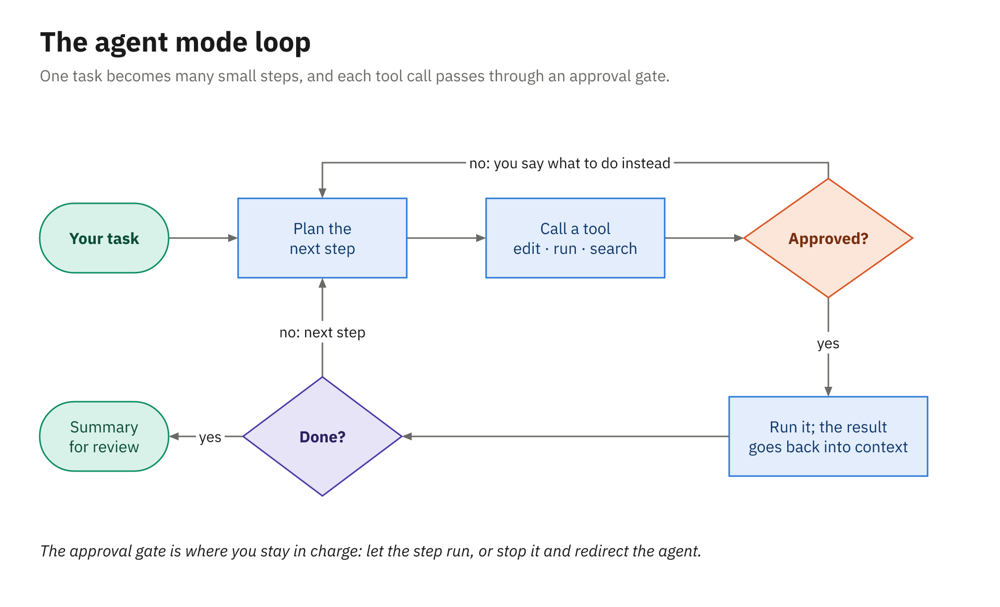

# Agent Mode

Where chat explains code, agent mode changes it: you describe a task, and the agent reads the code it
needs, edits files, runs the build and the tests, reads the output, and keeps going until the task is
done or it needs you. It's the agent loop from Module 1 running on your machine, inside the editor you
already use, with you holding the approval button.

---

## Starting an agent session

Open the Chat view (`Ctrl+Alt+I`) and look at the session controls along the chat box:

| Control | What it picks | For this module |
|---|---|---|
| Session Target | The harness, set before the first prompt of a session | Copilot (the default) |
| Agent | The agent: Ask is read-only, Plan (or `/plan`) writes a plan for review first | Agent |
| Language model | The model, as Module 1 described | Auto, or your choice |
| Permissions | How much the agent may do without asking (covered below) | Manual permissions |

Copilot harness sessions also list **Autopilot** as an agent mode (in Local sessions it's a permission
level instead). Leave it alone until you've watched a few ordinary agent runs on the codebase. If older
material sends you looking for a separate Edit mode, it's gone; the Agent covers that work now.

A good first task is small, specific, and checkable. In the library sample, the instructor demo uses
this one:

```text
Add a rule to LoanPolicy: a member who owes more than 10.00 in fines can't borrow.
Report it as a new PolicyCodes violation, and add unit tests for both sides of the limit.
Run the tests when you're done.
```

---

## How a task is planned and carried out

A typical run starts by reading and searching rather than writing: it looks for `LoanPolicy`, opens it
alongside `PolicyCodes` and the existing `LoanPolicyTests`, and works out where the new rule belongs.
On a larger task it may keep a to-do list as it goes. Then it edits, runs the tests, reads the
failures, and edits again.



*Each step is a tool call; the approval gate decides whether it runs now, asks you, or is refused.*

If you'd rather see the plan before anything changes, start with the **Plan** agent (or type `/plan`),
review the plan, and then let the agent carry it out.

---

## The tools the agent calls

Every action the agent takes is a tool call. VS Code's tools reference lists the built-in tools by
group. These are the Local harness names, and the Copilot harness doesn't always use the same ones;
type `#` in the chat input to see what your session actually has.

| Group | Tools | What the agent uses them for |
|---|---|---|
| Read and search | `#read/readFile`, `#search/codebase`, `#search/textSearch`, `#search/usages` | Finding and reading the code a task touches |
| Edit | `#edit/editFiles`, `#edit/createFile`, `#edit/createDirectory` | Changing code and adding new files |
| Run | `#execute/runInTerminal`, `#execute/getTerminalOutput`, `#execute/testFailure` | Building, running tests, reading results |
| Track and delegate | `#todos`, `#agent/runSubagent` | Keeping a task list; handing a subtask to a subagent |
| Web and GitHub | `#web/fetch`, `#githubRepo` | Reading a web page or another repository |

There's no dedicated "run tests" tool in that list. The agent runs your tests the way you would, by
running `dotnet test` or `.\mvnw.cmd test` in the terminal, which is why the terminal approval settings
below matter so much.

---

## How approvals work

The **Permissions** control sets the overall level for a session:

| Level | What it does |
|---|---|
| Manual permissions (default) | Uses your tool, URL, and terminal approval settings, and asks when they don't cover a call |
| Assisted permissions | Uses an LLM judge to assess each tool call; needs Folder isolation; not available in Local sessions |
| Allow all | Runs every tool call without confirmation |

Worktree sessions always run with Allow all. In this course, stay on Manual permissions so you see each
step.

When the agent asks, you can approve a single use or grant approval for the session, the workspace, or
all future invocations of that tool. The exact button labels change between builds, but those four
scopes are the choice you're making. Approving `dotnet test` for the session is reasonable; approving an
arbitrary shell command for all future invocations is not. The commands **Chat: Manage Tool Approval**
and **Chat: Reset Tool Confirmations** show and clear what you've approved so far.

### Settings worth knowing

| Setting | Default | What it controls |
|---|---|---|
| `chat.tools.terminal.autoApprove` | An object (`rm`, `curl`, and others set to `false`) | Which terminal commands run without asking; regular expressions allowed; read-only commands auto-run |
| `chat.tools.edits.autoApprove` | `{}` | Glob patterns for which files need your approval before the agent edits them |
| `chat.tools.eligibleForAutoApproval` | `[]` | Experimental; set a tool to `false` to always require approval for it |
| `chat.tools.global.autoApprove` | `false` | Auto-approves everything and disables critical security protections; leave it off |
| `chat.agent.maxRequests` | `25` | The maximum number of requests the agent can make |

For example, this lets the agent run the .NET test suite without stopping each time, while still
asking before `rm` or `curl`:

```jsonc
// settings.json
"chat.tools.terminal.autoApprove": {
  "dotnet test": true,
  "rm": false,
  "curl": false
}
```

VS Code can also run the agent's terminal commands in a sandbox (`chat.agent.sandbox.enabled`, off by
default; Copilot sessions offer **Sandboxing for terminal** in the permissions picker). It's Preview on
macOS, Linux, and WSL2 and Experimental on Windows, so treat it as a bonus rather than a guarantee.

---

## Reviewing the result: Keep, Undo, and checkpoints

The agent's edits are written to disk as it works, so your tests already run against them, but VS Code
tracks them as *pending* until you decide. **Keep** accepts the changes and clears their pending state,
and **Undo** reverts them without rewinding the conversation. Staging a file in Source Control keeps
its pending edits automatically.

To go further back, hover an earlier request in the chat and choose **Restore Checkpoint**. VS Code
puts your files back the way they were at that point and drops the later requests (checkpoints are on
by default through `chat.checkpoints.enabled`). They don't undo terminal commands, network calls, or
deployments, so a checkpoint can't take back a package the agent installed or a push it made.

Two habits make review easy. Commit before you start a session, so `git diff` shows exactly what the
agent changed. Then read that diff in Source Control the way you'd read a colleague's pull request,
including the tests, and keep or undo file by file.

---

## Reading the session log

When a result surprises you, look at what actually happened. VS Code gives you two views.

The **Chat Debug view** shows, for each model call, the system prompt, the user prompt, the context that
was attached, the response, and the tool responses. Open it from the Chat view's overflow menu with
**Show Chat Debug View**, with **Developer: Show Chat Debug View** in the Command Palette, or with
`/debug`. It's the place to confirm that your instruction files were loaded and that the agent read the
files you expected.

The **Agent Debug Logs** panel (Preview) summarizes a whole session: tool calls, tokens, errors, and
duration, plus an Agent Flow Chart of the steps. Open it from the "..." menu with **Show Agent Debug
Logs** or with **Developer: Open Agent Debug Logs**. For Copilot harness sessions, capture depends on
the experimental `chat.agentHost.agentDebugLog.enabled` setting, which isn't retroactive, so turn it on
before the session you want to inspect.

You can also ask the model to read the logs for you with `/troubleshoot`, followed by a question such
as "why didn't you run the tests?"

---

## Scoping a task well

The agent's results depend more on the task than on anything else you control. Compare these:

```text
Improve the loan rules.
```

```text
In LoanPolicy, block borrowing when a member owes more than 10.00 in fines. Use a new
PolicyCodes constant, test both sides of the limit, and run dotnet test.
```

The second names the class, the rule, the limit, how to report it, and what "done" means, and it's
small enough to review in one sitting. When a task needs more than a screenful of explanation, split it
into several sessions or ask the **Plan** agent for a plan first. When you find yourself repeating the
same conventions in every prompt ("use a `[Theory]`," "update the changelog"), it's time for a
repository instructions file, which is the next chapter.

---

## Summary

- Start agent mode from the Chat view: Session Target **Copilot**, agent **Agent**, a model, and a
  permission level.
- The agent plans by reading and searching, then calls tools to edit files, run terminal commands, and
  run the tests, repeating until it's done or reaches `chat.agent.maxRequests`.
- Manual permissions (the default) asks according to your approval settings; Assisted uses an LLM
  judge; Allow all asks nothing.
- Approvals can cover one use, the session, the workspace, or all future invocations.
- Pending edits are kept or undone with **Keep** and **Undo**; **Restore Checkpoint** rewinds files but
  not terminal commands or network calls.
- The Chat Debug view and Agent Debug Logs show what the harness sent and which tools ran.
