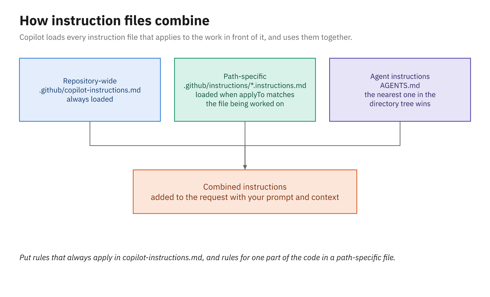

# Repository Instructions

Every new developer on the library team hears the same short lecture in their first week. Tests use
xUnit theories (or JUnit parameterized tests on the Java side), error codes live in `PolicyCodes` and
are never renumbered, money is never a `double`, and every change gets a line in `CHANGELOG.md`.
Copilot needs that lecture too, and *repository instructions* are how you give it once instead of
retyping it into every prompt. They're plain Markdown files in the repository, so they're reviewed,
versioned, and shared like any other code.

---

## Three kinds of instruction file

| File | Scope | Loaded when |
|---|---|---|
| `.github/copilot-instructions.md` | The whole repository | On every request in the repository |
| `.github/instructions/NAME.instructions.md` | Files matching its `applyTo` glob | When the work involves a matching file |
| `AGENTS.md` (one or more) | Its directory and everything below it | For work in that part of the tree; the nearest file takes precedence |



*Repository-wide, path-specific, and agent instruction files are combined into one set of instructions.*

---

## Repository-wide: `.github/copilot-instructions.md`

This is the file to write first. Put in it what any change to the repository needs to know: how the
code is organized, the conventions a reviewer would insist on, and the commands that prove a change
works. Here's the .NET version the instructor uses in the Module 2 demo (shortened slightly):

```markdown
# Library lending service — instructions for Copilot

This is an ASP.NET Core minimal API on .NET 10. Business rules live in `src/Library.Domain` and have no
web dependencies. Money is always `decimal`, and dates come from the injected `TimeProvider`.

## Loan rules
- Every borrowing rule lives in `LoanPolicy.CanBorrow` and reports a `PolicyViolation`. Never throw.
- Every new rule gets a new constant in `PolicyCodes`, numbered after the last one (`LIB003`, …).
- Put a rule's limit in a named `public const` on `LoanPolicy`.

## Tests
- Tests use xUnit v3 (`[Fact]`, `[Theory]` + `[InlineData]`). Name them `Method_Scenario_Expected`.
- Test both sides of every limit in one `[Theory]`. Assert on violation codes, not message text.

## Every change
- Add a line to `CHANGELOG.md` under `## [Unreleased]`.
- Run `dotnet test` and make sure it passes before you say you're done.
```

The Java version says the same things in Java terms: money is `BigDecimal`, "today" comes from the
injected `Clock`, limits are `public static final` fields, and the tests section reads:

```markdown
## Tests
- Tests use JUnit 6 and AssertJ. Name them `method_scenario_expected`.
- Test both sides of every limit in one `@ParameterizedTest` (`@CsvSource`).
- Run the tests (`.\mvnw.cmd test` on Windows, `sh ./mvnw test` elsewhere) before you say you're done.
```

Notice what the file doesn't contain. There's no essay on clean code and no list of generic best
practices the model already knows. Every line is specific to this repository and checkable in a diff,
which is what makes the difference visible when you rerun a task with and without it.

---

## Path-specific: `*.instructions.md` with `applyTo`

Some guidance only matters for part of the repository. Path-specific files live in (or below)
`.github/instructions/`, their names must end in `.instructions.md`, and their front matter says which
files they apply to:

```markdown
---
applyTo: "tests/**"
---

# Writing tests in this repository

- Use the real in-memory stores (`InMemoryBookCatalog`, `InMemoryMemberDirectory`,
  `InMemoryLoanRepository`) instead of mocks. There's no mocking library here.
- Control "today" with the `FixedClock` test helper; never depend on the real date.
- One behavior per test. If a test needs the word "and" in its name, split it.
```

The Java project's equivalent uses `applyTo: "src/test/**"` and points at `MutableClock`. An `applyTo`
value can list several globs separated by commas, such as `applyTo: "src/**/*.cs,tests/**/*.cs"`.

Two more front matter fields are worth knowing. In VS Code, `description` (with an optional `name`)
lets the agent load a file on demand when the description fits the task. On GitHub, `excludeAgent`
keeps a file away from one of GitHub's agents; its value is either `"code-review"` or `"cloud-agent"`,
and without it both agents use the file:

```markdown
---
applyTo: "src/**"
excludeAgent: "cloud-agent"
---

# Review checklist for policy code
- Flag any new rule that throws instead of returning a PolicyViolation.
- Flag a bare number in a limit check; limits are named constants.
```

When a path-specific file and the repository-wide file both apply, Copilot uses both.

---

## `AGENTS.md`

`AGENTS.md` is an open convention for agent instructions that many harnesses read. OpenCode and Kiro
both read it, which makes it the most portable choice if your team uses more than one tool. You can have several: put one at the repository root and others in subfolders, and for work in a
given folder the nearest `AGENTS.md` in the directory tree takes precedence.

```text
library-dotnet/
├── AGENTS.md                    # build and test commands, solution layout
└── src/Library.Api/AGENTS.md    # the nearest file for work on the HTTP endpoints
```

GitHub also accepts a single `CLAUDE.md` or `GEMINI.md` at the repository root in place of
`AGENTS.md`. If you're choosing between `AGENTS.md` and `.github/copilot-instructions.md` for shared
conventions, check the table below: Copilot Chat on GitHub.com reads the repository-wide file but not
the agent files.

---

## How the files combine

In VS Code, Visual Studio, and the Copilot CLI, Copilot combines every applicable instruction file
"without defining a general precedence order." Nothing falls back by priority, and the CLI loads
identical duplicates only once. Copilot Chat on GitHub.com does rank its sources, from highest to
lowest: personal instructions, then repository instructions (path-specific, then repository-wide,
then agent instructions), then organization instructions.

The practical consequence is that you shouldn't let two files disagree. If `copilot-instructions.md`
says "name tests `Method_Scenario_Expected`" and an `AGENTS.md` says something else, there's no rule
that picks a winner, and you'll get whichever the model happens to weigh more.

---

## Which surfaces read which files

GitHub publishes a support table. These are the rows that matter for this course:

| Surface | Repo-wide | Path-specific | Agent files (`AGENTS.md`, `CLAUDE.md`, `GEMINI.md`) |
|---|---|---|---|
| VS Code chat and agent mode | Yes | Yes | `AGENTS.md` only |
| Copilot CLI | Yes | Yes | Yes |
| Copilot cloud agent | Yes | Yes | Yes |
| Copilot code review on GitHub.com | Yes | Yes | Yes, plus `REVIEW.md` |
| Copilot Chat on GitHub.com | Yes | No | No |
| Code review in VS Code | Yes | No | No |

Personal instructions are read by GitHub.com chat and the CLI (`$HOME/.copilot/copilot-instructions.md`),
and organization instructions (Business and Enterprise) by GitHub.com chat, the cloud agent, and code
review. Code review has a couple of twists of its own, such as reading instructions from the pull
request's head branch; Module 3 covers them.

Keep instructions in files rather than editor settings. VS Code's docs call custom locations in the
`chat.instructionsFilesLocations` setting "not recommended for Copilot workflows," because the CLI and
the Copilot app don't read editor settings.

---

## Checking what loaded, and generating a first draft

Before you trust an instruction file, confirm that the harness picked it up:

- In VS Code, expand **References** on a response to see which instruction files were included, and
  look at the system prompt in the Chat Debug view to see their text.
- In the CLI, `copilot instruction list` shows every source it found, `/instructions` toggles files on
  and off, and `/env` shows everything loaded for the session.

```powershell
copilot instruction list
```

You don't have to start from a blank page. In the CLI, `/init` (or `copilot init`) analyzes the
codebase with read-only tools and writes a `.github/copilot-instructions.md`. On GitHub.com, opening
`github.com/copilot/agents` and giving the documented onboarding prompt produces the file as a draft
pull request. In VS Code, `/init` and `/create-instructions` exist only in the Local harness, but in
any harness you can simply ask the agent to draft the file. Whichever you use, treat the result as a
draft and cut it down to what's specific and checkable.

---

## Summary

- `.github/copilot-instructions.md` applies to every request in the repository; write it first.
- `.github/instructions/NAME.instructions.md` files apply to paths matching `applyTo`, and
  `excludeAgent` (`"code-review"` or `"cloud-agent"`) keeps one away from a GitHub agent.
- `AGENTS.md` files are portable across harnesses, and the nearest one in the tree takes precedence.
- VS Code and the CLI combine all applicable files with no precedence order, so don't let them
  contradict each other.
- Surfaces differ in what they read; GitHub's support table is the reference.
- Confirm loading with **References** or the Chat Debug view in VS Code, or with
  `copilot instruction list` in the CLI, and use `/init` in the CLI for a first draft.
