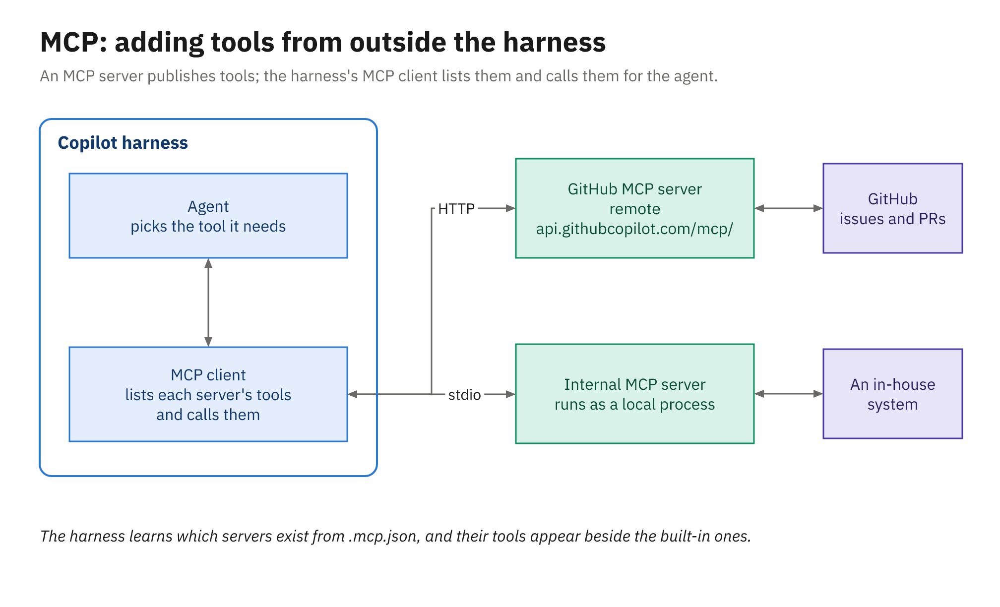

# MCP Servers

The built-in tools cover what's on your disk: reading and editing files, searching the code, and running
commands. Most real work also depends on systems outside the repository, such as the issue a change is
for, the pull request it'll land in, or the internal service that owns a business rule. MCP servers are
how you give the agent tools for those systems, and the same configuration file works in VS Code and in
the Copilot CLI.

---

## What MCP is

The **Model Context Protocol** (MCP) is an open protocol for plugging tools into an AI harness. An *MCP
server* is a small program that offers a set of tools, each with a name, a description, and the inputs it
takes. The harness acts as the *MCP client*: it starts or connects to each configured server, adds the
server's tools to the list it shows the model, and forwards any tool call the model makes to the right
server.

Servers reach the harness in one of two ways. A **local** (stdio) server is a process the harness starts
on your machine and talks to over standard input and output. A **remote** server is a web endpoint the
harness calls over HTTP.



*The harness is the MCP client; each server adds tools, and every call still passes through the harness's approvals.*

Because MCP tools are ordinary tools as far as the harness is concerned, they go through the same
approval settings as everything else. A server that can write to an external system deserves the same
caution as a terminal command.

---

## The GitHub MCP server

GitHub publishes an open-source (MIT) MCP server for GitHub itself. Its remote endpoint is:

```text
https://api.githubcopilot.com/mcp/
```

Its default toolsets are `context`, `repos`, `issues`, `pull_requests`, and `users`, and the remote server
also offers `copilot_spaces` and `github_support_docs_search`. An optional `copilot` toolset includes tools such
as `assign_copilot_to_issue` and `request_copilot_review`, which let an agent in your editor hand an issue
to the cloud agent or ask for a code review.

You can narrow what it exposes by choosing a different URL:

| URL | Exposes |
|---|---|
| `https://api.githubcopilot.com/mcp/` | The default toolsets |
| `https://api.githubcopilot.com/mcp/readonly` | The default toolsets, read-only |
| `https://api.githubcopilot.com/mcp/x/issues` | Only the `issues` toolset |
| `https://api.githubcopilot.com/mcp/x/issues/readonly` | Only the `issues` toolset, read-only |

Headers such as `X-MCP-Toolsets`, `X-MCP-Tools`, and `X-MCP-Readonly` do the same job. There's also a
local build as a Docker image (`ghcr.io/github/github-mcp-server`) with `--read-only` and `--toolsets`
flags.

You don't always have to configure it. The Copilot CLI has a GitHub MCP server built in and on by
default, and the cloud agent has it enabled by default too.

---

## Configuring servers: the portable `.mcp.json`

VS Code and the Copilot CLI can read the same file, `.mcp.json` at the root of the workspace, with a
top-level `mcpServers` key. This is the file the Module 2 demo and activity add to their sample
repositories:

```json
{
  "mcpServers": {
    "github": {
      "type": "http",
      "url": "https://api.githubcopilot.com/mcp/"
    }
  }
}
```

There are a few places a configuration can live, and they don't all use the same format:

| File | Top-level key | Read by |
|---|---|---|
| `.mcp.json` at the workspace root | `mcpServers` (portable) | VS Code's Copilot harness directly, and the Copilot CLI |
| `~/.copilot/mcp-config.json` | `mcpServers` (portable) | VS Code's Copilot harness and the CLI, for every workspace |
| `.github/mcp.json` | `mcpServers` | The Copilot CLI only (its docs suggest it for committed configuration, but VS Code doesn't read it) |
| `.vscode/mcp.json` or the user profile's `mcp.json` | `servers` (VS Code format) | VS Code, which forwards eligible servers to Copilot harness sessions |

The VS Code format is older and supports more, including `inputs` (prompts for values, referenced as
`${input:id}`), `envFile`, and a `sandbox` section. But the agent doesn't read `.vscode/mcp.json`
directly, the CLI doesn't read it at all, and VS Code's **MCP: Add Server** flow now labels it a
deprecated destination. Servers that need interactive inputs aren't forwarded to the Copilot harness.
For anything you want shared across surfaces, use `.mcp.json`. For comparison, the VS Code format of
the same server looks like this:

```jsonc
// .vscode/mcp.json (VS Code's own format, key "servers")
{
  "servers": {
    "github": { "type": "http", "url": "https://api.githubcopilot.com/mcp/" }
  }
}
```

In VS Code, **MCP: Add Server** walks you through adding an HTTP or command (stdio) server, searching
`@mcp` in the Extensions view browses a gallery of servers, and in a Copilot harness session `/mcp`
manages servers from the Chat view. In the CLI, `/mcp` manages servers during a session and
`copilot mcp list` shows what's configured; workspace configuration loads only in folders you've
trusted.

```powershell
copilot mcp list
```

---

## Adding an internal system

MCP is most useful when the tools come from your own systems. Suppose the library board
keeps its policies (LIB-12 for late fees, and others) in an internal service, and your platform team has
written a small MCP server for it in .NET. A local server entry in `.mcp.json` would look like this:

```json
{
  "mcpServers": {
    "github": {
      "type": "http",
      "url": "https://api.githubcopilot.com/mcp/"
    },
    "board-policies": {
      "type": "stdio",
      "command": "dotnet",
      "args": ["run", "--project", "tools/BoardPolicies.Mcp"],
      "env": { "POLICY_API_TOKEN": "${POLICY_API_TOKEN}" },
      "tools": ["get_policy", "search_policies"]
    }
  }
}
```

The `board-policies` server is an illustration, not part of the sample repositories. A Java team would
point `command` at `java` with `"args": ["-jar", "tools/board-policies-mcp.jar"]` instead. Three details
are worth copying into real configurations:

- The token comes from an environment variable through `${POLICY_API_TOKEN}` (the portable format also
  accepts `${NAME:-default}`), so no secret is ever committed to the repository.
- `tools` lists exactly the tools the agent may use, and the CLI and the cloud agent both enforce it.
  Allowlisting read-only tools is a good default.
- `"stdio"` marks a server the harness starts as a process, and every surface in this course accepts
  it (the CLI and the cloud agent also take `"local"`, which means the same thing). A remote internal
  server would use `"type": "http"` with a `url` and optional `headers`.

Once the server is configured, a prompt such as *"Check LateFeeCalculator against the current text of
policy LIB-12 using the board-policies tools"* gives the agent the source of truth rather than just the
code. In the CLI you can also allow or deny MCP tools by name, for example
`--allow-tool='board-policies(get_policy)'`, and a deny rule always wins; Module 4 covers the syntax.

---

## Governance

MCP servers run code and reach other systems, so organizations control them centrally:

- The **MCP servers in Copilot** policy decides whether MCP runs at all, across clients.
- Enterprises can publish allowlists and denylists of servers in `managed-settings.json`
  (`allowedMcpServers` and `deniedMcpServers`). This is the recommended mechanism, and the Copilot app,
  the CLI, and VS Code enforce it.
- Restricting servers to those in a registry is also possible, but it's in public preview and GitHub
  says it's "not the recommended method."

If a server you configured doesn't appear, check these policies before you debug the JSON.

---

## MCP for the cloud agent lives in repository settings

The cloud agent runs on GitHub, so you configure its MCP servers there too, in the repository's
**Settings → Copilot → MCP servers**: paste JSON into the **MCP configuration** box and choose **Save MCP
configuration**. The format is close to the portable one, with two stricter rules: every server must
have a `type` (`local`, `stdio`, `http`, or `sse`) and a `tools` allowlist (`"*"` means all, though
GitHub strongly recommends allowlisting read-only tools).

```json
{
  "mcpServers": {
    "board-policies": {
      "type": "stdio",
      "command": "dotnet",
      "args": ["run", "--project", "tools/BoardPolicies.Mcp"],
      "env": { "POLICY_API_TOKEN": "${COPILOT_MCP_POLICY_API_TOKEN}" },
      "tools": ["get_policy", "search_policies"]
    }
  }
}
```

A few cloud-specific rules follow from running on GitHub's infrastructure:

- Secrets must be named with the `COPILOT_MCP_` prefix and stored as the repository's **Agents**
  secrets, and they're referenced as `$VAR`, `${VAR}`, or `${VAR:-default}`.
- The GitHub MCP server and the Playwright MCP server are enabled by default. The GitHub server uses a
  specially scoped token with read-only access to the current repository; to widen it, you add a
  `COPILOT_MCP_GITHUB_PERSONAL_ACCESS_TOKEN` secret (a fine-grained token is recommended) or GitHub App
  secrets.
- Remote servers that sign in with OAuth aren't supported here.
- A local server's command has to exist in the agent's environment, and a remote server has to be
  reachable from GitHub's cloud, not just from your office network.
- The cloud agent's firewall applies only to commands the agent runs through its Bash tool, not to MCP
  server processes, so only add servers you trust.

Managed *connectors* (hosted MCP integrations such as Sentry or Linear) are set up from the **Customize**
menu and work in cloud sandbox sessions, but they aren't yet supported in GitHub Actions sessions, which
includes sessions started by assigning an issue. Module 3 returns to the cloud agent's environment.

---

## Summary

- MCP is an open protocol that lets a harness (the MCP client) add tools from MCP servers, local (stdio)
  or remote (HTTP).
- The GitHub MCP server's remote endpoint is `https://api.githubcopilot.com/mcp/`, with read-only and
  per-toolset variants; the CLI and the cloud agent have it on by default.
- `.mcp.json` (key `mcpServers`) is the portable file read by VS Code's Copilot harness and the CLI;
  `.vscode/mcp.json` (key `servers`) isn't read by the agent directly.
- Internal systems plug in the same way, with secrets from environment variables and a `tools`
  allowlist.
- Organizations govern MCP with the **MCP servers in Copilot** policy and enterprise allowlists in
  `managed-settings.json`.
- The cloud agent's MCP servers are configured in repository settings, with `COPILOT_MCP_` secrets and a
  required `type` and `tools` for each server.
