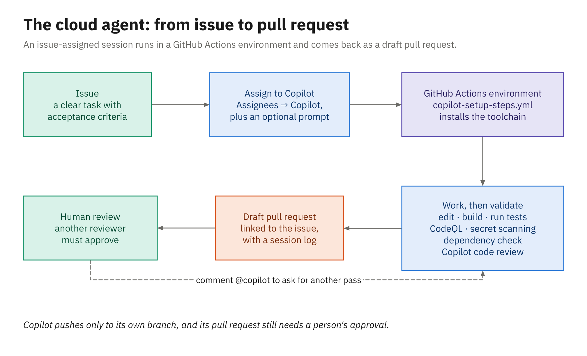

# The Copilot Cloud Agent

Up to now, every Copilot session in this course has run on your own machine with you watching each step.
The Copilot cloud agent moves that work to GitHub: you describe a task in an issue, assign the issue to
Copilot, and the agent works on its own in a GitHub-hosted environment until it has a pull request for you
to review. Because you aren't there to approve each command, the guardrails move as well. They live in the
environment the agent runs in, the firewall around it, and the review its pull request still has to pass.

---

## What the cloud agent is

The product used to be called the *Copilot coding agent*, and you'll still meet that name in older posts
and docs; its current name is **Copilot cloud agent**. On 2026-10-28 GitHub folded it into a
wider experience called **Copilot in the cloud**, which connects sessions across GitHub.com, GitHub Mobile,
the Copilot CLI, the Copilot app, VS Code, Slack, and Teams. A single organization policy, also named
"Copilot in the cloud", now controls access, and the new experience needs a paid Copilot plan.

Behind the names is the harness from Module 1 running somewhere other than your laptop. Cloud sessions have
the same tools as the Copilot CLI and the Copilot app, including Bash, the GitHub CLI, and code search, and
they read the repository instructions and custom agents you wrote in Module 2.

A few ground rules hold wherever a session runs:

- Only people with write access to the repository can trigger it; without write access a session is
  read-only.
- It works only with repositories hosted on GitHub.
- It works on one branch at a time and opens one pull request per task.
- Rulesets and branch protection apply to it, so a rule can block it unless you grant a bypass.

---

## From issue to pull request



*The issue-to-pull-request flow for a session started by assigning an issue.*

Most of this module hangs off that picture. You assign an issue, GitHub prepares a GitHub Actions
environment using your setup steps, and the agent works through the task by reading code, editing files,
building, and running tests. Before it hands the work back, built-in validation checks the changes for
security and quality problems (chapter 2). The result is a draft pull request, and from there it's an
ordinary review, by you and by Copilot code review (chapter 4).

---

## Assigning an issue to Copilot

This module's activity uses the most common way in. Open an issue, find **Assignees** in the sidebar, and
choose **Copilot**. GitHub shows a few more options before anything starts, and each of them shapes the
run:

| Field | What it controls |
|---|---|
| Optional prompt | Extra instructions on top of the issue text |
| Repository | Where the work happens; you need write access and the cloud agent enabled there |
| Starting branch | The branch the work starts from |
| Agent | A custom agent from the repository, or a new one you create |
| Model | The model for this run, plus a reasoning level if the model offers one |

When you confirm, Copilot takes the issue's title, its body, and the comments already on it. It doesn't
pick up comments you add after that point, which matters more than it sounds; chapter 3 covers how to steer
a session once it's running.

---

## Other ways to start a task

Assigning an issue is one of several entry points, and they all hand the task to the same agent. On
GitHub.com you can also start from the **Agents** tab in a repository (or the Agents icon to the right of
the **Go to file** search bar), from the Copilot home page at `github.com/copilot`, with `/task
<description>` in Copilot Chat, or with **Fix with Copilot** on a failing GitHub Actions job. From the
Agents tab or the home page, you pick a repository and an **Environment**, type a prompt (images are fine),
optionally set a base branch, a custom agent, and a model, and select **Start task**.

From a terminal, the GitHub CLI (`gh` 2.80.0 or later) has an `agent-task` command group, still in public
preview. The prompt here is self-contained because there's no issue behind it:

```powershell
gh agent-task create "Add GET /loans/overdue: active loans past their due date, most overdue first" `
    --repo OWNER/library-dotnet --base main
gh agent-task list
gh agent-task view --repo OWNER/library-dotnet 42
```

In bash, replace the trailing backtick with a backslash. To watch a session from the terminal, add `--log
--follow` to `gh agent-task view`. The Copilot CLI has its own route, `/delegate` (or a `&` prefix on a
prompt), which Module 4 covers. Sessions can also start from GitHub Mobile, the IDEs, the REST API, the
GitHub MCP server, tools such as Jira, Slack, Teams, Azure Boards, and Linear, and scheduled or
event-driven automations. VS Code can hand a task to the cloud agent as well, but the control for it has
moved between releases, so look for it on the build you have.

---

## Following sessions in the Agents tab

The **Agents** tab in a repository, added in January 2026, lists every session for that repository, lets
you start, archive, and page through sessions, and links each one to its pull request. For your own work
across repositories, open the Agents panel (it's available from any page on GitHub) or choose **View all
sessions** in the GitHub Copilot menu.

---

## Where a session runs

Since the Copilot in the cloud launch, the prompt box has an **Environment** menu with three choices:
**Cloud** (a GitHub-hosted cloud sandbox, the default for new sessions), **Actions** (a GitHub Actions
runner), and **Environments** (remote machines you've registered). Sessions you start by assigning an issue
still run on GitHub Actions, and that's the environment the demo and the activity use.

| | GitHub Actions session | Cloud sandbox |
|---|---|---|
| Repositories | One per session | Can span repositories in one organization |
| Continue from other clients | GitHub website only | Yes |
| Chat data kept | 28 days | Life of the account |
| Custom setup | `copilot-setup-steps.yml`, self-hosted runners, custom compute and network | Not supported; firewall allowlists still apply |
| Customizations | Instructions, MCP, content exclusions | Adds dotfiles, personal and repository MCP, and connectors |
| Time limit | 59 minutes, which can't be extended | No one-hour cap on total running time |

Size issues for the Actions path with the 59-minute limit in mind, because a task that needs more than an
hour of agent time is really two issues.

---

## Shaping the Actions environment with copilot-setup-steps.yml

An Actions session starts on a runner that knows nothing about your build, and if the agent has to install
the right SDK or download Maven and its plugins before it can run a test, it spends its 59 minutes on
chores. The file `.github/workflows/copilot-setup-steps.yml` handles that up front. It's a GitHub Actions
workflow whose steps run before the agent starts, so the toolchain and dependencies are ready when it
begins. The rules are strict:

- The workflow has a single job, and that job **must** be named `copilot-setup-steps`. Copilot won't pick
  it up under any other name.
- Copilot honors only these job keys: `steps`, `permissions`, `runs-on`, `services`, `snapshot`, and
  `timeout-minutes` (59 at most). Everything else is ignored, and Copilot overrides the `fetch-depth` you
  give `actions/checkout`.
- The file must be on the repository's default branch before it takes effect.
- If a step exits non-zero, the remaining steps are skipped and the agent works with whatever state the
  runner is in.
- It applies only when Copilot runs on GitHub Actions. Cloud sandbox sessions ignore it.
- Runners can be Ubuntu x64 Linux or Windows 64-bit, not macOS. Windows needs a larger or self-hosted
  runner, and the integrated firewall doesn't work on Windows or self-hosted runners.

Every sample in this course ships one. The library app's pair makes a good worked example.

### The .NET sample

```yaml
name: Copilot Setup Steps

on:
  workflow_dispatch:
  push:
    paths:
      - .github/workflows/copilot-setup-steps.yml
  pull_request:
    paths:
      - .github/workflows/copilot-setup-steps.yml

jobs:
  copilot-setup-steps:
    runs-on: ubuntu-latest
    timeout-minutes: 15
    permissions:
      contents: read
    steps:
      - uses: actions/checkout@v7
      - uses: actions/setup-dotnet@v6
        with:
          dotnet-version: "10.0.x"
      - name: Restore NuGet packages
        run: dotnet restore
```

The triggers at the top are for you, not for Copilot. `workflow_dispatch` lets you run the job by hand from
the Actions tab to prove it works, and the `push` and `pull_request` triggers, filtered to the file's own
path, re-run it whenever someone edits it. The job installs the .NET 10 SDK and runs `dotnet restore`, so
every NuGet package the solution pins in `Directory.Packages.props` is on the runner before the agent's
first `dotnet build`. The job only reads code, so `permissions` grants `contents: read` and nothing more.
The sample sets `timeout-minutes` to 15; the documented ceiling is 59.

### The Java sample

```yaml
jobs:
  copilot-setup-steps:
    runs-on: ubuntu-latest
    timeout-minutes: 15
    permissions:
      contents: read
    steps:
      - uses: actions/checkout@v7
      - uses: actions/setup-java@v6
        with:
          distribution: temurin
          java-version: "21"
          cache: maven
      # Downloads Maven itself (through the wrapper), the plugins, and the dependencies.
      - name: Warm the Maven cache
        run: sh ./mvnw -B -q -DskipTests verify
```

The name and triggers match the .NET file. `actions/setup-java` installs Temurin 21 and caches the Maven
repository between runs. The last step runs the Maven Wrapper once: the wrapper downloads the pinned Maven
version, and `verify` pulls every plugin and dependency the build needs. `-DskipTests` keeps the warm-up
quick, `-B` runs Maven in batch (non-interactive) mode, and `-q` keeps the log short.

The step calls `sh ./mvnw` rather than `./mvnw` on purpose. `mvnw` is a shell script, and running it as
`./mvnw` needs the file's executable bit. Git can record that bit, but a copy of the project made on Windows
loses it, and on the Linux runner `./mvnw` then fails with "Permission denied". Handing the script to `sh`
doesn't need the bit at all, which is why the sample's `ci.yml` uses the same form. It's also worth putting
in the repository instructions: on your Windows machine you run `.\mvnw.cmd`, but the agent's runner is
Ubuntu, so the build command it should use is `sh ./mvnw`.

---

## The firewall

By default the agent's internet access goes through a firewall, which you configure under **Settings →
Copilot → Internet access** (an organization can set it for all its repositories). The **Recommended
allowlist** is on by default too, and it covers OS package repositories, container registries, language
package registries, certificate authorities, and the hosts Playwright downloads browsers from. To reach
anything else, add a rule to the **Custom allowlist** and save it.

The firewall applies in both Actions runners and cloud sandboxes, but only to processes the agent starts
through its Bash tool. It doesn't apply to MCP server processes or to your setup steps. That gives you a
clean way to handle a dependency on an internal package feed: restore it in `copilot-setup-steps.yml`
instead of opening the firewall to the agent. When the firewall does block a request, Copilot says so with
a warning in the pull request body or in a comment.

---

## The pull request it returns

When you assign an issue, Copilot opens a **draft pull request** linked to that issue and requests your
review when it's done. Its commits are authored by Copilot, with you, the person who asked, as co-author,
and they're signed. Copilot pushes only to its own branch (a new one whose name starts with `copilot/`), or
to the pull request's branch when you trigger it on an existing pull request.

Your GitHub Actions workflows, including CI, don't run on a Copilot pull request by themselves. Someone
with write access has to select **Approve and run workflows** in the merge box first, and that can be you,
even though you asked for the pull request. The gate is the **Require approval for workflow runs** policy
under Settings → Copilot → Cloud agent, and GitHub advises leaving it on: without it, code nobody has
reviewed runs with your workflows' access to the repository and its secrets. Treat the agent's code the
way you'd treat a pull request from a new contributor and read it before you let it run in your pipeline.

Approving the pull request itself is a different matter. If your branch rules require an approval, the
approval of the person who asked Copilot for the work doesn't count, so someone else has to give it.

A session draws on two budgets. The model's tokens are billed in AI Credits, the usage-based billing Copilot
moved to on 2026-06-01, and the compute comes from a dollar-based GitHub Actions entitlement shared by
standard runners, larger runners, and cloud sandboxes (billing for sandboxes starts in November 2026).

---

## Summary

- The **Copilot cloud agent** (formerly the Copilot coding agent) is the Copilot harness running on GitHub,
  part of the **Copilot in the cloud** experience, which needs a paid plan.
- Assign an issue with **Assignees → Copilot**; the dialog sets a prompt, repository, branch, agent, and
  model. The Agents tab, `github.com/copilot`, `/task`, `gh agent-task create`, and `/delegate` also work.
- Issue-assigned sessions run on **GitHub Actions** with a 59-minute cap; new sessions started elsewhere
  default to a **cloud sandbox**.
- `copilot-setup-steps.yml` prepares the Actions runner: one job named `copilot-setup-steps`, a few honored
  keys, on the default branch. The Java sample calls `sh ./mvnw` so it doesn't need the executable bit.
- The firewall covers the agent's Bash processes, not setup steps or MCP servers.
- The result is a **draft pull request**. Workflows wait for **Approve and run workflows**, which anyone
  with write access can select; the requester's own approval of the pull request doesn't count.
