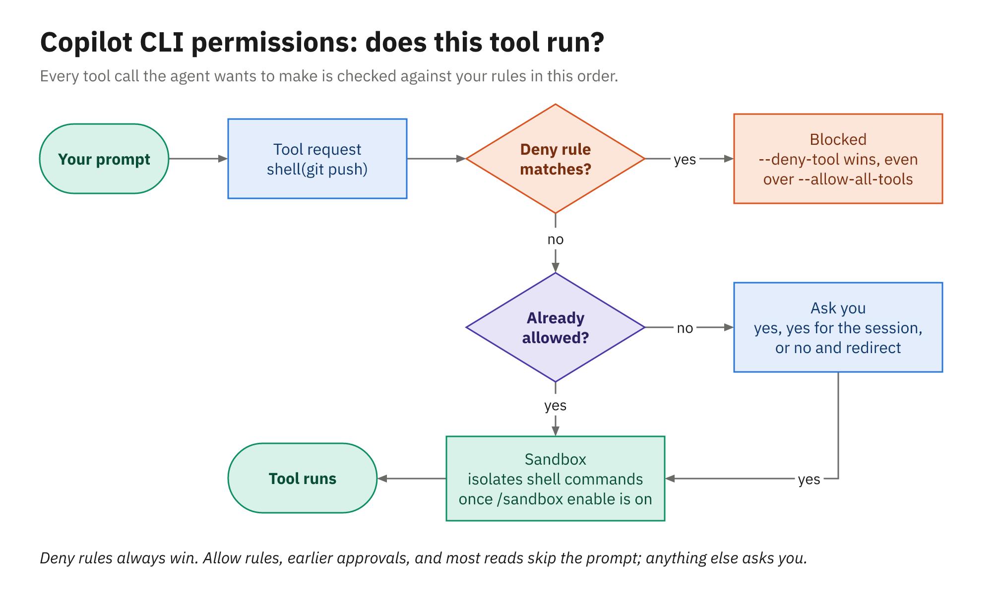

# Permissions and the Sandbox

A Copilot CLI session on your laptop runs with your user account's access. With sandboxing off, which
is the default, a shell command the agent runs can read, write, and delete anything you can, reach any
network your machine can reach, and use whatever credentials sit in your environment. Two separate
layers keep that in check. **Permissions** decide whether a tool call runs at all, and the **sandbox**
limits what a command can touch once it does. You'll use the first layer every day; the second is the
one to switch on before you let the agent run unattended.

---

## What asks for approval

The agent works by calling tools. Read-only work, such as searching, reading files, and running
read-only shell commands, generally goes ahead without asking. The calls that change things or reach
outside the project go through an approval gate: other shell commands, file writes, MCP tool calls,
and URL access. File access is also fenced by default to the current working directory and its
subdirectories, plus the system temp directory, so reaching a sibling folder needs your say-so too.

### The approval prompt

When a call needs approval, the CLI stops and typically shows three choices:

```text
1. Yes
2. Yes, and approve TOOL for the rest of the running session
3. No, and tell Copilot what to do differently (Esc)
```

Option 1 approves this one call. Option 2 stops asking about that tool until the session ends, which
is convenient for something harmless and repetitive, like the test runner, and risky for something
broad: say yes to one `rm` this way and the agent can run any `rm` for the rest of the session.
Option 3 is the one people forget: it declines the call *and* lets you type what the agent should do
instead, such as "don't edit the test, fix the production code", so you steer without starting over.

Approvals you grant with option 2 last only for the running session. Some prompts also offer to stop
asking in this repository, and those approvals are saved in `~/.copilot/permissions-config.json`.
`/reset-allowed-tools` takes back both kinds for the current repository and returns you to manual
mode. When a prompt surprises you, `/diagnose` analyzes the session logs, including why a permission
request needed approval.

### Permission modes

`/permissions` switches between three modes, and `/permissions show` tells you which one you're in.

| Mode | What happens on a tool call |
|---|---|
| `manual` (default) | Reads go ahead; edits, commands, and anything else not already allowed get the approval prompt |
| `assisted` | An LLM judge reviews each request and approves the ones it judges safe |
| `allow-all` | Everything runs without asking (`/allow-all`, alias `/yolo`) |

Assisted mode cuts down on prompts, but the CLI's own help calls the judge probabilistic and "not a
security boundary", so treat it as a convenience rather than a control. `--assisted-approval` starts
a session in that mode. At launch, `--allow-all` (or `--yolo`) is the same as
`--allow-all-tools --allow-all-paths --allow-all-urls` together, which is everything at once.

---

## How a request is decided



*Deny rules are checked first and always win; the sandbox limits what an approved command can touch.*

Follow one request through, say the agent asking to run `git push`. If any **deny rule** matches, the
call is refused, and nothing else matters, not even `--allow-all-tools`. If an **allow rule** matches
(or you approved that tool earlier, or the call is read-only), it runs without a prompt. Otherwise
the **permission mode** decides: in manual mode you get the 1/2/3 prompt, in assisted mode the judge
weighs in, and in allow-all mode it simply runs. Finally, if sandboxing is on, the approved command runs **inside the
sandbox**, where it can only reach the paths and networks the sandbox policy grants.

One step comes before all of this: `--available-tools` and `--excluded-tools` decide which tools the
model can see at all, and the approval flags never expose a tool those filters removed.

---

## Allow and deny rules

`--allow-tool` pre-approves calls that match a pattern, and `--deny-tool` refuses them. Both take a
pattern of the form `kind(argument)`, and both can be repeated.

| Pattern | What it matches |
|---|---|
| `shell` | Every shell command |
| `shell(git:*)` | Any `git` command; `:*` matches by prefix on the command stem, so not `gitea` |
| `shell(git push)` | Exactly `git push` (git and `gh` are matched per first-level subcommand) |
| `shell(dotnet:*)` | Any `dotnet` command |
| `write` | Every built-in file create or edit (not shell redirection) |
| `write(.env)` | Any file named `.env` in any folder; a relative path matches trailing components |
| `MyMCP`, `MyMCP(tool)` | Every tool, or one tool, from the MCP server named `MyMCP` |
| `url(https://*.github.com)` | URL access by the shell and web-fetch tools, protocol-aware |

A few combinations you'll reach for:

```powershell
# Let git run freely, but never push
copilot --allow-tool='shell(git:*)' --deny-tool='shell(git push)'

# Build and test without prompts, and never write a .env file
copilot --allow-tool='shell(dotnet:*)' --deny-tool='write(.env)'

# Allow an internal MCP server, except for one destructive tool
copilot --deny-tool='inventory(delete_item)' --allow-tool='inventory'
```

`write` covers the agent's built-in file tools only. A shell command that redirects output into a file
is a shell call, so `--deny-tool='write'` alone doesn't make a session read-only. Deny the shell
commands you're worried about by name, or use the sandbox's path policy (later in this chapter) to
decide which folders a shell command may write to.

### Paths and URLs

The default path fence (working directory, its subdirectories, and the temp directory) suits a single
repository. When a .NET solution or a Maven build reaches into a sibling checkout, widen it on purpose
rather than switching the check off:

```powershell
copilot --add-dir ..\shared-contracts      # repeatable; /add-dir does the same mid-session
```

`--add-dir` also loads that directory's `.github/skills` and `.github/agents` as trusted
configuration, so add only folders you'd trust as a project. `/list-dirs` shows what's currently
granted, `--allow-all-paths` turns path checking off entirely, and `--disallow-temp-dir` takes away the
automatic temp-directory access.

URL access works the same way with `--allow-url`, `--deny-url` (which wins over an allow), and
`--allow-all-urls`. The rules are protocol-aware, and a bare domain means HTTPS, so approving
`https://example.com` doesn't approve `http://example.com`:

```powershell
copilot --allow-url=docs.spring.io --allow-url=learn.microsoft.com
```

---

## Previewing before anything runs

Seeing the agent's intent before it acts is the cheapest safety measure you have, and the CLI gives
you several ways to do it. They combine well:

- Plan mode (Shift+Tab, `/plan`, or `--plan`) makes the agent write an implementation plan before it
  edits anything. Read it, correct it, and then switch back to standard mode to carry it out.
- Approving step by step in manual mode, choosing option 1 each time, shows you every edit and every
  command that needs approval as it comes up. It's slower, and it's the right speed for a bug you
  don't understand yet.
- Declining with option 3 turns a bad proposal into a better one without abandoning the session.
- `/diff` shows everything that changed in the working directory before you commit, and `/rewind`
  reverts the last turn's file changes if the turn went wrong.

Keep in mind what `/rewind` can't do: it reverts files, but a command that already pushed a branch or
called an external service has had its effect. That's the practical argument for denying `git push`
until you're ready, and for approving it yourself when you are.

---

## The local sandbox

Command sandboxing is available to everyone and is **off by default**. Turn it on with
`/sandbox enable`, which persists to your settings, or with `--sandbox` for a single session.
`/sandbox` on its own shows the status and opens a dialog for the policy, and `/sandbox disable` turns
it off again. Your organization's managed policy can require it.

When it's on, shell commands run inside an operating-system sandbox built on Microsoft Execution
Containers (MXC): Seatbelt on macOS, bubblewrap on Linux (`bwrap` 0.5.0 or later, plus `slirp4netns`
and a few other tools), and ProcessContainer with BaseContainer on Windows. On Windows that means
Windows 11 version 25H2 with update KB5124010 or later, or version 26H1 with KB5124006 or later
(`https://aka.ms/ghcp-sandbox-os-support`); Windows Server isn't on the list. If a host can't run the
sandbox, sandboxed commands fail rather than silently running unprotected.

When your machine can't run the local sandbox, the other way to keep the agent's commands off it is to
run the whole session in the cloud. `copilot --cloud` starts an interactive session inside a cloud
sandbox that GitHub creates, which chapter 5 describes.

| Area | The starting policy when you enable it |
|---|---|
| Filesystem | Your working directory, PATH directories, the temp directory, and your user profile; everything else is blocked unless you add it |
| Network | Separate switches for outbound connections and for the local network (both start out allowed) |
| Credentials | `git` and `gh` authenticate through a local masking proxy, so sandboxed tools never see the real token |
| MCP and LSP servers | Optionally spawn local (stdio) servers inside the sandbox too; remote servers are never sandboxed |
| Bypass | A per-command escape hatch you approve case by case, unless policy sets `allowBypass: false` |

Two details keep expectations accurate. The OS sandbox applies to **shell commands**; the agent's
built-in file edits follow the same policy on a best-effort basis but aren't OS-sandboxed. And the
sandbox inherits your shell environment apart from a fixed blocklist, so a credential such as
`AWS_ACCESS_KEY_ID` that's already exported stays visible unless you configure it for masking.

Permissions and the sandbox answer different questions, so they stack rather than compete. An
approval says "yes, run `.\mvnw.cmd test`", and the sandbox adds "and while it runs, reach only the
paths and networks the policy grants".

### Builds inside the sandbox: `allowDevToolAccess`

A sandbox that blocked your package caches would break most builds, which is why the
`allowDevToolAccess` setting exists and is **on by default**. Per command, it grants access to the
dev-tool locations builds need: NuGet's caches and config, Maven's `~/.m2/settings.xml`, Gradle and
npm caches, and similar. The grants cover the ecosystems the command itself invokes plus those implied
by build manifests in the working directory, such as `pom.xml`, so `dotnet test` and
`.\mvnw.cmd test` can resolve their dependencies inside the sandbox without you listing any paths.

That design has two consequences for .NET and Java teams:

- Launch the CLI from the folder that holds the build manifest. A working directory with no Java
  manifest keeps `~/.m2` ungranted, and a Maven build started from there may fail to resolve.
- Sandboxed commands can *read* those config files, including any registry tokens they hold for a
  private NuGet feed or Maven repository. If that's not acceptable, turn `allowDevToolAccess` off and
  grant build paths explicitly with `readonlyPaths` and `readwritePaths` in the sandbox policy.

The settings live under the `sandbox` key of `~/.copilot/settings.json`, and the `/sandbox` dialog
edits the same values:

```json
{
  "sandbox": {
    "enabled": true,
    "allowDevToolAccess": true,
    "allowBypass": true
  }
}
```

---

## Summary

- The approval prompt offers once, for the session, or no-and-redirect; option 3 is how you steer
  without starting over.
- `/permissions` switches between `manual` (default), `assisted` (an LLM judge, not a security
  boundary), and `allow-all` (`/yolo`).
- `--allow-tool` and `--deny-tool` take patterns such as `shell(git:*)`, `write(.env)`, an MCP server
  name, or `url(...)`; deny always wins, even over `--allow-all-tools`.
- Paths are fenced to the working directory by default; widen them with `--add-dir`, and control the
  web with `--allow-url` and `--deny-url`.
- Plan mode, step-by-step approval, `/diff`, and `/rewind` let you preview and undo before work leaves
  your machine.
- The local sandbox (`/sandbox enable` or `--sandbox`) is off by default; `allowDevToolAccess` keeps
  NuGet and Maven builds working inside it, at the cost of letting builds read those tools' config.
- On Windows the sandbox needs Windows 11 25H2 (KB5124010+) or 26H1 (KB5124006+), not Windows Server;
  where it can't run, `copilot --cloud` moves the whole session into a cloud sandbox.
