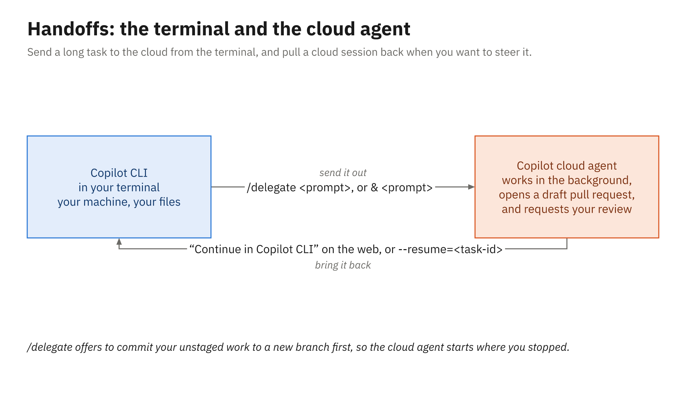

# Reusing Customizations, Second Opinions, and Handoffs

The instructions, custom agent, and MCP configuration you committed in Module 2 were never VS Code
settings. They're files in the repository, and the Copilot CLI reads them from the same paths, so a
terminal session follows the same team conventions the editor did. You can confirm that in a few
seconds, and then the terminal adds two things on top: a second opinion before you push, and a way to
move a session between your machine and the cloud agent in either direction.

---

## The Module 2 files, read unchanged

Here are the files from the demos and activities, and what the CLI does with each one:

| File | What the CLI does with it |
|---|---|
| `.github/copilot-instructions.md` | Loads it for requests in the repository |
| `.github/instructions/tests.instructions.md` | Loads it when the work involves files that match its `applyTo` glob |
| `AGENTS.md` | Loads it from the repo root, the working directory, the folders in between, and folders on the path of a file being worked on |
| `.github/agents/test-writer.agent.md` | Lists it in `/agent` and accepts it with `--agent test-writer` |
| `.mcp.json` | Starts its `mcpServers` once you've trusted the folder (chapter 4) |

The CLI also reads `CLAUDE.md` (and `.claude/CLAUDE.md`) and `GEMINI.md`, your personal
`~/.copilot/copilot-instructions.md` and `~/.copilot/instructions/**/*.instructions.md`, and any extra
folders you list in `COPILOT_CUSTOM_INSTRUCTIONS_DIRS`. It doesn't rank them either: every
instruction file that applies is combined into the request, and identical duplicates are loaded once.
That's different from Copilot Chat on GitHub.com, which does apply a
precedence order, so if two files disagree, fix the files rather than hoping one wins.

One trap to avoid: editor settings such as `chat.instructionsFilesLocations` live in VS Code, and the
CLI and the Copilot app don't read editor settings. Instructions in a non-standard folder that VS Code
finds through a setting will be invisible in the terminal. Keep them in the standard locations and
every surface finds them.

### Checking what loaded

You can see the instruction sources before you even start a session, and toggle them once you're in:

```powershell
copilot instruction list       # which instruction sources a session here would load
```

Inside a session, `/instructions` shows the loaded instruction files and lets you switch individual
ones off, and `/env` shows the whole environment: instructions, MCP servers, skills, agents, hooks,
and plugins. `--no-custom-instructions` starts a session without `AGENTS.md` and the related files,
which makes a neat before-and-after experiment, the terminal version of the Module 2 activity:

```powershell
$ask = 'Describe how you would name and structure a new test class for LateFeeCalculator. Do not create it.'
copilot -p $ask -s --allow-all-tools --deny-tool='write'
copilot -p $ask -s --allow-all-tools --deny-tool='write' --no-custom-instructions
```

### Custom agents in the terminal

`/agent` lists the agents the CLI found and switches to one (`/agent test-writer`). For a one-shot
run, pass it at launch, or just mention the agent by name in your prompt and Copilot infers it:

```powershell
copilot --agent test-writer -p "Add tests for the LIB-12 grace period in LateFeeCalculator" `
    --allow-all-tools --deny-tool='shell(git push)'
```

The CLI looks in the repository's `.github/agents`, your own `~/.copilot/agents`, your
organization's `.github` or `.github-private` repository, and your enterprise's agents. According to
the CLI docs, a user agent takes precedence over a repository agent with the same name, which then
beats organization and enterprise agents, so if `test-writer` behaves unexpectedly, check for a
personal copy with the same name. The agent's frontmatter carries over too: its `tools` list
(aliases such as `read`, `edit`, `search`, `execute`, and MCP tools like `github/*`) and its `model`.
Leaving `target` unset makes an agent available to both targets (`vscode` and `github-copilot`),
which is the simplest choice for a file you want everywhere. `handoffs` and `argument-hint` come from
the IDE, and GitHub ignores them on GitHub.com, so don't build on them outside the editor.

The CLI also has built-in agents of its own, including Explore, Task, General-purpose, and
Code-review. Agent skills (`.github/skills`) and hooks (`.github/hooks/*.json`) are shared across
surfaces in the same way, though this course doesn't build either.

---

## Second opinions before you push

Before work leaves your machine, you can ask a different agent to look at it. The CLI has three
commands for this, each aimed at a different question:

| Command | What it does |
|---|---|
| `/review` | Runs the code review agent to analyze your changes |
| `/security-review` | Analyzes staged and unstaged changes for security vulnerabilities |
| `/rubber-duck` | Gets an independent critique of your current work from the rubber duck agent |

A good rhythm for the activity is fix, run the tests, `/diff`, then `/review`, and only then commit.
A separate agent reading the diff is a cheap way to catch the test you forgot or the edge case the fix
moved rather than solved, and you still decide which of its points to act on.

This doesn't replace Copilot code review on the pull request (Module 3), which runs on GitHub, reads
the repository's review instructions from the pull request's head branch, and posts its comments
where your team can see them. Once the pull request is open, request it from the terminal:

```powershell
gh pr edit 42 --add-reviewer '@copilot'   # quote it in PowerShell
```

---

## Handing a session to the cloud agent

Sometimes the rest of a task doesn't need you watching: the docs update after the fix, a batch of
similar tests, a refactor you've already agreed on. `/delegate` sends the session to GitHub, where
the Copilot cloud agent carries on and opens a pull request, and prefixing a prompt with `&` does the
same thing.

```text
/delegate Add tests for the remaining LIB-12 fee rules and update the README's lending section
```

```text
& Add XML doc comments to the public members of LoanPolicy
```

Here's what happens, in order. First the CLI offers to commit your unstaged changes to a new branch
it creates, as a checkpoint, so the cloud agent starts from what you have rather than from the last
push. It then opens a **draft pull request**, works in the background, and requests your review when it's
done, and the terminal gives you links to both the pull request and the session. The pull request
targets your current branch unless you add `--base BRANCH` to choose a different one.



*One command sends the session out; the session's ID or the web page's "Continue in Copilot CLI" brings it back.*

Two cautions come with that convenience. If you accept the checkpoint, your local changes go to
GitHub, so run `/diff` first and make sure nothing in them should stay on your machine. And the
delegated task runs in the cloud agent's environment (Module 3), not in your terminal, so approvals
you granted locally don't travel with it, and an MCP server configured only on your machine may not
be available there. If the session runs on GitHub Actions, it also has the 59-minute cap from
Module 3.

`gh` offers the same handoff without an open session, which is handy in scripts: `gh agent-task create
"prompt"` starts a task (with `--base`, `--repo`, and `--follow` options), and `gh agent-task list`
and `gh agent-task view` follow it. The `agent-task` commands are still a public preview in `gh`.

---

## Continuing a cloud session in the terminal

Coming back takes about as little effort as going out. On GitHub, a session's menu offers **Continue in
Copilot CLI**, which gives you a command to paste into your terminal. From the terminal, `/resume`
accepts cloud history and task IDs as well as local sessions, and so does the launch flag:

```powershell
copilot --resume=TASK-ID            # pick up a cloud task by its ID
copilot --connect SESSION-ID        # connect directly to a remote session
```

Whether a session can come back depends on where it ran. GitHub describes sessions in its cloud
sandbox as resumable across clients, while a session that runs on GitHub Actions, like the one an
assigned issue starts, is available only on the website; you steer that one with `@copilot` comments on
its pull request, as in Module 3.

Resuming is useful when the cloud agent got most of the way and the last step needs your local
toolchain, a database on your machine, or simply your judgment in real time.

### Starting the whole session in the cloud

`copilot --cloud` goes one step further and runs the interactive session itself in a cloud sandbox,
an isolated Linux environment that GitHub creates with your repository cloned into it. You still type
in your terminal, but the commands, tests, and edits happen in the sandbox rather than on your machine,
which makes it useful where the local sandbox can't run (chapter 3).

```powershell
copilot --cloud          # interactive only; it can't be combined with -p or -i
```

The option applies only to the session you start with it. Because it's a cloud-sandbox session, you
can pick it up later from another client, and the sandbox keeps a snapshot of its state while the
session is stopped. Setup steps from `copilot-setup-steps.yml` don't apply there (Module 3), so the
agent may have to install your SDK before it can build. Cloud sandboxes are billed by usage (compute,
memory, and storage for stopped sessions), separately from the AI Credits the model uses, and the
**Copilot in the cloud** policy decides whether you can start one.

### Steering a local session from the web

`/remote on` works in the other direction, letting GitHub on the web, or GitHub Mobile, steer a
session that's running in your terminal, so you can check on a long local task from your phone and
answer its approval prompts there. The session keeps running on your machine, and remote control
re-enables itself when you come back with `--continue` or `--resume`. If you find older instructions
that use `--remote` or `--no-remote` at startup, those flags were retired in October 2026.

---

## A round trip on the library app

Put together, a realistic hour with the library sample looks like this. You start `copilot` in the
repository, confirm with `/instructions` that the team's files loaded, and bring in the issue with
`#NUMBER`. Plan mode lays out a diagnosis before anything changes. You approve the fix one step at a
time, decline one proposal that edits the test instead of the code, run `.\mvnw.cmd test` (or
`dotnet test`), ask `/review` for a second look, and let the agent open the pull request. Then you
`/delegate` the follow-up documentation work and review its draft pull request when it arrives. When a
task you started earlier in the cloud sandbox gets most of the way and needs your local toolchain for
the last step, "Continue in Copilot CLI" brings that session back to your terminal. Each move in that
story is a command from this module, and none of it needed a terminal-specific copy of your
customizations.

---

## Summary

- The CLI reads `.github/copilot-instructions.md`, `.github/instructions/*.instructions.md`,
  `AGENTS.md`, `.github/agents/*.agent.md`, and `.mcp.json` from the same paths VS Code does, and it
  combines instruction files rather than ranking them.
- `copilot instruction list`, `/instructions`, and `/env` show what loaded; `--no-custom-instructions`
  turns the files off for comparison.
- `/agent` or `--agent` selects a custom agent; a user agent with the same name takes precedence over
  the repository's.
- `/review`, `/security-review`, and `/rubber-duck` give a second opinion before you push; Copilot
  code review on the pull request is still the team-visible check.
- `/delegate` (or `&`) checkpoints your changes on a new branch, opens a draft pull request, and hands
  the work to the cloud agent; `--base` picks the target branch.
- "Continue in Copilot CLI", `/resume`, and `--resume` bring a cloud session back; `/remote` lets the
  web or Mobile steer a local one.
- `copilot --cloud` runs a whole interactive session in a cloud sandbox that other clients can pick
  up later.
