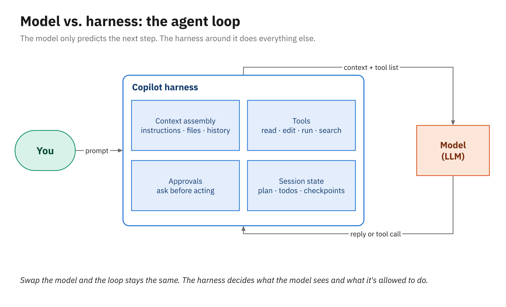
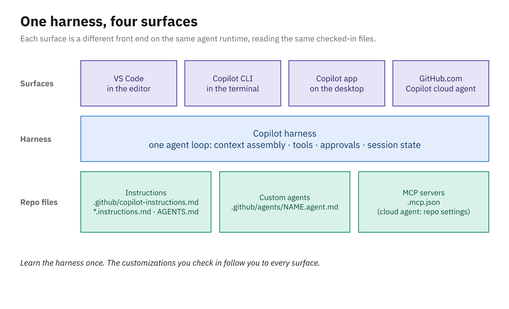
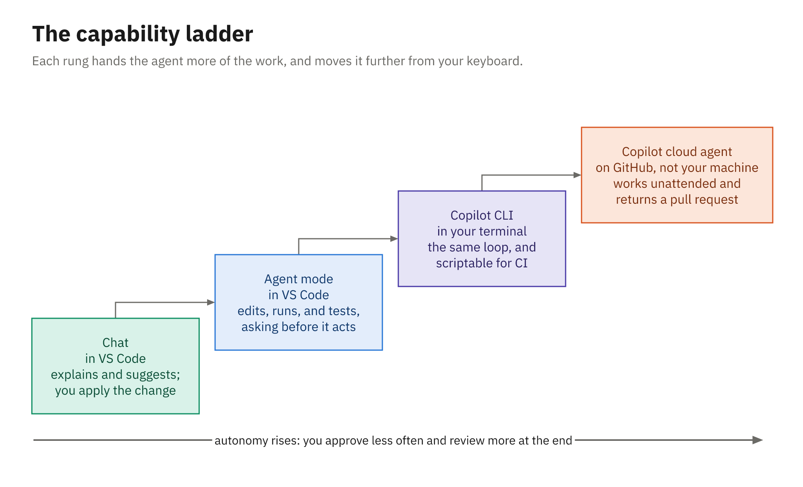
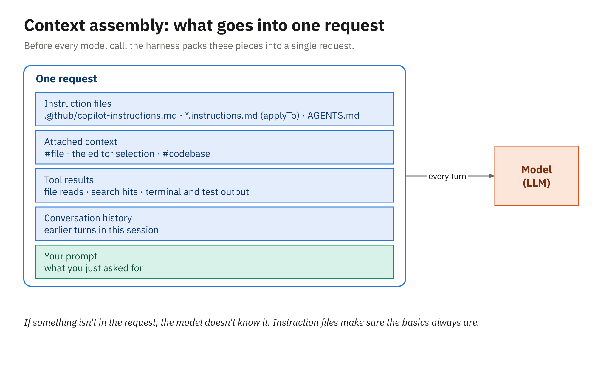

# The Copilot Harness and Chat in VS Code

## Agenda

- Model versus harness
- One harness, four surfaces
- The capability ladder: chat → agent mode → CLI → cloud agent
- Chat that knows the project
- Choosing a model
- Live demo, then your turn

# Model versus Harness

## The Model Only Predicts

- Input: instructions, code, history, and a list of tools
- Output: an answer, or a request to call a tool
- It can't open a file or run `dotnet test`
- It remembers nothing between requests
- If a file isn't in the request, it hasn't seen it

## The Harness Does the Rest

| Job | What the harness does |
|---|---|
| Context assembly | Builds each request: instructions, files, history |
| Tools | Reads, searches, edits, runs commands, calls MCP |
| Agent loop | Feeds each result back until done or a limit |
| Approvals | Decides what runs now and what asks you first |
| Session state | Keeps history, pending edits, and checkpoints |

## The Agent Loop



## One Request, Step by Step

- Harness builds the request: instructions, prompt, tool list
- Model: "search the workspace for `LateFeeCalculator`"
- Harness runs it; model asks to read the file and its tests
- Model proposes a test file; harness marks it pending
- Model asks to run `dotnet test`; harness asks you first
- Output goes back; model fixes an error or reports done

## One Harness, Four Surfaces



## Same Runtime Everywhere

- One agent runtime, the engine the Copilot CLI hosts
- Copilot SDK (GA June 2026): drive that runtime from code
- VS Code's Copilot harness runs on the SDK and the Agent Host
- Cloud sessions share the CLI's tools: Bash, `gh`, code search
- Copilot app: desktop; each local session in its own worktree
- SDKs for .NET and Java, plus Node, Python, Go, and Rust
- Shared files: instructions, `.github/agents`, `.mcp.json`

## Harnesses in VS Code

- Session Target picks the harness, before the first prompt
- Copilot: the default since 1.143 (SDK + Agent Host)
- Local: the original built-in agent, tied to the window
- Claude and Codex: Anthropic's and OpenAI's harnesses
- Cloud: a target, not a harness; runs in GitHub's cloud
- Prompt files, `/init`, and handoffs are Local-only
- This course uses the Copilot harness

# The Capability Ladder

## Four Rungs



## What Changes at Each Rung

| Rung | Who drives | Runs on | Can touch | You review |
|---|---|---|---|---|
| Chat | You | Your editor | Attached files, read-only | The answer |
| Agent mode | Agent + approvals | Your machine | Files, terminal, tests | Keep / Undo |
| Copilot CLI | Agent + approvals | Your terminal | Folder, shell, GitHub | Prompts, `/diff` |
| Cloud agent | Agent, async | GitHub's cloud | Its own branch | A draft PR |

## Picking a Rung

- A question about unfamiliar code → chat
- A small, well-scoped change you'll watch → agent mode
- Terminal work, a script, or a CI job → Copilot CLI
- A well-written issue to review later → cloud agent
- Each step up trades control for autonomy
- Sessions move: `/delegate` out, Continue in Copilot CLI back

# Chat That Knows the Project

## What Goes Into One Request



## Adding Context

| Reference | Attaches |
|---|---|
| `#<file>`, `#<folder>`, `#<symbol>` | A file, a folder, a class, or a method |
| `#selection` | The highlighted code |
| `#codebase` | A search across the whole workspace |
| `#terminalSelection`, `#fetch` | Terminal text, or a web page |

- Or use Add Context, or drag files, images, errors, issues in
- `@workspace` is deprecated: use `#codebase` instead

## Inline Chat and Slash Commands

- `Ctrl+I`: inline chat in the editor or the terminal
- `Ctrl+Alt+I`: the Chat view · `Ctrl+N`: a new chat
- `/explain`: walk through the selection or file
- `/fix`: propose a fix for a problem
- `/tests`: generate tests (name xUnit or JUnit)
- `/doc`: doc comments, in editor inline chat
- Context menu: Generate Code > Generate Tests

## Generate, Then Run

```text
/explain #LateFeeCalculator.cs Who pays what, and when?
/tests Use xUnit v3. One [Theory] per rule.
/tests Use JUnit 6 and AssertJ with @ParameterizedTest.
```

```powershell
dotnet test          # .NET
.\mvnw.cmd test      # Java on Windows (./mvnw test elsewhere)
```

- A generated test describes what the code does today
- Check expected values against the policy, not the code

# Choosing a Model

## The Model Picker

- VS Code: the Language model control in the Chat view
- CLI: `/model`, or `--model` at startup
- GitHub.com chat and the cloud agent: a model dropdown
- Vendors: OpenAI, Anthropic, Google, Microsoft, Moonshot, xAI
- GitHub sets the menu, and it changes often
- Some surfaces add a reasoning-effort setting

## Auto

- Picks a model per task: system health + task complexity
- Profiles: Efficiency, Balance, Intelligence
- 10% off model costs on paid plans
- Billed at the rate of the model Auto chose
- Copilot Fusion: can combine several models, each billed
- A sensible default for this course

## AI Credits

- Billing since June 1, 2026: tokens at each model's API rate
- Completions and Next Edit Suggestions use no credits
- Pro $10 · Pro+ $39 · Business $19/user · Enterprise $39/user
- 1 credit = 1¢; each plan includes at least its price
- No fallback to a cheaper model when credits run out
- Agent sessions make many model calls, so they cost more
- "Premium requests" and multipliers are legacy billing

## Fast or Strong?

| Task | Reach for |
|---|---|
| Explain, rename, write a doc comment | A fast model, or Auto |
| Tests for clearly stated rules | Auto |
| A multi-file change, a subtle bug, a plan | A stronger model |
| Unfamiliar business rules | A stronger model |
| The agent loops or misreads the code | Step up and retry |

- Same wrong answer from a strong model? Fix the context.

## Bring Your Own Key

- VS Code: Chat: Manage Language Models
- Azure, Anthropic, Gemini, OpenAI, or a custom endpoint
- Chat and utility tasks only; completions still use GitHub
- Copilot harness: turn on an experimental setting first
- Business and Enterprise: an admin enables the BYOK policy
- CLI: `COPILOT_PROVIDER_*` (`copilot help providers`)

## Live demo

- A copy of `samples/library-dotnet`; tour the chat controls
- Ask (read-only): `#codebase` how do loan limits and fees work?
- `/explain` on `LateFeeCalculator`: the LIB-12 rules
- `/tests` with xUnit `[Theory]`, then `dotnet test`
- Check the expected values against the policy
- One question on a small model, a large one, then Auto
- References, then a debug view: what the model was sent

## Your turn

- Activity 01: Chat with Workspace Context (25 minutes)
- The orders sample, in .NET or Java
- Use workspace context to explain `DiscountPolicy`
- Generate a unit test for one of its rules
- Run it with `dotnet test` or `.\mvnw.cmd test`

## Key Takeaways

- The model predicts; the harness does the work
- One harness: VS Code, the CLI, the Copilot app, GitHub.com
- Climb the ladder as tasks grow and get better specified
- Good answers need good context: `#file`, `#selection`, `#codebase`
- `/explain`, `/fix`, `/tests`, and `/doc` for everyday jobs
- Start on Auto; step up to a stronger model for hard problems
- Billing is AI Credits, metered by the token
