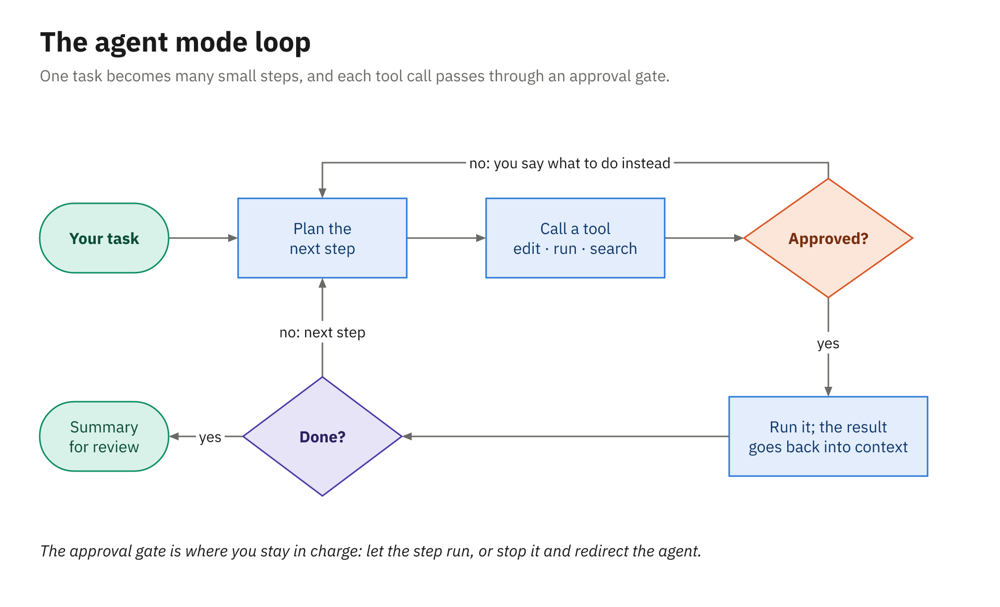
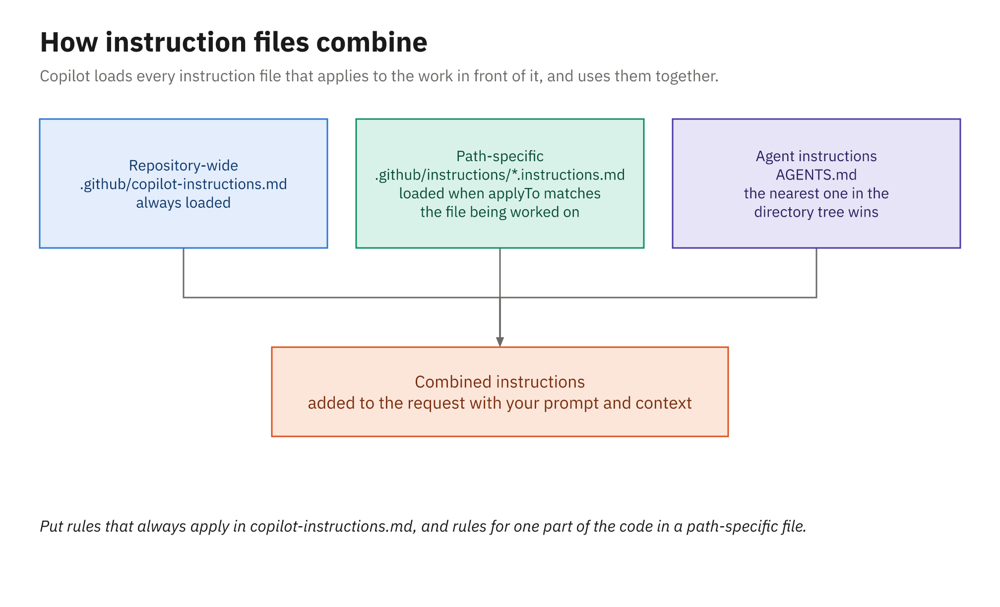
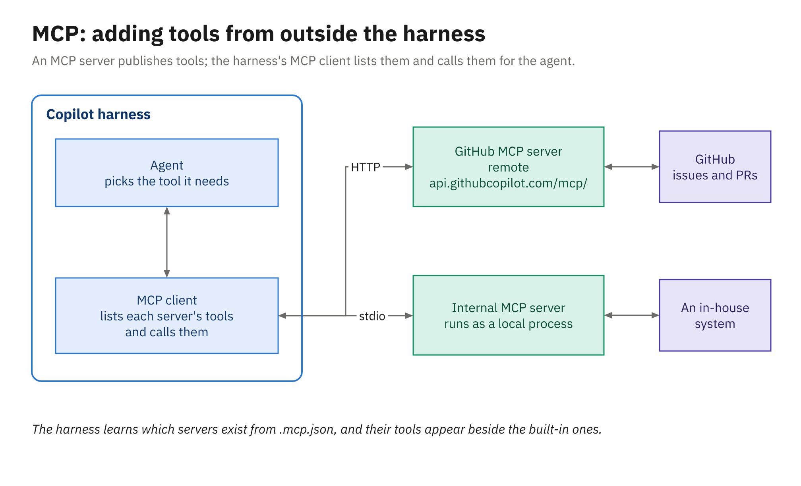

# Agent Mode, Instructions, Agents, MCP

## Agenda

- Agent mode: planning, tools, approvals, and the session log
- Repository instructions: three kinds of file
- Custom agents in `.github/agents`
- MCP servers: GitHub and your own systems
- Live demo, then your turn

# Agent Mode

## Starting an Agent Session

- Chat view (`Ctrl+Alt+I`), then set the session controls
- Session Target: Copilot, the default harness
- Agent: Agent (Ask is read-only; Plan, or `/plan`, writes a plan first)
- Language model: Auto, or your pick
- Permissions: Manual permissions to start
- Then give it a small, specific, checkable task

## A Well-Scoped Task

```text
Add a rule to LoanPolicy: a member who owes more than 10.00
in fines can't borrow. Report it as a new PolicyCodes
violation, add unit tests for both sides of the limit,
and run the tests when you're done.
```

- Names the class, the rule, the limit, and what "done" means
- Small enough to review in one sitting

## The Agent Mode Loop



## Tools the Agent Calls

| Group | Examples (Local harness names) |
|---|---|
| Read and search | `#read/readFile`, `#search/codebase`, `#search/usages` |
| Edit | `#edit/editFiles`, `#edit/createFile` |
| Run | `#execute/runInTerminal`, `#execute/testFailure` |
| Track and delegate | `#todos`, `#agent/runSubagent` |
| Web and GitHub | `#web/fetch`, `#githubRepo` |

- No run-tests tool: the agent runs `dotnet test` in the terminal

## Permission Levels

| Level | What it does |
|---|---|
| Manual permissions (default) | Follows your tool, URL, and terminal settings |
| Assisted permissions | An LLM judge assesses each tool call |
| Allow all | Runs every tool call without asking |

- Approve once, or for the session, workspace, or all future uses
- Worktree sessions always run as Allow all
- Stay on Manual permissions in this course

## Approval Settings

| Setting | Default |
|---|---|
| `chat.tools.terminal.autoApprove` | `rm`, `curl` set to `false`; read-only commands run |
| `chat.tools.edits.autoApprove` | `{}` (glob patterns) |
| `chat.tools.global.autoApprove` | `false`, and leave it that way |
| `chat.agent.maxRequests` | `25` requests |

- Chat: Manage Tool Approval · Chat: Reset Tool Confirmations
- Terminal sandbox: `chat.agent.sandbox.enabled`, off by default

## Keep, Undo, Checkpoints

- Edits are on disk, but pending until you decide
- Keep: retains the changes and clears the pending state
- Undo: reverts them without rewinding the conversation
- Restore Checkpoint: hover an earlier request
- Checkpoints don't undo terminal commands or network calls
- Commit first, then review the diff like a colleague's PR

## Reading the Session Log

- Chat Debug view: system prompt, context, response, tool results
- Open it from the overflow menu, or with `/debug`
- Check: did the instructions load? Which files did it read?
- Agent Debug Logs (Preview): tool calls, tokens, errors, flow
- Capture first: `chat.agentHost.agentDebugLog.enabled`
- Or ask: `/troubleshoot why didn't you run the tests?`

# Repository Instructions

## Three Kinds of Instruction File



## Which File Loads When

| File | Loads |
|---|---|
| `.github/copilot-instructions.md` | On every request in the repository |
| `.github/instructions/*.instructions.md` | When the work matches its `applyTo` |
| `AGENTS.md` (one or more) | For its folder tree; the nearest wins |

- VS Code and the CLI combine them all, with no precedence
- So don't let two files disagree

## Repo-Wide Instructions

```markdown
<!-- .github/copilot-instructions.md (excerpt) -->
## Loan rules
- Every rule lives in `LoanPolicy.CanBorrow` and reports a
  `PolicyViolation`. Never throw.
- Every new rule gets a new `PolicyCodes` constant (`LIB003`, …).
## Tests
- xUnit v3: test both sides of every limit in one `[Theory]`.
## Every change
- Add a line to `CHANGELOG.md`. Run `dotnet test` before you finish.
```

- Java: JUnit 6 `@ParameterizedTest`, `BigDecimal`, `.\mvnw.cmd test`

## Path-Specific Instructions

```yaml
# front matter of .github/instructions/tests.instructions.md
applyTo: "tests/**"                # Java: "src/test/**"
```

- Body: use the in-memory stores, not mocks
- Body: control "today" with the `FixedClock` helper
- Applies when the work touches a matching file
- Repo-wide and path-specific both apply when both match
- Optional `excludeAgent`: `"code-review"` or `"cloud-agent"`

## AGENTS.md

- One or more files; the nearest in the tree takes precedence
- Or a single `CLAUDE.md` or `GEMINI.md` at the repo root
- Portable: OpenCode and Kiro read `AGENTS.md` too
- Copilot Chat on GitHub.com reads repo-wide, not agent files

## Who Reads What

| Surface | Repo-wide | Path-specific | Agent files |
|---|---|---|---|
| VS Code chat and agent mode | Yes | Yes | `AGENTS.md` only |
| Copilot CLI | Yes | Yes | Yes |
| Cloud agent | Yes | Yes | Yes |
| Code review on GitHub.com | Yes | Yes | Yes, plus `REVIEW.md` |
| Chat on GitHub.com | Yes | No | No |

- Check: References (VS Code), `copilot instruction list`

# Custom Agents

## A Custom Agent File

```yaml
# .github/agents/policy-guard.agent.md (front matter, excerpt)
name: policy-guard
description: Read-only reviewer for the lending and fee policies.
tools: ["read", "search"]
```

```markdown
You review changes to the Library lending service against its
business policies. You can read and search, but not edit or run.
```

- No `edit` or `execute` tools, so it can't change anything

## Front Matter and Tool Aliases

| Field | Notes |
|---|---|
| `description` | Required |
| `name`, `model`, `target` | Optional; `target` is `vscode` or `github-copilot` |
| `tools` | `read`, `edit`, `search`, `execute`, `agent`, `web` |
| `disable-model-invocation` | Plus `user-invocable`: who may invoke it |

- MCP tools by server, such as `github/*`; `infer` is retired
- Prompt body: up to 30,000 characters

## Picking an Agent Everywhere

| Surface | How |
|---|---|
| VS Code | Session Target, then the Agent dropdown |
| Copilot CLI | `/agent policy-guard`, or `--agent=policy-guard` |
| GitHub.com | Agent dropdown: agents tab or issue assignment |

- Org-wide: `agents/` in the org's `.github` or `.github-private`
- Name clash across levels: the closest level wins

# MCP Servers

## MCP in One Picture



## The GitHub MCP Server

- Remote endpoint: `https://api.githubcopilot.com/mcp/`
- Default toolsets: context, repos, issues, pull requests, users
- Read-only: `…/mcp/readonly`; one toolset: `…/mcp/x/issues`
- Built in to the CLI; on by default for the cloud agent
- Open source (MIT); a local Docker image exists too

## The Portable MCP File

```json
{
  "mcpServers": {
    "github": {
      "type": "http",
      "url": "https://api.githubcopilot.com/mcp/"
    }
  }
}
```

- `.mcp.json` at the workspace root: VS Code and the CLI
- `.vscode/mcp.json` uses `servers`; the agent doesn't read it

## An Internal Server (Config Only)

```json
"board-policies": {
  "type": "stdio",
  "command": "dotnet",
  "args": ["run", "--project", "tools/BoardPolicies.Mcp"],
  "env": { "POLICY_API_TOKEN": "${POLICY_API_TOKEN}" },
  "tools": ["get_policy", "search_policies"]
}
```

- Secrets come from the environment, never from the file
- `tools` allowlists exactly what the agent may call

## Governance and the Cloud Agent

- Policy "MCP servers in Copilot" turns MCP on or off
- Enterprise allowlists live in `managed-settings.json`
- Enforced in the Copilot app, the CLI, and VS Code
- Cloud agent: Settings → Copilot → MCP servers
- Every cloud server needs a `type` and a `tools` allowlist
- Cloud secrets are named `COPILOT_MCP_…`
- GitHub and Playwright MCP servers are on by default

## Live demo

- Agent mode on the library app: the fines rule (`LIB003`)
- Approve or reject each step; watch `.\mvnw.cmd test` run
- Review the diff, then Keep or Undo
- Add `.github/copilot-instructions.md` and `tests.instructions.md`
- Stash the attempt, rerun the same prompt, and compare
- Pick the `policy-guard` agent to review the change
- Add `.mcp.json` and approve an MCP call that files an issue

## Your turn

- Activity 02: Agent Mode with Instructions (25 minutes)
- The orders sample, in .NET or Java
- Agent mode adds a new validation rule with unit tests
- Approve or reject each step, then review the diff
- Add the repository instructions file and run the task again
- Compare: what changed because of the instructions?
- Add a custom agent and the GitHub MCP server, then push

## Key Takeaways

- Agent mode runs the loop on your machine, behind your approvals
- Start on Manual permissions; read the diff; Keep or Undo
- The Chat Debug view shows exactly what was sent
- Instructions: repo-wide always, `applyTo` by path, `AGENTS.md` by tree
- Custom agents: a role, a prompt, and a limited set of tools
- `.mcp.json` is portable; the cloud agent's MCP lives in settings
