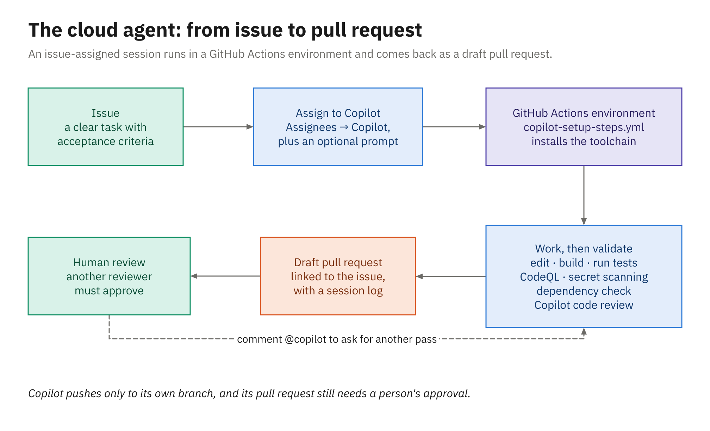

# Cloud Agent and Code Review

## Agenda

- The Copilot cloud agent and where it runs
- Preparing the environment with `copilot-setup-steps.yml`
- Inside a run: validation and the session log
- Steering: issues, custom agents, Spaces, Memory
- Copilot code review and review instructions
- PR summaries and Chat on GitHub.com
- Other agents in the Agents panel
- Live demo, then Activity 03

## What the Cloud Agent Is

- Formerly the Copilot coding agent; now **Copilot cloud agent**
- Part of **Copilot in the cloud** (2026-10-28); paid plans only
- Same harness: Bash, GitHub CLI, code search, your instructions
- Takes a task, works on its own, returns a pull request
- Needs write access; GitHub-hosted repositories only
- One branch and one pull request per task

## Issue to Pull Request



## Assigning an Issue

- Issue → **Assignees** → **Copilot**
- The assignment options set:
  - an optional prompt
  - the repository and starting branch
  - a custom agent
  - the model and reasoning level
- Copilot reads the title, body, and existing comments
- Comments added after assignment are ignored

## Other Ways to Start a Task

- The repository's **Agents** tab, or `github.com/copilot`
- `/task <description>` in Chat on GitHub.com
- **Fix with Copilot** on a failing Actions job
- `/delegate` in the Copilot CLI (Module 4)

```powershell
gh agent-task create "Add GET /loans/overdue" --repo OWNER/REPO
gh agent-task list
```

- The Agents tab lists every session and links each to its PR

## Where a Session Runs

| | Actions session | Cloud sandbox |
|---|---|---|
| Typical start | Assigning an issue | Default for new sessions |
| Repositories | One | Several in one org |
| Setup steps | `copilot-setup-steps.yml` | Ignored |
| Time limit | 59 minutes | No one-hour cap |
| Chat data kept | 28 days | Life of the account |

- **Environment** menu: Cloud (default), Actions, Environments

## copilot-setup-steps.yml (1)

- Runs before the agent starts: SDKs, packages, caches
- One job, named exactly `copilot-setup-steps`
- Honored: `steps`, `permissions`, `runs-on`, `services`
- Also `snapshot` and `timeout-minutes` (59 max); rest ignored
- Must be on the default branch
- A failing step skips the rest; the agent carries on
- Actions sessions only; cloud sandboxes ignore it
- .NET sample: `setup-dotnet@v6`, then `dotnet restore`

## copilot-setup-steps.yml (2)

```yaml
    steps:
      - uses: actions/checkout@v7
      - uses: actions/setup-java@v6
        with:
          distribution: temurin
          java-version: "21"
          cache: maven
      - name: Warm the Maven cache
        run: sh ./mvnw -B -q -DskipTests verify
```

- The wrapper fetches Maven; `verify` fetches every dependency
- `sh ./mvnw`: a copy made on Windows loses the executable bit
- The runner is Ubuntu, so the agent builds with `sh ./mvnw`

## The Firewall

- On by default: Settings → Copilot → **Internet access**
- **Recommended allowlist** is on by default
  - OS and language package registries, container registries, CAs
- **Custom allowlist** → **Add rule** for anything else
- Covers only processes the agent starts with its Bash tool
- Setup steps and MCP servers aren't covered
- Blocked requests show a warning on the pull request
- Doesn't work on Windows or self-hosted runners

## The Pull Request It Returns

- A **draft** PR linked to the issue; Copilot requests your review
- Commits authored by Copilot, with you as co-author, signed
- Pushes only to its own branch (or the PR's branch)
- CI waits for **Approve and run workflows**; you can click it
- Your own approval of the PR **doesn't count**
- Cost: AI Credits for tokens plus Actions compute

## Inside a Cloud Run

- Built-in validation on the agent's changes:
  - CodeQL and secret scanning
  - New dependencies checked against the GitHub Advisory Database
  - A Copilot code review second opinion
- No GHAS license needed; admins choose **Validation tools**
- Session log: **View session** on "Copilot started work"
- It streams live; read it for the plan, files, commands, blockers

## Writing Issues It Can Act On

- The issue is the prompt: title, body, existing comments
- Plus the optional prompt you add when you assign it
- Say what "done" means, as checkable acceptance criteria
- Point at the files, and at existing code to reuse
- Say how to test, with the exact commands
- List what's out of scope
- Too vague: "Staff want to see overdue loans. Can we add this?"

## A Good Issue for the Library App

```markdown
# Add GET /loans/overdue
## Acceptance criteria
- 200 with a JSON array; empty when nothing is overdue
- Overdue = not returned and due date before today
- Each item: ids, dueOn, daysOverdue, feeIfReturnedToday
- Most overdue first; add a CHANGELOG line
## Where to look
- LoanService; reuse LateFeeCalculator (LIB-12)
## How to test
- Move the test clock past a due date; all tests pass
## Out of scope
- No changes to the lending rules; no new packages
```

## Steering After Assignment

- Issue comments added later never reach the agent
- Comment `@copilot ...` on the pull request instead
  - Same branch, keeps context, write access only
- Works on any PR, including ones a person opened
- **Fix with Copilot** on a failing Actions job
- **Agent Merge**: **Watch and fix** failing CI or conflicts

## Custom Agents, Spaces, Memory

- `.github/agents/NAME.agent.md` appears in the assign options
- `handoffs` and `argument-hint` are IDE-only
- Spaces: curated repos, issues, PRs, notes, and files
- Used from Chat on GitHub.com, and in IDEs via GitHub MCP
- Memory (GA): repository facts and personal preferences
- Expires after 90 days without reinforcement (orgs: 7–180)
- Preferences: on for Pro, Pro+, Max; Business needs the policy

# Copilot Code Review

## Requesting a Copilot Review

- PR → **Reviewers** → **Request** next to Copilot
- Usually finishes in under 30 seconds

```powershell
gh pr edit 17 --add-reviewer '@copilot'   # quote it in PowerShell
```

- Automatic: on creation, **Review new pushes**, drafts
- Pushes don't re-trigger it by default, so re-request it
- Effort: Balanced by default; Lite, or Max (preview)

## What a Review Gives You

- A **Comment** review by default; it doesn't count as approval
- Approvals: GA (2026-10-28), off until an admin turns them on
- Suggested changes commit in a couple of clicks
- **Fix with Copilot** hands a comment to the cloud agent
- **Add to batch**, then **Fix and commit**
- Or reply with `@copilot`, or decline with a reason
- Costs AI Credits plus Actions minutes

## Review Instructions

- Reads `copilot-instructions.md` and `*.instructions.md`
- Plus `AGENTS.md`, `CLAUDE.md`, `GEMINI.md`, and `REVIEW.md`
- Read from the PR's **head** branch, not the base
- `excludeAgent: "code-review"` or `"cloud-agent"` targets a file
- Keep each file short: about 1,000 lines at most
- VS Code reviews may read only `copilot-instructions.md`

## REVIEW.md for the Library App

```markdown
# Review guidance: library lending service
## Money
- Fees are decimal (C#) or BigDecimal (Java); flag double, float
- Fee rules live only in LateFeeCalculator (LIB-12)
## Policy codes
- Never change LIB001 or LIB002; new rules get the next code
## Changelog
- Behavior or endpoint changes need a CHANGELOG.md line
```

- Concrete, checkable rules beat "write clean code"

# More on GitHub.com

## PR Summaries and Chat

- PR description toolbar → **Copilot actions** → **Summary**
- Start blank; regenerate after big pushes; not on Free
- Chat at `github.com/copilot`, available from any page
- Context: the repository, issue, or PR you're looking at
- A question can turn into agent work in the same session
- `/task <description>` starts a cloud-agent session
- Reads repo-wide, personal, and organization instructions

## Other Agents in the Agents Panel

- Anthropic **Claude** and OpenAI **Codex** coding agents
- Public preview; Pro, Pro+, Max, Business, Enterprise
- Allowed by policy, per account, organization, or enterprise
- Start them on the Agents tab, from an issue, or `@AGENT_NAME`
- Same security validation; Actions minutes and AI Credits
- Run one issue through two agents and compare the PRs

## Live demo

- Library app: the "list overdue loans" issue, assigned before class
- The **Agents** tab: find the session and open it
- The session log: plan, files read, test runs, checks
- A second run whose dependency check fires; **Validation tools**
- The draft PR: commits, co-author, linked issue
- **Approve and run workflows**, then watch CI
- Request a review: **Reviewers** → **Copilot**
- Make it automatic: a ruleset, or your personal settings
- **Copilot actions** → **Summary** on the PR description
- Chat on GitHub.com: ask how the late-fee rules work

## Your turn

- **Activity 03: Issue to Pull Request, Reviewed by Copilot** (orders app)
- Your personal repo can't run the cloud agent, so agent mode does the work
- Before the break:
  - Create the issue from the provided markdown
  - Hand it to agent mode on a new branch
- After the break:
  - Finish, push the branch, and open the pull request
  - Request a **Copilot code review** and answer its comments
  - Compare with the cloud agent's pull request from the demo

## Key Takeaways

- Assign an issue to Copilot and get back a draft pull request
- Issue-assigned sessions run on Actions, with a 59-minute cap
- `copilot-setup-steps.yml` gets the build ready first
- Validation and the session log keep unattended work honest
- The issue is the prompt: criteria, pointers, tests, scope
- Steer with `@copilot` on the PR, not on the issue
- Code review comments by default; `REVIEW.md` sets the bar
- You approve the workflow run; someone else approves the PR
