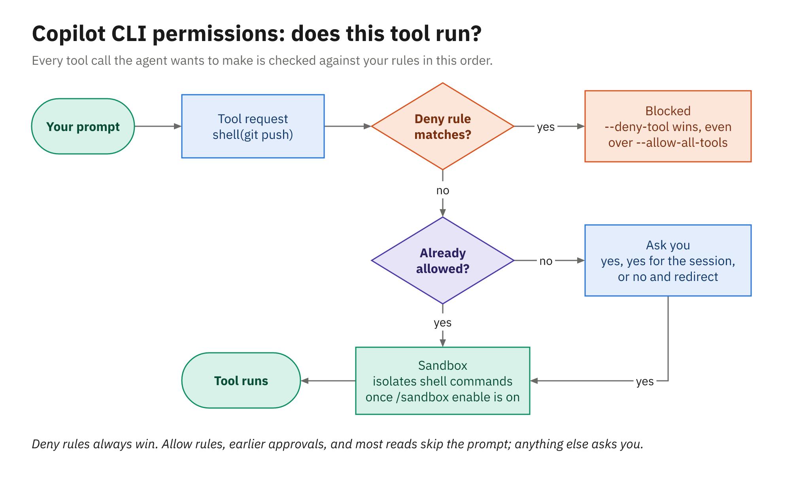
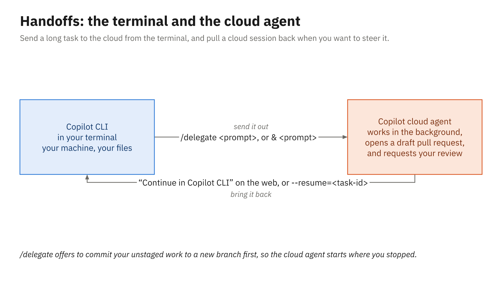

# The GitHub Copilot CLI in the Terminal

## Agenda

- What the CLI is, and how it differs from `gh`
- Installing, signing in, and trusting a folder
- Interactive sessions and programmatic runs
- Permissions, allow and deny rules, the local sandbox
- GitHub and MCP, built in
- Module 2's files, second opinions, and handoffs
- Live demo, then Activity 04

## The Same Harness, in a Terminal

- One binary, `copilot`, generally available since February 2026
- Same runtime the Copilot SDK exposes and VS Code's harness uses
- Same loop: read, run, edit, test, and ask before risky steps
- Same repo files: instructions, custom agents, `.mcp.json`
- Sessions move between the CLI, VS Code, the app, and GitHub.com
- Runs as you, on your machine, with your toolchain

## `copilot` Versus `gh`

| Command | What it is | Use it for |
|---|---|---|
| `copilot` | The Copilot CLI | Agent work: read, edit, build, test |
| `gh` | The GitHub CLI | Exact GitHub operations |
| `gh agent-task` | A `gh` command | Start or follow cloud tasks |
| `gh pr edit --add-reviewer '@copilot'` | A `gh` command | Request Copilot code review |
| `gh copilot` | Retired extension | Nothing; stopped 2025-10-25 |

## Install, Sign In, Trust

```powershell
winget install Microsoft.PowerShell   # Windows needs PowerShell 6+
winget install GitHub.Copilot
copilot --version
copilot login                         # approve in your browser
```

- macOS: `brew install --cask copilot-cli`; npm needs Node 22+
- Script: `curl -fsSL https://gh.io/copilot-install | bash`
- Tokens: `COPILOT_GITHUB_TOKEN` > `GH_TOKEN` > `GITHUB_TOKEN`
- Trust loads the repo's MCP servers and hooks: launch at the root

## A Session in the Terminal

| Type | Example | Effect |
|---|---|---|
| `@file` | `@src/.../LateFeeCalculator.java` | Adds a file to context |
| `#number` | `#42` | Pulls in an issue or PR |
| `!command` | `!.\mvnw.cmd test` | Runs in your shell, not the agent |
| `&prompt` | `& Add doc comments to LoanPolicy` | Delegates to the cloud agent |

- Shift+Tab cycles standard → plan → autopilot
- `--continue` or `--resume` brings a saved session back

## Slash Commands You'll Use

| Command | What it does |
|---|---|
| `/model` | Pick a model or `auto`; shows per-token cost |
| `/agent` | Choose a custom or built-in agent |
| `/instructions`, `/env` | See which files, servers, and agents loaded |
| `/plan` | Write an implementation plan before coding |
| `/diff`, `/review` | Inspect and review your changes |
| `/rewind` | Revert the last turn's file changes |
| `/usage`, `/context` | AI credits used; context window in use |

## Running a Prompt From a Script

```powershell
$notes = copilot -p "Draft release notes for this branch versus main" `
    -s --allow-all-tools `
    --deny-tool='write' --deny-tool='shell(git push)'
```

- `-p` runs one prompt and exits; `-s` prints only the answer
- `--output-format json` emits JSONL for other tools
- Prompt mode needs `--allow-all-tools`; deny rules still win
- Also: `--model`, `--agent`, `--no-ask-user`, `--max-ai-credits`

## In CI: An Illustration

```yaml
- name: Explain the failing tests
  if: failure()
  env:
    COPILOT_GITHUB_TOKEN: ${{ secrets.COPILOT_CLI_TOKEN }}
  run: |
    npm install -g @github/copilot
    copilot -p "Explain each failing test in target/surefire-reports" \
      -s --no-ask-user --allow-all-tools --disable-builtin-mcps \
      --deny-tool='write' --deny-tool='shell(git:*)'
```

- Token: fine-grained PAT with Copilot Requests, as a secret
- Job `permissions: contents: read`; it explains, it never pushes

## The Approval Prompt

```text
1. Yes
2. Yes, and approve TOOL for the rest of the running session
3. No, and tell Copilot what to do differently (Esc)
```

- Option 3 declines and redirects the agent in one step
- `/permissions`: manual (default), assisted, or allow-all
- Assisted uses an LLM judge, which isn't a security boundary
- `/yolo` equals `/allow-all`; `/reset-allowed-tools` takes it back

## How a Tool Request Is Decided



## Allow and Deny Rules

```powershell
copilot --allow-tool='shell(git:*)' --deny-tool='shell(git push)'
copilot --allow-tool='shell(dotnet:*)' --deny-tool='write(.env)'
copilot --allow-tool='inventory' --deny-tool='inventory(delete_item)'
```

- Kinds: `shell(...)`, `write(...)`, an MCP server name, `url(...)`
- Deny always wins, even over `--allow-all-tools`
- Paths: working directory by default; widen with `--add-dir`
- URLs: `--allow-url` and `--deny-url`, protocol-aware

## Preview Before It Runs

- Plan mode (Shift+Tab or `/plan`): read the plan before any edit
- Approve one call at a time while the bug is still unfamiliar
- Decline with option 3 and say what to do instead
- `/diff` before you commit; `/rewind` reverts the last turn's edits
- A pushed branch isn't undone by `/rewind`: deny `git push` early

## The Local Sandbox

- Off by default: `/sandbox enable`, or `--sandbox` for one session
- Shell commands run in an OS sandbox (MXC); file edits best-effort
- Windows 11 25H2 or 26H1 with recent updates; not Windows Server
- Starting policy: cwd, PATH, temp, and user profile; rest blocked
- `git` and `gh` authenticate through a credential-masking proxy
- `allowDevToolAccess` (on) grants NuGet and Maven caches per command
- Launch where `pom.xml` lives, or `~/.m2` isn't granted
- Org policy can require it and forbid per-command bypass

## GitHub and MCP, Built In

- Built-in `github-mcp-server`: a read-only subset by default
- `#42` brings an issue or PR into the conversation
- `/pr create` opens the current branch's pull request
- Write tools: `--add-github-mcp-toolset pull_requests` (or `all`)
- Your servers: `copilot mcp add`, or a repo `.mcp.json`
- Not read: `.vscode/mcp.json`; project servers need a trusted folder

## Same Files as Module 2

- `.github/copilot-instructions.md`: requests in the repo
- `.github/instructions/tests.instructions.md`: matching files
- `AGENTS.md`: root, working directory, and folders in between
- `.github/agents/test-writer.agent.md`: `/agent` or `--agent`
- `.mcp.json`: the same `mcpServers` file VS Code reads
- Check with `copilot instruction list`, `/instructions`, `/env`

## Second Opinions and Handoffs

- `/review`: the built-in code review agent on your changes
- `/security-review` and `/rubber-duck` for other angles
- `/delegate` or `&`: send the session to the cloud agent
- It checkpoints your changes on a new branch, opens a draft PR
- `--base BRANCH` picks the pull request's target branch
- Back again: Continue in Copilot CLI, `/resume`, `--resume`
- `copilot --cloud`: the whole session in a cloud sandbox
- `/remote`: steer a running local session from web or Mobile

## Terminal and Cloud, Both Ways



## Live demo

- Library app (Java): `copilot --sandbox` in the repo
- `/instructions` and `/sandbox`: Module 2 files loaded, sandbox on
- `#NUMBER`: an issue that describes a failing test
- Plan mode to diagnose it before any edit
- Fix under step-by-step approval, declining one tool call
- An approved command the sandbox still blocks
- Run `.\mvnw.cmd test`, then open a PR from the terminal
- `/review`, `/delegate` out, Continue in Copilot CLI back

## Your turn

- Activity 04: Fix a Reported Bug from the Terminal (25 minutes)
- Start `copilot` in your repo; read the issue with `#NUMBER`
- Diagnose the failing test in plan mode, then fix it under approval
- Run the suite: `dotnet test` or `.\mvnw.cmd test`
- Open a pull request without leaving the terminal
- Hand a follow-up to the cloud agent with `/delegate`
- Finished early? `/review`, `/security-review`, `copilot --cloud`

## Key Takeaways

- The CLI is the same Copilot harness, running in a terminal
- `copilot` is the agent; `gh` still starts tasks and requests reviews
- `-p` scripts it: `--allow-all-tools` plus deny rules that always win
- Approvals decide what runs; the sandbox limits what it can touch
- Module 2's instructions, agents, and `.mcp.json` work unchanged
- `/review` for a second opinion; `/delegate` and `/resume` to hand off
